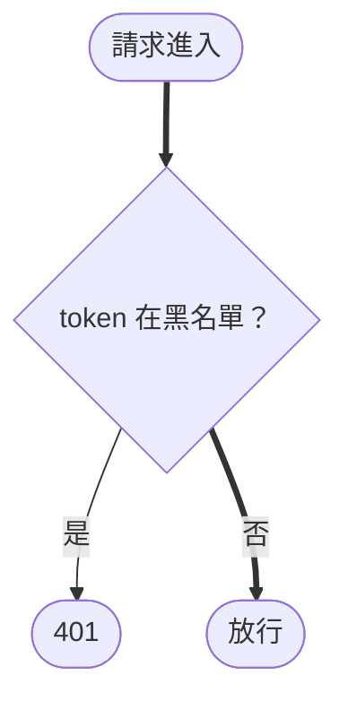

# Skill: Draw Mermaid

畫任何 mermaid 圖之前先載入本 skill，依「選圖種 → 畫 → 以圖取代文字 → 驗證」的順序進行。
若專案另有圖表規範的 spec（例：`openspec/specs/<圖表規範>/spec.md`），以 spec 為準，本檔是執行時的操作手冊；兩者衝突時回頭修本檔。

---

## 1. 先選圖種

依**描述對象**挑圖，不要預設只用流程圖。全部候選：

| 描述對象 | 圖種 |
|------|------|
| 實體與關聯（資料表） | `erDiagram` |
| 繼承、介面 | `classDiagram` |
| 決策分支、推導、連帶效應、套件相依 | `flowchart` |
| 跨元件往返、呼叫順序 | `sequenceDiagram` |
| 物件生命週期、狀態轉換 | `stateDiagram-v2` |
| 分類、概念總覽 | `mindmap` |
| 系統上下文、容器、部署拓撲 | `C4Context` / `C4Container` / `C4Component` / `C4Deployment`、`architecture-beta`、`block-beta` |
| 演進、遷移里程碑 | `timeline`；有工期排程才用 `gantt` |
| 分支與發版流程 | `gitGraph` |
| 佔比、趨勢、二維評估 | `pie`、`xychart-beta`、`quadrantChart` |
| 流量分流與損耗 | `sankey-beta` |
| 封包／二進位格式 | `packet-beta` |
| 使用者操作旅程 | `journey` |
| 需求與元件的滿足／驗證關係 | `requirementDiagram` |

- **不為湊圖種而畫**：某圖種無法比文字更清楚就不用。
- **量化圖必須有真實數據**（`pie` / `xychart` / `quadrant` / `sankey` / `journey` 的分數），不可估計或捏造。
- `-beta` 與 C4 圖種在 GitHub／Linear 的支援程度不一，首次採用前先確認兩邊都能渲染。
- 狀態圖只畫**真的會改變狀態**的轉換；只更新欄位、不改狀態的動作（例：refresh 時 `touch()`）寫在圖下，不畫成自我迴圈。

找新圖的線索——掃過模組程式碼時，以下訊號通常代表少一張圖：

| 程式碼訊號 | 候選圖 |
|------|------|
| `*_status` 欄位、`TextChoices` 狀態列舉、beat 依日期切換狀態 | 狀態圖 |
| `on_activation` / `on_deactivation` 逐層 `save()`、signal | 連帶效應流程圖 |
| 多個 `if … raise` 依身分／既有資料分流（如撞名規則） | 決策流程圖 |
| 多種身分各走不同憑證或入口 | 流程圖 LR（身分 → 入口 → 憑證 → 授權依據） |
| 集合運算（聯集、差集、`set()` 覆蓋同步） | 推導流程圖 |
| `package.json` / `pyproject.toml` 的內部相依 | 相依流程圖 TD（只畫遞移化簡後的邊，圖下註明） |

---

## 2. 畫法準則

| 項目 | 規範 |
|------|------|
| 方向 | 管線、時間軸、單向操作流程用 `LR`；層級結構、決策樹、相依層級用 `TD`。不用隱形節點或強制連線長度對抗自動排版 |
| 節點文字 | 一個短語（中文約 12 字內），技術識別符可原樣保留；條件細節、例外、程式碼位置移到圖下或序列圖 `Note`，**不用括號或 `<br/>` 塞進節點**。序列圖 participant 只留短名稱，端點路徑與 view 類別列在圖下對照表 |
| 子圖 | 流程圖超過 10 個節點即以 `subgraph` 收斂同一邊界／處理層／階段，子圖標題為短語；分層後仍太擠就拆成同一節內的多張圖，以同名交接節點銜接。連線可直接指向子圖 ID（一對多時省掉重複連線） |
| 形狀 | 一般步驟 `(…)`、判斷 `{…}`、儲存體 `[(…)]`、起點與終點結果 `([…])`；同一份檔案內同語意同形狀。只用 GitHub／Linear 已支援的語法，不用 `@{ shape: … }` |
| 線條 | 實線＝同步呼叫／主流程、虛線 `-.->`＝回傳或非同步、粗線 `==>`＝起點到成功終點的 Happy Path。失敗分支不得用粗線；粗線要**連續**，不可在半途斷成死巷 |
| 配色 | **不寫死顏色**：不用 `style` / `classDef` / `linkStyle` / `%%{init}%%` 指定色值，交給渲染端主題（亮暗皆可讀） |
| 節點 ID | 語意化英文識別名（`CheckBlacklist`、`Reject401`），不用 `A` / `B` / `J1` / `P0`；共用終點造成長距離交叉時，各子圖各自宣告（`JwtReject401`、`ApiKeyReject401`），少交叉優先於節點唯一 |
| 宣告／連線分離 | 先以 `%%` 標示的宣告區定義所有節點（含形狀與文字），再於連線區只用 ID；子圖內同樣先宣告後連線。ER 圖先列實體再列關聯，狀態圖以 `state "…" as Id` 先宣告 |
| 自我迴圈 | 避免。遞迴（子部門、子選單）改用明確的「子 X」節點，圖下註明會再往下遞迴 |
| 語言 | 節點與說明用台灣繁體中文；model 名、欄位名、URL path、HTTP method 等識別符原樣保留、不翻譯 |

範例：



ER 圖：只列主鍵、FK 與決定業務規則的關鍵欄位；**刪除行為與可空性寫進 FK 欄位的註記**（`bigint organization FK "可空，CASCADE"`），M2M 沒有欄位，以關聯標籤表示；共用基底欄位（軟刪除、審計 FK）不逐表重複。

---

## 3. 以圖為主，文字越少越好

`diagrams.md` 的資訊盡量畫進圖，圖下只留圖畫不出的補充。寫完後逐條檢查圖下條列：

| 條列內容 | 處置 |
|------|------|
| 分支條件、判斷順序 | 畫成判斷節點 |
| 連帶效應、遞迴 | 畫成連帶流程圖 |
| 狀態轉換、觸發時機 | 寫進狀態圖的轉換標籤或 `note` |
| FK 刪除行為、可空性 | 寫進 ER 欄位註記 |
| 重述圖中已有的內容 | 刪除 |
| 數值門檻、時間、例外、不可達說明、與規格的落差 | 保留在圖下 |

每張圖下方保留一行 **依據**（對應程式碼檔案路徑），不受「文字越少越好」限制。

---

## 4. 內容與放置

- **以程式碼為準**，不照抄規格文字；畫之前追實際呼叫鏈。圖與既有規格衝突時以程式碼為準，記入檔案末的**落差表**（`# / 既有規格 / 程式碼實況 / 本檔處理`）並在報告點出。
- **放置**：以模組為單位放在專案內的 `openspec/specs/<module>/diagrams.md`（monorepo 則放在各子專案的 `openspec/specs/<module>/`）；與同模組既有規格並存，**不修改**其他規格檔。不放在不受版本控制的資料夾。
- **前後端分工**（前後端分 repo 時）：跨前後端流程（登入、MFA、refresh、工作階段撤銷、授權判斷、資料關聯）只在**後端**畫；前端以後端 repo 預設分支的檔案網址（含章節錨點）連結，只補頁面導向、權杖狀態、路由守衛、UI 權限閘、請求管線。
- **錨點穩定**：後端改 `diagrams.md` 檔名或被前端引用的章節標題時，同一次變更要更新前端連結；新增圖優先加子節（`### 4-1 …`），不改既有被引用的標題。
- **檔案結構**：開頭一段引言（程式碼基準日期、與規格衝突時的優先序、前後端分工）＋「面向／圖／圖種」索引表，接著各節的圖、圖下補充、依據，末尾落差表。

---

## 5. 圖亂不等於設計差

整理過的圖仍然很亂，是**值得追查的訊號，不是結論**。先判斷亂的來源：

| 來源 | 判讀 | 處置 |
|------|------|------|
| 畫法問題 | 混了多個抽象層級、圖種或方向選錯 | 改圖（拆圖、換圖種、加子圖） |
| 本質複雜度 | 業務或安全規則本身就有那麼多分支（例：多層授權判斷） | 接受，靠拆圖與子圖提高可讀性 |
| 意外複雜度 | 設計造成的複雜 | **才需要優化設計** |

重畫後出現以下訊號才算有把握判定設計需要優化：子圖之間連線多（跨邊界耦合）、分組命名不出來、少數節點連出連入特別多、有往回走的線或循環依賴、同一判斷在多條路徑各寫一次、有不可達或矛盾的分支。發現時記入該圖表檔的落差表，**不在改圖的 change 裡順手改程式碼**。

---

## 6. 驗證

1. **渲染**：以 docker `minlag/mermaid-cli:11.4.2` 分別用 `default` 與 `dark` 主題渲染每個區塊（npx 首次下載會逾時，不要用）：

   ```bash
   .claude/skills/draw-mermaid/scripts/render.sh <diagrams.md 絕對路徑> <輸出目錄> [PNG 的區塊編號…]
   ```

   一張圖約 15 秒、整份檔案可能超過 10 分鐘，**以背景執行**，等完成通知再看結果；輸出目錄放 scratchpad。
2. **目視**：新增或大改的圖要轉 PNG（腳本第三個參數起帶區塊編號，如 `b03 b16`）並用 Read 看排版——自我迴圈、粗線斷頭、長距離交叉只有看圖才抓得到。
3. **靜態檢查**：腳本最後會 grep 色碼與代碼式 ID；另檢查連線區沒有內聯定義（`Foo["…"] --> Bar`）。
4. 報告列出：新增／改動了哪些圖、圖下文字的增減、沒採用的圖種與理由、落差表新增項。
