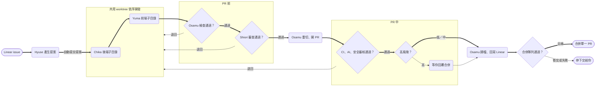

# 多 Agent 開發工作流（fullstack）

> 隨 littleduck-skills 的 `install.sh agent-team-fullstack` 安裝：**一個 repo 同時有前後端**（例：`backend/` 與 `frontend/`、`crates/` 與 `web/`），從 repo 根目錄啟動 Claude Code。
> 只有一端、只用一個開發 Agent 的專案改用 `agent-team-single-side`。框架名稱（Django/DRF 等）僅為範例。

## 目標

把開發流程的四個階段各交給一個專職 Agent，加上審查員，由主對話（你只要執行 `/ship-issue`）統一分派，**從提案一路自動做到合併**：

1. 每個階段是一個 subagent（角色、權限、模型），流程步驟收在該角色的 skill。
2. OpenSpec 變更目錄是角色之間唯一的交接介面，規定誰讀什麼、寫什麼。
3. 總指揮指令 `/ship-issue` 串起全流程，**不設固定的人工確認**，只在停下條件（高風險、退回超過上限、衝突等）成立時問你。
4. 層層把關：PR 前兩項檢查（Osamu 實際跑檢查與執行驗證、Shiori 對照規格審查），PR 中四項檢查（CI、內建 `/code-review`、內建 `/security-review`、按風險審批）。
5. 合併時由 Osamu 模擬合併隊列：rebase 到最新主幹、重跑檢查與 CI，全綠才合併。

| 階段 | Agent | 主要 skill / 指令 | 產出 |
| --- | --- | --- | --- |
| 提案 | architect（Hyuse） | /issue-architect | proposal、UML、OpenAPI 草稿、標 `[BE]`／`[FE]` 的 tasks |
| 後端實作 | 後端 Agent（Chika） | /backend-processor | 後端子目錄的 API、單元測試、migration；`openapi.yaml` 定稿 |
| 前端實作 | 前端 Agent（Yuma） | /frontend-processor | 前端子目錄的畫面與 API 串接 |
| 檢查、收尾、歸檔、合併 | integrator（Osamu） | /issue-integrator | 檢查與執行驗證結果、重切 commit、PR、歸檔、Linear 回寫、合併 |
| PR 前審查、PR 中評定 | reviewer（Shiori） | /custom-review | review.md 的審查發現與處理結果 |
| PR 中檢查 | 主對話 | 內建 /code-review、/security-review、gh pr checks | review.md、PR 留言、風險等級 |



Chika 與 Yuma 共用同一份 worktree，**先後端、後前端**依序開發（共用 git index，平行會互相污染 commit）。沒有 `[BE]` 任務時直接派 Yuma，沒有 `[FE]` 任務時 Chika 做完就交給 Osamu。檢查、審查、PR 中檢查任一處退回都會回到發現所屬那一端的開發 Agent，共用「同一目標最多兩次」的退回上限，第三次停下交給你。

## 結構宣告：「## agent-team 設定」

角色 skill、`/ship-issue`、寫入範圍 hook 都不寫死目錄，一律讀 repo 根目錄 `CLAUDE.md` 的這一段（欄位名不要改）：

```markdown
## agent-team 設定

- **結構**：fullstack
- **主幹**：main
- **worktree 根目錄**：wt/
- **後端子目錄**：backend/
- **前端子目錄**：frontend/
```

缺段落或缺欄位時，`/ship-issue` 在建 worktree 前就停下，寫入範圍 hook 對開發 Agent 一律拒絕（fail closed）。

同一份角色 skill 也支援 `single-side`。兩種結構的差異只在這幾處：

| 步驟 | fullstack（本 kit） | single-side |
|------|-----------|-------------|
| architect 建 tasks | `[BE]` 在前、`[FE]` 在後，同一份 `tasks.md` | 全部標宣告端的 tag |
| design.md 時序圖 | 必畫前後端互動 | 沒有前後端互動時可省略並寫理由 |
| 後端交棒 | 有 `[FE]` → 階段 `frontend`；沒有 → `integrating` | 直接 `integrating` |
| integrator 檢查 | 兩個子目錄各跑各的指令 | 程式碼目錄跑一次 |
| `openapi.yaml` | 後端就地定稿，前端讀同一份 | 有 API 就照寫，沒有就 `paths: {}` |
| 寫入範圍 hook | 開發 Agent 依子目錄限制 | 開發 Agent 不限制 |

## 團隊編制

| Agent | 預設名稱 | 職責 | 工具權限 | 模型 | 寫入範圍（hook 角色） |
| --- | --- | --- | --- | --- | --- |
| architect | Hyuse | 讀 Linear、系統分析、寫 UML 與 OpenAPI 草稿、寫提案 | Read、Grep、Glob、Write、Linear MCP | opus | `architect`：只寫 `openspec/` |
| 後端 | Chika | 依 `[BE]` 任務開發 API、單元測試、migration | Read、Edit、Write、Bash | sonnet | `backend`：後端子目錄＋變更目錄 |
| 前端 | Yuma | 依 `[FE]` 任務切版、依 OpenAPI 串接 API | Read、Edit、Write、Bash | sonnet | `frontend`：前端子目錄＋變更目錄 |
| integrator | Osamu | 實際檢查與執行驗證、審查後重切 commit、開 PR、歸檔、回寫 Linear、模擬合併隊列並合併 | Read、Grep、Bash、Linear MCP、gh（需 merge 權限） | sonnet | `integrator`：只寫 `handoff.md`、`.linear.md`、歸檔同步的規格 |
| reviewer | Shiori | PR 前對照 proposal、specs、openapi.yaml 審查 diff；PR 中評定 /code-review、/security-review 發現 | Read、Grep、Glob（唯讀） | opus | 不需要 hook |

分工原則：

- **Agent 是「誰」，skill 是「怎麼做」。** 流程步驟寫在 skill，定義檔只寫身分、邊界與交接規則。改流程只改 skill。
- **Agent 名稱可以改。** 改定義檔檔名、frontmatter 的 `name`、`CLAUDE.md` 的 Agent 表與 `ship-issue.md` 裡的名稱即可。角色 skill 不寫 Agent 名稱，hook 參數是角色，所以重跑 installer 後不必再改 `.claude/skills/`。**改名後重跑 installer 會再建立範本名稱的 Agent 定義**（同名檔不存在就建立），重跑後要刪掉多出來的範本名稱定義檔，否則會有兩套 Agent。
- **權限要真的限制。** architect 不改程式碼；後端與前端 Agent 只能寫自己的子目錄；integrator 不修 bug，發現問題就退回；reviewer 只有唯讀工具。hook 管不到 Bash 寫檔，靠定義檔明文禁止。
- **architect 用較強模型。** 規格錯了後面全錯，這一步最值得花 token；開發角色用 sonnet 控制成本。
- **Osamu 管「有沒有過」，Shiori 管「該測的有沒有測」。** 開發 Agent 同時寫程式和測試，理解有偏差時兩者會一起錯、測試照樣通過，這是 Shiori 要補的缺口。
- **審查規則依性質分三處放**（見 `CLAUDE.md`「審查規則三分法」）。

## 交接契約

Subagent 之間不共享對話，所有交接都落在**同一個** OpenSpec 變更目錄；每個 Agent 開工先讀、結束寫回，缺檔就停下回報。

change-id 以 Linear issue 編號開頭並**全小寫**（OpenSpec CLI 不接受大寫），例：`eng-123-order-export`。分支名保留大寫的 issue 編號（`feature/ENG-123-order-export`），讓 Linear automation 認得。

```
wt/eng-123-order-export/                 # 本次的 worktree（repo 內，.gitignore 排除）
├── backend/ …                           # 後端 Agent 只寫這裡
├── frontend/ …                          # 前端 Agent 只寫這裡
└── openspec/changes/eng-123-order-export/
    ├── proposal.md     # 需求背景、範圍、驗收條件（來自 Linear）
    ├── design.md       # UML、執行驗證觀察點、變異測試目標
    ├── openapi.yaml    # API 契約：architect 起草、後端定稿、前端依此串接
    ├── tasks.md        # [BE] 在前、[FE] 在後，完成就勾選
    ├── specs/          # OpenSpec 的需求差異
    ├── handoff.md      # 狀態區塊與各 Agent 的交接紀錄
    ├── review.md       # 審查發現與處理結果（以「端」欄區分前後端）
    └── review-diff.patch  # 主對話備妥的 diff，供 Shiori 讀取（.gitignore，不進 commit）
```

| 檔案 | 寫入者 | 讀取者 | 規則 |
| --- | --- | --- | --- |
| proposal.md | architect | 全部 | 開發中不改；需求變動要退回 architect |
| design.md | architect | 開發 Agent、integrator | 至少一張資料流圖、一張前後端互動時序圖 |
| openapi.yaml | architect 起草、後端定稿 | 前端、integrator、reviewer | 只有一份；後端改欄位必須就地更新並在 handoff.md 註明 |
| tasks.md | architect 建立、開發 Agent 勾選 | integrator | 每項標 `[BE]` 或 `[FE]`，勾選時附一行說明 |
| handoff.md | 每個 Agent 完成時追加 | 下一個 Agent | 「## 狀態」就地改值；下方紀錄只追加 |
| review.md | 主對話（代 Shiori 與 /code-review 寫入） | 開發 Agent、Osamu、你 | 每條發現標端、嚴重度、信心度、檔案與行號、對應需求；註明「退回」或「PR 備註」 |
| review-diff.patch | 主對話 | Shiori | Shiori 看不到 git diff，所以由主對話先產生 |

## 導入步驟

每個階段都用一個真實的小 issue 跑一次再往下走。

### 1. 安裝與設定

- [ ] 在 repo 根目錄安裝：`curl -fsSL https://raw.githubusercontent.com/StevenShih-0402/littleduck-skills/main/install.sh | sh -s -- agent-team-fullstack`（本地 clone：`<clone>/install.sh agent-team-fullstack <repo>`）。角色 skill（含 `backend-processor`、`frontend-processor`）都裝在 repo 根目錄的 `.claude/skills/`。
- [ ] **不要在前後端子目錄下建立 `.claude/`**：子目錄再放一份 skill 會重複載入。
- [ ] repo 已有 `CLAUDE.md` 時 installer 不會覆寫：把 kit 的 `CLAUDE.md` 各段（「## agent-team 設定」「## 檢查指令」「## Agent 與指令」「## 交接規則」「## 層層把關」「## 審查規則三分法」「## 執行驗證」「## 變異測試」）手動合併進去。
- [ ] 填好「## agent-team 設定」與「## 檢查指令」表（兩個子目錄各自的安裝、測試、lint、型別檢查、migration 指令）。
- [ ] `.gitignore` 加 `/wt/` 與 `review-diff.patch`。
- [ ] 執行 OpenSpec 初始化，確認 `/opsx:propose`、`/opsx:apply`、`/opsx:archive` 可用。
- [ ] 確認 Linear MCP 已連線；`gh` 已登入且有 merge 權限。
- [ ] （可選）填「## 執行驗證」：啟動、就緒檢查、觀察點、停止。前後端都要跑時用一個能同時啟動前後端的指令（例：docker compose）。截圖觀察點要先在執行 Osamu 的環境裝好固定版本的截圖工具與瀏覽器。
- [ ] （可選）填「## 變異測試」：指令與通過閾值；沒寫就略過、不擋流程。

完成標準：手動 `git worktree add -b test wt/test origin/main`，能在兩個子目錄跑起服務與測試。

### 2. Architect

- [ ] 用 2 個已完成的舊 issue 單點呼叫 Hyuse 試跑，比對產出與你當初的做法。
- [ ] 確認 `tasks.md` 的 `[BE]` 排在依賴它的 `[FE]` 之前。

完成標準：提案不需大改就能直接開工。正式流程中提案會自動提交，不等你核准。

### 3. 後端與前端

- [ ] 一個前後端都有改動的 issue：先派 Chika，確認它交棒時狀態區塊是 `frontend`、worktree 乾淨；再派 Yuma。
- [ ] 確認寫入範圍 hook 生效：請 Chika 改前端子目錄的檔案，應被拒絕。
- [ ] 編輯後 lint hook：後端用 `backend-processor/hooks/post-edit-lint.sh`（指令可用 `LITTLEDUCK_LINT_CMD` 指定），前端用 `frontend-processor/hooks/post-edit-lint.sh`（`LITTLEDUCK_FE_LINT_CMD`），都已在定義檔以 `$CLAUDE_PROJECT_DIR` 註冊。

### 4. Integrator

- [ ] 刻意製造一個錯誤（例：前端讀了 `openapi.yaml` 沒有的欄位），確認 Osamu 退回對的那一端。
- [ ] 在主幹先合併一個會衝突的改動，確認合併段會 `rebase --abort` 並停下，不會合併。

### 5. 總指揮與審查

- [ ] 用 `/ship-issue <id>` 端到端跑完 3 個 issue，記錄你介入的次數與原因。
- [ ] 在 `CLAUDE.md` 補齊需要判斷的專案慣例，內建 `/code-review` 在 PR 中依此審查；機械性規則交給 linter。
- [ ] 填好「高風險檔案樣式」「風險分級」「合併設定」。主幹不是 `origin` 預設分支時，`/security-review` 會改以 `/code-review high` 代替。
- [ ] 保留內建 `/code-review`，**不要建立同名 skill**（會失去 effort／`--fix`／`ultra`）。

完成標準：低／中風險的 issue 從 `/ship-issue` 到合併你都不需介入；高風險 issue 只在風險審批時介入一次。

## 範本

完整範本已隨安裝放進 repo，直接修改即可；frontmatter 可用欄位以你目前 Claude Code 版本的官方文件為準。

| 檔案 | 重點 |
| --- | --- |
| `.claude/agents/hyuse.md` | opus；照 `/issue-architect`；PreToolUse 掛 `guard-write-scope.sh architect` |
| `.claude/agents/chika.md` | sonnet；照 `/backend-processor`；PreToolUse 掛 `guard-write-scope.sh backend`，PostToolUse 掛後端 lint hook |
| `.claude/agents/yuma.md` | sonnet；照 `/frontend-processor`；PreToolUse 掛 `guard-write-scope.sh frontend`，PostToolUse 掛前端 lint hook；不改 `openapi.yaml` |
| `.claude/agents/osamu.md` | sonnet；照 `/issue-integrator`；PreToolUse 掛 `guard-write-scope.sh integrator`；不採信前一棒、不自己修；只在合併段 merge，禁止 `--admin` |
| `.claude/agents/shiori.md` | opus；唯讀 Read／Grep／Glob；照 `/custom-review`；只回報、不修改、不核准、不合併 |
| `.claude/commands/ship-issue.md` | 讀「## agent-team 設定」→ 建一份 worktree → Hyuse 提案並自動提交 → Chika、Yuma 依序 → Osamu 檢查 → Shiori PR 前審查 → Osamu 收尾開 PR → PR 中四項檢查 → 風險審批 → Osamu 歸檔、合併 |
| `.claude/hooks/guard-write-scope.sh` | 參數是角色（`architect`、`integrator`、`backend`、`frontend`）；開發角色的子目錄讀自 `CLAUDE.md` |
| `openspec/handoff-template.md` | 「## 狀態」區塊就地改值，下方各角色紀錄只追加 |
| `openspec/review-template.md` | 每輪審查一節，只追加；發現表有「端」欄 |

平常也可以單點呼叫，例如「Chika 執行 /backend-processor eng-123-order-export」或「Osamu 幫我檢查 eng-123-order-export」。

## 停下條件與風險

| 停下條件 | 時機 | 你要看什麼 |
| --- | --- | --- |
| 設定不完整 | `/ship-issue` 開始時 | 補「## agent-team 設定」缺的欄位 |
| 待確認問題 | Hyuse 提案時 | 回答 Hyuse 列出的問題 |
| 規格免同步聲明 | Osamu 檢查通過後 | 聲明的目標、觸發路徑與理由是否成立 |
| 高風險 | PR 中檢查通過後 | 高風險檔案的 diff、`review.md` 的 PR 備註、PR 連結；看完回覆「合併」 |
| 退回超過上限 | 同一目標第 3 次要退回時 | 歷次退回原因，決定怎麼處理 |
| 衝突或 blocker | 任何時候 | 失敗原因與衝突檔案 |

| 風險 | 徵兆 | 對策 |
| --- | --- | --- |
| 規格錯誤一路傳到底 | 開發中頻繁回頭改 proposal | 先把提案品質調好；architect 遇到不明確就列成待確認問題 |
| 自動合併放過錯誤程式碼 | 合併後才發現問題 | PR 前兩檢查、PR 中四檢查、高風險人工審批、合併隊列重跑檢查；失敗就不合併 |
| 前後端 API 不一致 | 前端串接失敗、欄位名對不上 | `openapi.yaml` 只有一份；Shiori 審查時比對前後端兩邊的使用 |
| 開發 Agent 越界改另一端 | 後端 commit 混進前端檔案 | 寫入範圍 hook 依子目錄限制；依序派工避免共用 index 互相污染 |
| Agent 回報不實 | 回報「測試全過」但實際失敗 | integrator 必須實際執行測試，不採信前一棒的摘要 |
| 無限退回 | 同一問題來回修 | 退回上限 2 次（四個來源共用），超過交給你；第 2 輪起只審新改動 |
| 同名 skill 覆蓋內建審查 | `/code-review` 失去 effort／`--fix`／`ultra` | 不建立名為 `code-review` 的 skill |

## 常見問題

### 能同時處理多個 Linear 任務嗎？

可以，每個 issue 各自一份 worktree（`wt/<change-id>`）、一條 `/ship-issue`，在不同 session 執行。並行前要先處理：

| 項目 | 問題 | 做法 |
| --- | --- | --- |
| 執行環境 | 多條產線共用 port 與測試資料庫會互相干擾 | docker compose 以 change-id 當 project name，各自獨立 port 與 DB |
| 資料庫 migration | 兩個分支都產生同編號 migration | Osamu 在開 PR 前檢查，必要時合併 migration |
| 修改範圍重疊 | 同時改同一模組會衝突 | Hyuse 在提案中列出預計修改的檔案範圍，你依此決定能否並行 |

真正的上限是你的審查量：從 2 條並行開始，穩定後再加。

### 為什麼同一個 issue 的前後端不平行？

兩個 Agent 共用同一份 worktree 與 git index，平行時一方的 `git add` 會把另一方寫到一半的檔案帶進 commit。要平行就得拆成兩份 worktree、兩個 PR，失去「一個 PR 看完整變更」的好處；而單一 issue 的時間主要花在規格與審查，平行省下的不多。

## 從舊版 agent-team 遷移

舊版 `install.sh agent-team`（協作中樞 repo 加上前後端分兩個 repo）已移除。已在單一 repo 用舊版加覆寫的專案：

1. 先 diff 現有骨架與舊版 kit，列出專案自己的差異（Agent 名稱、color、模型、檢查指令、專案規則）。
2. 執行 `install.sh agent-team-fullstack <repo>`：角色 skill 會更新為新版；已存在的骨架檔（Agent 定義、`ship-issue.md`、hook、範本、`CLAUDE.md`）會被略過。
3. 以新版骨架為底逐檔合併第 1 步的差異：hook 參數改成角色、刪掉「本專案的差異（單一 repo）」之類的覆寫段落。
4. `CLAUDE.md` 加「## agent-team 設定」，刪掉「單一 repo 設定」等對照段落；執行驗證、變異測試、高風險檔案樣式等專案設定保留。
5. 驗收：`grep -riE '前端 ?repo|後端 ?repo|team-?hq' .claude/skills/` 應無輸出；用模擬 JSON 確認 hook 正反向；用一張小 issue 跑 `/ship-issue`。
6. 進行中的 issue 先用舊流程走完，再切換。
