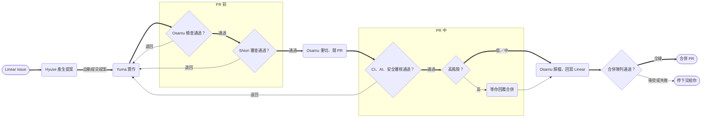

# 多 Agent 開發工作流（single-side）

> 隨 littleduck-skills 的 `install.sh agent-team-single-side` 安裝：**一個 repo 只有一端、只用一個開發 Agent**（例：純後端服務、純前端網站、桌面程式、CLI），從 repo 根目錄啟動 Claude Code。
> 一個 repo 同時有前後端、要分給兩個開發 Agent 的專案改用 `agent-team-fullstack`。

## 目標

把開發流程交給四個專職 Agent，由主對話（你只要執行 `/ship-issue`）統一分派，**從提案一路自動做到合併**：

1. 每個階段是一個 subagent（角色、權限、模型），流程步驟收在該角色的 skill。
2. OpenSpec 變更目錄是角色之間唯一的交接介面。
3. 總指揮指令 `/ship-issue` 串起全流程，**不設固定的人工確認**，只在停下條件（高風險、退回超過上限、衝突等）成立時問你。
4. 層層把關：PR 前兩項檢查（Osamu 實際跑檢查與執行驗證、Shiori 對照規格審查），PR 中四項檢查（CI、內建 `/code-review`、內建 `/security-review`、按風險審批）。
5. 合併時由 Osamu 模擬合併隊列：rebase 到最新主幹、重跑檢查與 CI，全綠才合併。

| 階段 | Agent | 主要 skill / 指令 | 產出 |
| --- | --- | --- | --- |
| 提案 | architect（Hyuse） | /issue-architect | proposal、UML、OpenAPI 草稿（沒有 API 就 `paths: {}`）、tasks |
| 實作 | 開發 Agent（Yuma） | 「端」為 `frontend` 時 /frontend-processor，`backend` 時 /backend-processor | 程式碼與測試 |
| 檢查、收尾、歸檔、合併 | integrator（Osamu） | /issue-integrator | 檢查與執行驗證結果、重切 commit、PR、歸檔、Linear 回寫、合併 |
| PR 前審查、PR 中評定 | reviewer（Shiori） | /custom-review | review.md 的審查發現與處理結果 |
| PR 中檢查 | 主對話 | 內建 /code-review、/security-review、gh pr checks | review.md、PR 留言、風險等級 |



檢查、審查、PR 中檢查任一處退回都會回到 Yuma，共用「同一目標最多兩次」的退回上限，第三次停下交給你。判定為高風險時才停下等你回覆「合併」，其餘全自動。

## 結構宣告：「## agent-team 設定」

角色 skill 與 `/ship-issue` 不寫死目錄，一律讀 repo 根目錄 `CLAUDE.md` 的這一段（欄位名不要改）：

```markdown
## agent-team 設定

- **結構**：single-side
- **主幹**：main
- **worktree 根目錄**：wt/
- **端**：frontend
- **程式碼目錄**：.
```

- **端**決定開發 Agent 走哪個 processor skill、任務標 `[FE]` 還是 `[BE]`。它不代表專案一定是網頁前端或 API 後端：桌面程式、CLI 這類沒有 HTTP API 的專案通常選 `frontend`，`openapi.yaml` 寫 `paths: {}`。
- **程式碼目錄**是開發 Agent 工作與跑檢查的目錄，預設 repo 根目錄。
- 缺段落或缺欄位時，`/ship-issue` 在建 worktree 前就停下。

同一份角色 skill 也支援 `fullstack`；兩種結構的差異見 littleduck-skills 的 `agent-team-fullstack/docs/multi-agent-workflow.md`。

## 團隊編制

| Agent | 預設名稱 | 職責 | 工具權限 | 模型 | 寫入範圍 |
| --- | --- | --- | --- | --- | --- |
| architect | Hyuse | 讀 Linear、系統分析、寫 UML 與 OpenAPI 草稿、寫提案 | Read、Grep、Glob、Write、Linear MCP | opus | hook `architect`：只寫 `openspec/` |
| 開發 | Yuma | 依 tasks 實作與寫測試 | Read、Edit、Write、Bash | sonnet | 不掛 hook：擁有整個程式碼目錄 |
| integrator | Osamu | 實際檢查與執行驗證、審查後重切 commit、開 PR、歸檔、回寫 Linear、模擬合併隊列並合併 | Read、Grep、Bash、Linear MCP、gh（需 merge 權限） | sonnet | hook `integrator`：只寫 `handoff.md`、`.linear.md`、歸檔同步的規格 |
| reviewer | Shiori | PR 前對照 proposal、specs、openapi.yaml 審查 diff；PR 中評定 /code-review、/security-review 發現 | Read、Grep、Glob（唯讀） | opus | 不需要 hook |

分工原則：

- **Agent 是「誰」，skill 是「怎麼做」。** 流程步驟寫在 skill，定義檔只寫身分、邊界與交接規則。改流程只改 skill。
- **Agent 名稱可以改。** 改定義檔檔名、frontmatter 的 `name`、`CLAUDE.md` 的 Agent 表與 `ship-issue.md` 裡的名稱即可；角色 skill 不寫 Agent 名稱，hook 參數是角色，重跑 installer 後不必再改 `.claude/skills/`。**改名後可以放心重跑 installer**：`.claude/agents/` 已有任何 Agent 定義（不論檔名）時，installer 不會建立範本名稱的 Agent 定義，並在輸出逐檔說明略過原因；只有 `.claude/agents/` 不存在或沒有 `*.md` 時才建立全部範本。「端」為 `backend` 時，建議把開發 Agent 改成後端角色的名字，並把它的 lint hook 改成 `backend-processor` 的。
- **權限要真的限制。** architect 不改程式碼；integrator 不修 bug，發現問題就退回；reviewer 只有唯讀工具。
- **Osamu 管「有沒有過」，Shiori 管「該測的有沒有測」。** 開發 Agent 同時寫程式和測試，理解有偏差時兩者會一起錯、測試照樣通過，這是 Shiori 要補的缺口。
- **審查規則依性質分三處放**（見 `CLAUDE.md`「審查規則三分法」）。

## 交接契約

Subagent 之間不共享對話，所有交接都落在**同一個** OpenSpec 變更目錄；每個 Agent 開工先讀、結束寫回，缺檔就停下回報。change-id 以 Linear issue 編號開頭並**全小寫**，例：`eng-123-order-export`；分支名保留大寫的 issue 編號（`feature/ENG-123-order-export`）。

```
wt/eng-123-order-export/openspec/changes/eng-123-order-export/
├── proposal.md     # 需求背景、範圍、驗收條件（來自 Linear）
├── design.md       # UML、執行驗證觀察點、變異測試目標
├── openapi.yaml    # API 契約；沒有 HTTP API 時為 paths: {}
├── tasks.md        # 每項都標宣告端的 tag，完成就勾選
├── specs/          # OpenSpec 的需求差異
├── handoff.md      # 狀態區塊與各 Agent 的交接紀錄
├── review.md       # 審查發現與處理結果
└── review-diff.patch  # 主對話備妥的 diff，供 Shiori 讀取（.gitignore，不進 commit）
```

| 檔案 | 寫入者 | 讀取者 | 規則 |
| --- | --- | --- | --- |
| proposal.md | architect | 全部 | 開發中不改；需求變動要退回 architect |
| design.md | architect | 開發 Agent、integrator | 至少一張資料流圖；時序圖畫使用者或模組間的互動，沒有可畫的就寫明理由 |
| openapi.yaml | architect 起草、開發 Agent 定稿（端為 `backend` 時） | integrator、reviewer | 沒有 API 時維持 `paths: {}` |
| tasks.md | architect 建立、開發 Agent 勾選 | integrator | 勾選時附一行說明 |
| handoff.md | 每個 Agent 完成時追加 | 下一個 Agent | 「## 狀態」就地改值；下方紀錄只追加 |
| review.md | 主對話（代 Shiori 與 /code-review 寫入） | 開發 Agent、Osamu、你 | 每條發現標嚴重度、信心度、檔案與行號、對應需求；註明「退回」或「PR 備註」 |

## 導入步驟

- [ ] 在 repo 根目錄安裝：`curl -fsSL https://raw.githubusercontent.com/StevenShih-0402/littleduck-skills/main/install.sh | sh -s -- agent-team-single-side`（本地 clone：`<clone>/install.sh agent-team-single-side <repo>`）。
- [ ] repo 已有 `CLAUDE.md` 時 installer 不會覆寫：把 kit `CLAUDE.md` 的各段手動合併進去，填好「## agent-team 設定」與「## 檢查指令」。
- [ ] 「端」為 `backend` 時，改開發 Agent 定義檔的 lint hook 路徑（見定義檔內註解）。
- [ ] `.gitignore` 加 `/wt/` 與 `review-diff.patch`。
- [ ] 執行 OpenSpec 初始化；確認 Linear MCP 已連線、`gh` 已登入且有 merge 權限。
- [ ] （可選）填「## 執行驗證」與「## 變異測試」；沒寫就略過、不擋流程。
- [ ] 用 2 個已完成的舊 issue 單點呼叫 Hyuse 試跑，調到提案不需大改。
- [ ] 刻意製造一個錯誤，確認 Osamu 會退回；在主幹先合併一個會衝突的改動，確認合併段會停下不合併。
- [ ] 用 `/ship-issue <id>` 端到端跑完 3 個 issue；填好「高風險檔案樣式」「風險分級」「合併設定」。

完成標準：低／中風險的 issue 從 `/ship-issue` 到合併你都不需介入；高風險 issue 只在風險審批時介入一次。

## 範本

| 檔案 | 重點 |
| --- | --- |
| `.claude/agents/hyuse.md` | opus；照 `/issue-architect`；PreToolUse 掛 `guard-write-scope.sh architect` |
| `.claude/agents/yuma.md` | sonnet；依「端」照 `/frontend-processor` 或 `/backend-processor`；PostToolUse 掛該端的 lint hook；不掛寫入限制 |
| `.claude/agents/osamu.md` | sonnet；照 `/issue-integrator`；PreToolUse 掛 `guard-write-scope.sh integrator`；只在合併段 merge，禁止 `--admin` |
| `.claude/agents/shiori.md` | opus；唯讀 Read／Grep／Glob；照 `/custom-review`；只回報 |
| `.claude/commands/ship-issue.md` | 讀「## agent-team 設定」→ 建一份 worktree → Hyuse 提案並自動提交 → Yuma 實作 → Osamu 檢查 → Shiori PR 前審查 → Osamu 收尾開 PR → PR 中四項檢查 → 風險審批 → Osamu 歸檔、合併 |
| `.claude/hooks/guard-write-scope.sh` | 參數是角色（`architect`、`integrator`）；管不到 Bash，靠定義檔明文禁止 |
| `openspec/handoff-template.md`、`openspec/review-template.md` | 狀態區塊就地改值、紀錄只追加；每輪審查一節 |

## 停下條件

| 停下條件 | 時機 | 你要看什麼 |
| --- | --- | --- |
| 設定不完整 | `/ship-issue` 開始時 | 補「## agent-team 設定」缺的欄位 |
| 待確認問題 | Hyuse 提案時 | 回答 Hyuse 列出的問題 |
| 規格免同步聲明 | Osamu 檢查通過後 | 聲明的目標、觸發路徑與理由是否成立 |
| 高風險 | PR 中檢查通過後 | 高風險檔案的 diff、`review.md` 的 PR 備註、PR 連結；看完回覆「合併」 |
| 退回超過上限 | 同一目標第 3 次要退回時 | 歷次退回原因，決定怎麼處理 |
| 衝突或 blocker | 任何時候 | 失敗原因與衝突檔案 |

## 從舊版 agent-team 遷移

舊版 `install.sh agent-team`（協作中樞 repo 加上前後端分兩個 repo）已移除。已在單一 repo 用舊版加覆寫的專案：

1. 先 diff 現有骨架與舊版 kit，列出專案自己的差異（Agent 名稱、color、模型、檢查指令、專案規則）。
2. 執行 `install.sh agent-team-single-side <repo>`：角色 skill 會更新為新版；已存在的骨架檔會被略過。
3. 以新版骨架為底逐檔合併第 1 步的差異：hook 參數改成角色、刪掉「本專案的差異（單一 repo）」之類的覆寫段落。專案內被手動裁剪過的 skill 不必再裁：新版 skill 依 `CLAUDE.md` 的設定決定跑或略過。
4. `CLAUDE.md` 加「## agent-team 設定」，刪掉單一 repo 的對照段落；執行驗證、變異測試、高風險檔案樣式等專案設定保留。
5. 驗收：`grep -riE '前端 ?repo|後端 ?repo|team-?hq' .claude/skills/` 應無輸出；用一張小 issue 跑 `/ship-issue`。
6. 進行中的 issue 先用舊流程走完，再切換。
