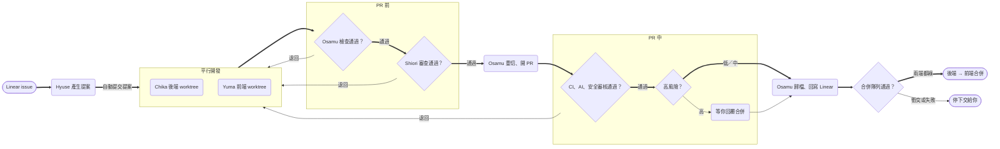

# 多 Agent 開發工作流改造計畫

> 隨 littleduck-skills 的 `install.sh agent-team` 安裝。文中 `<team-hq-repo>`、`<frontend-repo>`、`<backend-repo>` 為佔位，請換成你的實際路徑；框架名稱（Django/DRF 等）僅為範例。

## 目標與現況

目標：把新版流程圖上的四個開發階段各交給一個專職 Agent，加上審查員，由主對話（你只要執行 `/ship-issue`）統一分派，**從提案一路自動做到合併**。

現況是一個 Agent 從讀 Linear 到寫 code 一路做完，context 越做越長，前後端也無法平行。新版流程已經切好四個階段，這份計畫做的是五件事：

1. 每個階段變成一個 subagent（角色、權限、模型），原本的 slash command 收進該角色的 skill。
2. OpenSpec 變更目錄成為角色之間唯一的交接介面，規定誰讀什麼、寫什麼。
3. 用一個總指揮指令 `/ship-issue` 串起全流程，**不設固定的人工確認**，只在停下條件（高風險、退回超過上限、衝突等）成立時問你。
4. 參考 Anthropic 的「層層把關」：PR 前兩項檢查（Osamu 實際跑檢查與執行驗證、Shiori 對照規格審查），PR 中四項檢查（CI、內建 `/code-review`、內建 `/security-review`、按風險審批）。
5. 合併時由 Osamu 模擬合併隊列：rebase 到最新主幹、重跑檢查與 CI，兩端都綠才合併。

| 流程圖階段 | 對應 Agent | 主要 skill / 指令 | 產出 |
| --- | --- | --- | --- |
| /issue-architect | architect | /issue-architect（依 `openspec instructions` 寫 artifact） | proposal、UML、OpenAPI 草稿、兩份 tasks |
| /backend-processor | backend | /backend-processor、/opsx:apply | 後端 API（例：Django/DRF）、單元測試、migration |
| /frontend-processor | frontend | /frontend-processor、/opsx:apply | 畫面切版、API 串接 |
| /issue-integrator（檢查、收尾、歸檔、合併） | integrator | /issue-integrator、/opsx:archive | 檢查與執行驗證結果、重切 commit、PR、歸檔、Linear 回寫、合併 |
| PR 前審查、PR 中評定 | reviewer | /custom-review（審查模式、評定模式） | review.md（審查發現與處理結果） |
| PR 中檢查 | 主對話 | 內建 /code-review、/security-review、gh pr checks | review.md、PR 留言、風險等級 |



Chika 與 Yuma 在各自的 worktree 平行開發。Osamu 檢查、Shiori 審查、PR 中檢查任一處退回都會回到開發者，共用「同一目標最多兩次」的退回上限，第三次停下交給你。判定為高風險時才停下等你回覆「合併」，其餘全自動。

## 團隊編制

先建四個 Agent，和流程圖一一對應；QA 與演算法角色等四人跑順後再加。每個 Agent 可以取一個人名當 `name`，你就能用「Chika 幫我在後端執行 /backend-processor」這種方式呼叫。

| Agent | 建議人名 | 職責 | 工具權限 | 建議模型 | 工作目錄 |
| --- | --- | --- | --- | --- | --- |
| architect | Hyuse | 讀 Linear、系統分析、寫 UML 與 OpenAPI 草稿、執行 /opsx:propose | Read、Grep、Glob、Write（限 openspec/）、Linear MCP | opus | 前後端兩個 repo 的 openspec/ |
| backend | Chika | 依後端 tasks 開發 API、單元測試、migration | Read、Edit、Write、Bash | sonnet | 後端 worktree |
| frontend | Yuma | 依前端 tasks 切版、依 OpenAPI 串接 API | Read、Edit、Write、Bash | sonnet | 前端 worktree |
| integrator | Osamu | 實際檢查與執行驗證、核對 tasks、審查後重切 commit、開 PR、/opsx:archive、回寫 Linear、模擬合併隊列並合併 | Read、Grep、Bash、Linear MCP、gh（需 merge 權限） | sonnet | 兩個 worktree（唯讀為主） |
| reviewer | Shiori | PR 前對照 proposal、specs、openapi.yaml 審查 diff：需求有沒有實作、邊界有沒有測、邏輯是否正確；PR 中評定 /code-review、/security-review 發現 | Read、Grep、Glob（唯讀） | opus | 兩個 worktree 的變更目錄與 review-diff.patch |

分工原則：

- **Agent 是「誰」，skill 是「怎麼做」。** 流程步驟寫在 skill，角色檔只寫身分、邊界與交接規則。改流程只改 skill。
- **權限要真的限制。** architect 不改程式碼；integrator 不修 bug，發現問題就退回給 backend 或 frontend；reviewer 只有唯讀工具。
- **architect 用較強模型。** 規格錯了後面全錯，這一步最值得花 token；開發角色用 sonnet 控制成本。
- **Shiori 只回報，不修改、不核准。** Shiori 沒有寫入權限，審查結果由主對話寫進 `review.md`；不能核准或合併 PR，高風險變更由你審批。
- **Osamu 管「有沒有過」，Shiori 管「該測的有沒有測」。** Chika 與 Yuma 同時寫程式和測試，理解有偏差時兩者會一起錯、測試照樣通過，這是 Shiori 要補的缺口。
- **審查規則依性質分三處放**（見 team-hq `CLAUDE.md`「審查規則三分法」）：機械性交給 linter、需判斷的慣例寫進各 repo `CLAUDE.md` 由內建 `/code-review` 在 PR 中審、對照規格的需求覆蓋放進 `/custom-review` 由 Shiori 在 PR 前審。
- **後續擴編：** QA（Quinn，只能改 tests/，對照 spec 驗收）與演算法（Ada，寫 design.md 與 benchmark，用 opus）。

## 交接契約

Subagent 之間不共享對話，所有交接都落在同一個 OpenSpec 變更目錄裡；每個 Agent 開工先讀、結束寫回，缺檔就停下回報。

變更 ID 統一用 Linear issue 編號開頭並**全小寫**（OpenSpec CLI 不接受大寫），例如 `eng-123-order-export`；前後端兩個 repo 用同一個 ID，方便對照與歸檔。分支名保留大寫的 issue 編號（`feature/ENG-123-order-export`），讓 Linear automation 認得。

```
openspec/changes/eng-123-order-export/
├── proposal.md     # 需求背景、範圍、驗收條件（來自 Linear）
├── design.md       # UML：資料流、時序圖（Mermaid）
├── openapi.yaml    # Swagger 草稿，前後端共同依據
├── tasks.md        # 該 repo 的任務清單，完成就勾選
├── specs/          # OpenSpec 的需求差異
├── handoff.md      # 各 Agent 的交接紀錄與退回原因
├── review.md       # Shiori 與 /code-review 的審查發現與處理結果
└── review-diff.patch  # 主對話備妥的 diff，供 Shiori 讀取（.gitignore，不進 commit）
```

| 檔案 | 寫入者 | 讀取者 | 規則 |
| --- | --- | --- | --- |
| proposal.md | architect | 全部 | 開發中不改；需求變動要退回 architect |
| design.md | architect | backend、frontend | 至少一張資料流圖、一張前後端互動時序圖 |
| openapi.yaml | architect 起草、backend 定稿 | frontend、integrator | backend 改欄位必須同步更新並在 handoff.md 註明 |
| tasks.md | architect 建立、開發者勾選 | integrator | 每個任務標註 `[BE]` 或 `[FE]`，勾選時附一行說明 |
| handoff.md | 每個 Agent 完成時追加 | 下一個 Agent | 格式：角色、時間、做了什麼、未完成、風險 |
| review.md | 主對話（代 Shiori 與 /code-review 寫入） | Chika、Yuma、Osamu、你 | 每條發現標註嚴重度、信心度、檔案與行號、對應需求；註明「退回」或「PR 備註」 |
| review-diff.patch | 主對話 | Shiori | Shiori 只有 Read、Grep、Glob，看不到 git diff，所以由主對話先產生；列入各 repo `.gitignore` |

前端 repo 的 `openapi.yaml` 是後端的副本。建議由 integrator 在檢查時比對兩份是否一致，不一致就退回。

## 執行步驟

分六個階段（Phase 5 視需求導入），每階段都用一個真實的小 issue 跑一次再往下走；前一階段的完成標準沒過，就不要進下一階段。

### Phase 0　前置作業（第 1 週，約半天）

**設定檔放哪裡：** 四個 Agent 與總指揮指令橫跨前後端，放在獨立的 team-hq repo；只跟單一 repo 有關的設定才放進前後端 monorepo。Claude Code 只載入啟動目錄所在專案的 `.claude/agents/`，放在任一邊，另一邊就叫不到 Hyuse 與 Osamu。

| 位置 | 專案具體路徑 | 放什麼 |
| --- | --- | --- |
| team-hq repo | `<team-hq-repo>` | 五個 agent 定義檔（含 shiori）、/ship-issue、/issue-architect、/issue-integrator、/frontend-processor（含前端 lint hook）、/custom-review（Shiori 用）、寫入限制 hook、`review.md` 範本、總覽用 CLAUDE.md |
| 前端 monorepo | `<frontend-repo>` | CLAUDE.md、openspec/ |
| 後端 monorepo | `<backend-repo>` | CLAUDE.md、/backend-processor skill、openspec/、後端測試與 migration hook |

```
~/work/
├── team-hq/            # 從這裡啟動 Claude Code
│   ├── CLAUDE.md       # 前後端 repo 路徑、worktree 慣例
│   └── .claude/
│       ├── agents/     # hyuse.md chika.md yuma.md osamu.md shiori.md
│       ├── commands/   # ship-issue.md
│       ├── hooks/      # guard-write-scope.sh
│       └── skills/     # issue-architect、issue-integrator、frontend-processor 與相依
├── frontend/           # 前端 monorepo
├── backend/            # 後端 monorepo
└── wt/                 # 各 issue 的 worktree
```

平常從 team-hq 啟動，用 additional directories 設定（或 `--add-dir`）加入前後端 repo 與 wt/。Hyuse、Yuma、Osamu 讀 team-hq 的 skill；Chika 讀後端 repo 的 /backend-processor。兩邊不對稱的原因：`backend-processor` 的 lint hook 以後端 repo 路徑註冊，也可能被後端 repo 自己的 `.claude/settings.json` 使用，所以裝在後端；其餘三個 skill 只在 team-hq 被呼叫，隨 `install.sh agent-team` 一起安裝並在重跑時更新。

- [ ] 建立 team-hq repo，放入五個 agent 定義檔與 /ship-issue
- [ ] 在 team-hq 的 CLAUDE.md 寫明前後端 repo 路徑與 worktree 慣例
- [ ] 設定 additional directories，確認從 team-hq 能讀寫兩個 repo 與 wt/
- [ ] 在後端 repo 安裝 /backend-processor（含編輯後 lint hook 與規格同步說明 `spec-sync/`）：
      `curl -fsSL https://raw.githubusercontent.com/StevenShih-0402/littleduck-skills/main/install.sh | sh -s -- backend-processor <backend-repo>`
- [ ] 確認 team-hq 的 `.claude/skills/` 已有 `issue-architect`、`issue-integrator`、`frontend-processor`、`custom-review`（`install.sh agent-team` 會一併安裝；重跑即更新 skill，但不覆寫已存在的骨架檔）
- [ ] 在前後端兩個 repo 的 `.gitignore` 各加一行 `review-diff.patch`（程式碼審查用的暫存 diff，不進 commit）

* [ ] 決定 worktree 慣例：例如 `../wt/<repo>-<change-id>`，每個 issue 一組前後端 worktree
* [ ] 前後端 repo 各自執行 OpenSpec 初始化，確認 /opsx:propose、/opsx:apply、/opsx:archive 可用
* [ ] 每個 repo 寫好 `CLAUDE.md`：技術棧、目錄結構、啟動 / 測試 / lint 指令、命名慣例
* [ ] 確認 Linear MCP 已連線，能讀 issue、能改狀態與留言
* [ ] 確認 `gh` CLI 已登入，能開 PR、留言與合併 PR（Osamu 合併段需要 merge 權限）
* [ ] （可選）在前後端 repo 的 `CLAUDE.md` 加「## 執行驗證」段（啟動、就緒檢查、觀察點、停止；格式見 team-hq `CLAUDE.md`），Osamu 檢查時會把產品跑起來觀察；沒寫就略過。觀察點可以是指令，也可以是**截圖**（前端畫面）。用截圖時，要先在執行 Osamu 的環境裝好固定版本的截圖工具與瀏覽器（例：`npx playwright install chromium`）
* [ ] 建立 `handoff.md` 範本，放進 OpenSpec 的變更樣板（範本已隨安裝放在 `openspec/handoff-template.md`；開頭的「## 狀態」區塊就地改值，開發 Agent 中斷後靠它接續。已用舊版骨架建立的 team-hq，安裝不會覆寫既有檔案，要取新版範本須先移除或改名舊的 `openspec/handoff-template.md` 再重跑 `install.sh agent-team`）

完成標準：在任一 repo 手動開一個 worktree，能跑起服務與測試。

### Phase 1　Architect（第 1 週）

- [ ] 檢視隨安裝提供的 /issue-architect：讀 issue → 系統分析 → UML → OpenAPI 草稿 → 前後端各一份變更目錄。它不呼叫 /opsx:propose（subagent 不能回答釐清問題），改依 `openspec instructions` 逐份寫 artifact
- [ ] 把 `hyuse.md` 的 `<frontend-repo>` 等佔位換成實際路徑；寫入限制 hook 已在 frontmatter 註冊
- [ ] 確認 skill 的規定符合你的專案：同一個 change-id 在前後端各產生一份 `tasks.md`，任務標註 `[BE]` / `[FE]`
- [ ] 用 2 個已完成的舊 issue 試跑，比對產出與你當初實際做法的差異
- [ ] 依差異修正 skill，直到提案不需大改就能直接開工

完成標準：連續 2 個 issue 的提案，你看過後只覺得需要小幅修改。正式流程中提案會自動提交，不等你核准，所以這一階段要先把提案品質調好。

### Phase 2　Backend 與 Frontend（第 2 週）

- [ ] 檢視 /backend-processor（後端 repo）與 /frontend-processor（team-hq），兩者第一步都是讀 proposal、design、openapi、tasks；測試、lint 等指令取自各 repo 的 CLAUDE.md，沒寫就停下回報
- [ ] 建立 `chika.md`、`yuma.md`，各自限定只在自己的 worktree 工作
- [ ] backend skill 寫明完成定義：API 通過單元測試、migration 可正反向執行、openapi.yaml 已定稿
- [ ] frontend skill 寫明：先用 openapi.yaml 產生型別或 mock，後端未完成也能先切版
- [ ] 先依序跑（先 BE 後 FE），穩定後再試平行
- [ ] 加上 hook：編輯檔案後自動跑 lint / 型別檢查。後端用 /backend-processor 附帶的 `hooks/post-edit-lint.sh`：`chika.md` 範本的 frontmatter 已註冊（把 `<backend-repo>` 換成實際路徑）；不想綁在 Agent 上時，改在後端 repo 的 `.claude/settings.json` 加同樣的 PostToolUse hook（matcher `Write|Edit`）。lint 指令可用環境變數 `LITTLEDUCK_LINT_CMD` 指定，未指定時自動偵測 `./pants` 或 ruff，都沒有就不跑。前端用 /frontend-processor 附帶的 `hooks/post-edit-lint.sh`，已在 `yuma.md` 註冊（路徑以 `$CLAUDE_PROJECT_DIR` 指向 team-hq，不需替換）；lint 指令可用 `LITTLEDUCK_FE_LINT_CMD` 指定，未指定時有 eslint 設定檔與本地 eslint 才跑

完成標準：一個前後端都有改動的 issue，兩個 Agent 各自完成 tasks，且 handoff.md 紀錄完整。

### Phase 3　Integrator（第 2–3 週）

- [ ] 檢視隨安裝提供的 /issue-integrator：實際跑兩端測試與執行驗證 → 核對 tasks 全勾 → 比對兩份 openapi.yaml → 規格同步閘門 → 審查後重切 commit 並開 PR → PR 中檢查通過後歸檔並回寫 Linear → 模擬合併隊列並合併
- [ ] 確認 `osamu.md` 的寫入限制 hook 生效：發現問題只寫進 handoff.md 並退回，不自行修改程式碼
- [ ] 在 team-hq `CLAUDE.md` 的 repo 表填好兩端主幹，Osamu 開 PR 時以它為 base
- [ ] 在 team-hq `CLAUDE.md` 填好「合併設定」（合併方式、CI 等待上限）
- [ ] 刻意製造一個錯誤（例如欄位名不一致），確認 Osamu 會退回而不是放行
- [ ] 在主幹先合併一個會和分支衝突的改動，確認合併段會 `rebase --abort` 並停下，不會合併

完成標準：Osamu 能正確擋下刻意製造的錯誤與衝突，正常 issue 能產出可審查的 PR 並在檢查通過後合併。

### Phase 4　總指揮與自動化（第 3 週）

- [ ] 檢視隨安裝提供的 `/ship-issue <issue-id>`，串起五個角色（摘要見下一節）
- [ ] 前後端改用平行執行，各自使用獨立 worktree
- [ ] 確認退回上限：同一目標退回 2 次，第 3 次停下來交給你
- [ ] 用 3 個新 issue 端到端跑完，記錄每個 issue 你介入的次數與原因

完成標準：低／中風險的 issue 從 `/ship-issue` 到合併你都不需介入；高風險 issue 只在風險審批時介入一次。

### Phase 5　審查與 PR 中檢查（Phase 4 穩定後）

**啟用條件：** 預設就啟用（流程沒有人工檢查點，審查是自動合併前的主要防線）。

- [ ] 依最新官方文件確認內建 `/code-review` 與 `/security-review` 的行為；保留內建、**不要建立同名 skill**（會失去 effort／`--fix`／`ultra`）
- [ ] 在各 repo 的 `CLAUDE.md` 補齊需要判斷的專案慣例（分層、錯誤格式、命名原則），內建 `/code-review` 在 PR 中依此審查
- [ ] 確認命名、格式等機械性規則已由 linter 在 Osamu 檢查階段擋下，不交給 AI 審查
- [ ] 確認 team-hq 已有 `/custom-review`（隨 `install.sh agent-team` 安裝）與 `shiori.md`、`review.md` 範本
- [ ] 在 team-hq `CLAUDE.md` 填好「高風險檔案樣式」與「風險分級」（依技術棧）
- [ ] 在前後端兩個 repo 的 `.gitignore` 加 `review-diff.patch`
- [ ] 確認各 repo 的主幹是否為 `origin` 預設分支；不是的話 `/security-review` 會改以 `/code-review high` 代替（見 team-hq `CLAUDE.md`「合併設定」）
- [ ] 審查直接採自動退回：只有「高嚴重度且高信心」才退回，其餘列入 PR 備註並留言到 PR。事後可以用各 `review.md` 的處理欄統計誤報

完成標準：連續 N 個 issue 中，Shiori 退回的項目你都認同，且合併後回報的邏輯問題明顯減少。

## 範本

完整範本已隨 `install.sh agent-team` 放進 team-hq，直接修改即可；frontmatter 可用欄位以你目前 Claude Code 版本的官方文件為準。這裡只列每個檔案的重點，避免與實際檔案不同步。

| 檔案 | 重點 |
| --- | --- |
| `.claude/agents/hyuse.md` | opus；照 `/issue-architect`；PreToolUse 掛 `guard-write-scope.sh hyuse`，只能寫 `openspec/`；不能問 user，疑問列成待確認問題回傳 |
| `.claude/agents/chika.md` | sonnet；照後端 repo 的 `/backend-processor`；PostToolUse 掛後端 lint hook（`<backend-repo>` 要換成實際路徑） |
| `.claude/agents/yuma.md` | sonnet；照 team-hq 的 `/frontend-processor`；PostToolUse 掛前端 lint hook；不改 `openapi.yaml` |
| `.claude/agents/osamu.md` | sonnet；照 `/issue-integrator`；PreToolUse 掛 `guard-write-scope.sh osamu`；不採信前一棒、不自己修；檢查通過只設 `reviewing`，收尾才重切並用 `--force-with-lease`；只在合併段 merge，禁止 `--admin` |
| `.claude/agents/shiori.md` | opus；唯讀 Read／Grep／Glob；照 `/custom-review` 的審查模式（PR 前）與評定模式（PR 中）；只回報、不修改、不核准、不合併 |
| `.claude/commands/ship-issue.md` | 先問完參數再派工；Hyuse 沒有待確認問題就自動提交提案；依序派 Chika、Yuma；Osamu 檢查；Shiori PR 前審查；Osamu 收尾開 PR；PR 中跑 CI、`/code-review`、`/security-review` 與 Shiori 評定；依風險分級，高風險才停下等你回覆「合併」；Osamu 歸檔、合併 |
| `.claude/hooks/guard-write-scope.sh` | Hyuse 與 Osamu 共用的寫入範圍限制；管不到 Bash，靠定義檔明文禁止 |
| `openspec/handoff-template.md` | 「## 狀態」區塊就地改值，下方各角色紀錄只追加 |
| `openspec/review-template.md` | 每輪審查一節「第 N 輪 — PR 前／PR 中」，只追加；範圍／已審到的 SHA／審查指令／高風險檔案／風險等級／發現表／結果 |

平常也可以單點呼叫，例如「Chika 幫我在後端執行 /backend-processor」或「Osamu 幫我檢查 eng-123-order-export」。

## 停下條件、風險與驗收

全流程**沒有固定的人工檢查點**。你執行 `/ship-issue` 後，Agent 團隊一路做到合併，只在下列情況停下問你：

| 停下條件 | 時機 | 你要看什麼 |
| --- | --- | --- |
| 待確認問題 | Hyuse 提案時 | 回答 Hyuse 列出的問題 |
| 規格免同步聲明 | Osamu 檢查通過後 | 聲明的目標、觸發路徑與理由是否成立 |
| 高風險 | PR 中檢查通過後 | 高風險檔案的 diff、`review.md` 的 PR 備註、PR 連結；看完回覆「合併」 |
| 退回超過上限 | 同一目標第 3 次要退回時 | 歷次退回原因，決定怎麼處理 |
| 衝突或 blocker | 任何時候（合併隊列衝突、CI 逾時、服務未啟動等） | 失敗原因與衝突檔案 |

| 風險 | 徵兆 | 對策 |
| --- | --- | --- |
| 規格錯誤一路傳到底 | 開發中頻繁回頭改 proposal | Phase 1 先把提案品質調好；architect 遇到不明確就列成待確認問題 |
| 自動合併放過錯誤程式碼 | 合併後才發現問題 | PR 前兩檢查、PR 中四檢查、高風險人工審批、合併隊列重跑檢查；不帶 `--admin`，失敗就不合併 |
| 前後端 API 不一致 | 前端串接失敗、欄位名對不上 | openapi.yaml 單一來源，integrator 比對兩份 |
| Agent 回報不實 | 回報「測試全過」但實際失敗 | integrator 必須實際執行測試，不採信前一棒的摘要 |
| token 與時間成本暴增 | 小 issue 也跑完整四棒 | 小 issue 走捷徑，只派單一開發 Agent |
| 無限退回 | 同一問題來回修 | 退回上限 2 次（Osamu 檢查、PR 前審查、CI、PR 中評定共用），超過交給你；第 2 輪起只審新改動，舊意見不重提 |
| 審查誤報造成來回修改 | 退回的項目你常常不認同 | 只有高嚴重度且高信心才退回，其餘寫進 PR 備註；用 `review.md` 的處理欄統計誤報，調整 `/custom-review` |
| 審查增加 token 成本 | 小改動也跑完整審查 | `/code-review` 只在 PR 中跑一次；小 issue 沒有 delta spec 時 PR 前不派 Shiori；`/security-review` 只在高風險時跑 |
| 合併隊列反覆重跑 | 多條流程並行、主幹一直前進 | 每次 rebase 後重跑是正常排隊行為；衝突或失敗直接停下交給你 |
| 同名 skill 覆蓋內建審查 | `/code-review` 失去 effort／`--fix`／`ultra` | 不建立名為 `code-review` 的 skill；Shiori 用另取名的 `/custom-review` |

## 常見問題

### 多加幾個 backend / frontend Agent 會變快嗎？能同時處理多個 Linear 任務嗎？

多建定義檔本身不會變快；同時處理多個 issue 做得到，但瓶頸會轉移到你的審查量與環境隔離上。

**定義檔是樣板，不是人力。** `chika.md` 可以同時啟動多個實例，平行度取決於有沒有彼此獨立的工作，而不是定義檔數量。

**同一個 issue 多派開發 Agent，效益通常很低：**

- 後端任務多半碰同一批 model、serializer、migration，平行寫容易衝突
- 拆分與對齊 openapi.yaml 的協調成本，常高於省下的時間
- 單一 issue 的時間主要花在規格與審查，不在寫 code
- 例外：issue 能切成互不相干的模組時，由 Hyuse 在 tasks.md 標出可平行區塊，再同時派兩個 Chika 實例

**要變快，應該增加同時進行的 issue 數。** 每個 issue 各自一組 worktree、一個 change-id、一條 `/ship-issue`，在不同 session 執行。並行前要先處理：

| 項目 | 問題 | 做法 |
| --- | --- | --- |
| 執行環境 | 多條產線共用 port 與測試資料庫會互相干擾 | docker compose 以 change-id 當 project name，各自獨立 port 與 DB |
| 資料庫 migration（例：Django） | 兩個分支都產生同編號 migration | Osamu 在開 PR 前檢查，必要時執行 `makemigrations --merge` |
| 修改範圍重疊 | 同時改同一模組會衝突 | Hyuse 在提案中列出預計修改的檔案範圍，你依此決定能否並行 |
| 前端共用元件與型別 | 同時改共用元件或 API 型別 | 後合併的分支負責 rebase |

**真正的上限是你。** 高風險 issue 要你審批，合併隊列衝突也要你處理，並行越多，這些負擔越重。

- 從 2 條並行開始，穩定後再考慮第 3 條
- 用管線化取代純平行：Chika 與 Yuma 開發 issue A 時，Hyuse 先寫 issue B 的提案
- 集中審查：例如早上一次核准提案、下午一次看 PR，減少切換成本
- 注意用量：並行會明顯拉高 token 消耗與 rate limit 壓力，Hyuse 使用 opus 的部分尤其明顯

## 從舊版流程升級

舊版（有檢查點 1、2 與 shadow mode）的 team-hq 重跑 `install.sh agent-team` 時，**角色 skill 會更新，但已存在的骨架檔不會被覆寫**。新版 `issue-integrator` 搭配舊版 `ship-issue.md`，會因為缺少「PR 中檢查已通過」而在歸檔時停下，不會誤合併，但流程也走不完。升級步驟：

1. 先移除或改名這些舊骨架檔：`.claude/commands/ship-issue.md`、`.claude/agents/osamu.md`、`.claude/agents/shiori.md`、`openspec/handoff-template.md`、`openspec/review-template.md`。
2. 重跑 `install.sh agent-team <team-hq>`，取得新版。
3. 把舊版改過的地方（repo 路徑佔位、模型、hook 路徑）合併回新檔。
4. 手動更新 team-hq `CLAUDE.md`：「交接規則」、「層層把關」、「審查規則三分法」、「風險分級」、「合併設定」、「執行驗證」（可參考本 repo `agent-team/CLAUDE.md`）。
5. 進行中的 issue 先用舊流程走完，再切換。

### 截圖觀察點與 design.md 觀察點

新版的 `issue-integrator` 支援截圖觀察點，`issue-architect` 會在 `design.md` 寫「## 執行驗證觀察點」。重跑 `install.sh agent-team` 會更新這兩個 skill，但 team-hq 的 `CLAUDE.md`、`.claude/agents/hyuse.md`、`.claude/agents/osamu.md` 是骨架檔，不會被覆寫：

1. 手動把本 repo `agent-team/CLAUDE.md`「執行驗證」段的截圖格式與注意事項，合併進 team-hq `CLAUDE.md`。
2. `hyuse.md`、`osamu.md` 的邊界與回報可以參考本 repo 的版本更新；不更新也不影響流程，因為步驟都寫在 skill 裡。
3. 前後端 repo 想用截圖時，在各自 `CLAUDE.md` 的「## 執行驗證」加截圖觀察點。
