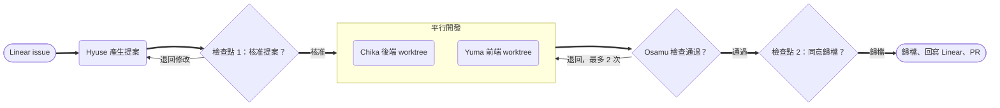

# 多 Agent 開發工作流改造計畫

> 隨 littleduck-skills 的 `install.sh agent-team` 安裝。文中 `<team-hq-repo>`、`<frontend-repo>`、`<backend-repo>` 為佔位，請換成你的實際路徑；框架名稱（Django/DRF 等）僅為範例。

## 目標與現況

目標：把新版流程圖上的四個階段，各交給一個專職 Agent，由主對話（你）統一分派，約三週完成導入。

現況是一個 Agent 從讀 Linear 到寫 code 一路做完，context 越做越長，前後端也無法平行。新版流程已經切好四個階段，這份計畫做的是三件事：

1. 每個階段變成一個 subagent（角色、權限、模型），原本的 slash command 收進該角色的 skill。
2. OpenSpec 變更目錄成為角色之間唯一的交接介面，規定誰讀什麼、寫什麼。
3. 用一個總指揮指令 `/ship-issue` 串起全流程，並在兩處保留人工確認。

| 流程圖階段 | 對應 Agent | 主要 skill / 指令 | 產出 |
| --- | --- | --- | --- |
| /issue-architect | architect | /issue-architect、/opsx:propose | proposal、UML、OpenAPI 草稿、兩份 tasks |
| /backend-processor | backend | /backend-processor、/opsx:apply | 後端 API（例：Django/DRF）、單元測試、migration |
| /frontend-processor | frontend | /frontend-processor、/opsx:apply | 畫面切版、API 串接 |
| /issue-integrator | integrator | /issue-integrator、/opsx:archive | 啟動檢查結果、歸檔、Linear 回寫、PR |



Chika 與 Yuma 在各自的 worktree 平行開發；Osamu 檢查失敗會退回開發者，同一階段最多兩次。

## 團隊編制

先建四個 Agent，和流程圖一一對應；QA 與演算法角色等四人跑順後再加。每個 Agent 可以取一個人名當 `name`，你就能用「Chika 幫我在後端執行 /backend-processor」這種方式呼叫。

| Agent | 建議人名 | 職責 | 工具權限 | 建議模型 | 工作目錄 |
| --- | --- | --- | --- | --- | --- |
| architect | Hyuse | 讀 Linear、系統分析、寫 UML 與 OpenAPI 草稿、執行 /opsx:propose | Read、Grep、Glob、Write（限 openspec/）、Linear MCP | opus | 前後端兩個 repo 的 openspec/ |
| backend | Chika | 依後端 tasks 開發 API、單元測試、migration | Read、Edit、Write、Bash | sonnet | 後端 worktree |
| frontend | Yuma | 依前端 tasks 切版、依 OpenAPI 串接 API | Read、Edit、Write、Bash | sonnet | 前端 worktree |
| integrator | Osamu | 啟動檢查、核對 tasks、/opsx:archive、回寫 Linear、開 PR | Read、Grep、Bash、Linear MCP、gh | sonnet | 兩個 worktree（唯讀為主） |

分工原則：

- **Agent 是「誰」，skill 是「怎麼做」。** 流程步驟寫在 skill，角色檔只寫身分、邊界與交接規則。改流程只改 skill。
- **權限要真的限制。** architect 不改程式碼；integrator 不修 bug，發現問題就退回給 backend 或 frontend。
- **architect 用較強模型。** 規格錯了後面全錯，這一步最值得花 token；開發角色用 sonnet 控制成本。
- **後續擴編：** QA（Quinn，只能改 tests/，對照 spec 驗收）與演算法（Ada，寫 design.md 與 benchmark，用 opus）。

## 交接契約

Subagent 之間不共享對話，所有交接都落在同一個 OpenSpec 變更目錄裡；每個 Agent 開工先讀、結束寫回，缺檔就停下回報。

變更 ID 統一用 Linear issue 編號開頭，例如 `ENG-123-order-export`，前後端兩個 repo 用同一個 ID，方便對照與歸檔。

```
openspec/changes/ENG-123-order-export/
├── proposal.md     # 需求背景、範圍、驗收條件（來自 Linear）
├── design.md       # UML：資料流、時序圖（Mermaid）
├── openapi.yaml    # Swagger 草稿，前後端共同依據
├── tasks.md        # 該 repo 的任務清單，完成就勾選
├── specs/          # OpenSpec 的需求差異
└── handoff.md      # 各 Agent 的交接紀錄與退回原因
```

| 檔案 | 寫入者 | 讀取者 | 規則 |
| --- | --- | --- | --- |
| proposal.md | architect | 全部 | 開發中不改；需求變動要退回 architect |
| design.md | architect | backend、frontend | 至少一張資料流圖、一張前後端互動時序圖 |
| openapi.yaml | architect 起草、backend 定稿 | frontend、integrator | backend 改欄位必須同步更新並在 handoff.md 註明 |
| tasks.md | architect 建立、開發者勾選 | integrator | 每個任務標註 `[BE]` 或 `[FE]`，勾選時附一行說明 |
| handoff.md | 每個 Agent 完成時追加 | 下一個 Agent | 格式：角色、時間、做了什麼、未完成、風險 |

前端 repo 的 `openapi.yaml` 是後端的副本。建議由 integrator 在檢查時比對兩份是否一致，不一致就退回。

## 執行步驟

分五個階段，每階段都用一個真實的小 issue 跑一次再往下走；前一階段的完成標準沒過，就不要進下一階段。

### Phase 0　前置作業（第 1 週，約半天）

**設定檔放哪裡：** 四個 Agent 與總指揮指令橫跨前後端，放在獨立的 team-hq repo；只跟單一 repo 有關的設定才放進前後端 monorepo。Claude Code 只載入啟動目錄所在專案的 `.claude/agents/`，放在任一邊，另一邊就叫不到 Hyuse 與 Osamu。

| 位置 | 專案具體路徑 | 放什麼 |
| --- | --- | --- |
| team-hq repo | `<team-hq-repo>` | 四個 agent 定義檔、/ship-issue、/issue-architect、/issue-integrator、總覽用 CLAUDE.md |
| 前端 monorepo | `<frontend-repo>` | CLAUDE.md、/frontend-processor skill、openspec/、前端 lint 與型別檢查 hook |
| 後端 monorepo | `<backend-repo>` | CLAUDE.md、/backend-processor skill、openspec/、後端測試與 migration hook |

```
~/work/
├── team-hq/            # 從這裡啟動 Claude Code
│   ├── CLAUDE.md       # 前後端 repo 路徑、worktree 慣例
│   └── .claude/
│       ├── agents/     # hyuse.md chika.md yuma.md osamu.md
│       └── commands/   # ship-issue.md
├── frontend/           # 前端 monorepo
├── backend/            # 後端 monorepo
└── wt/                 # 各 issue 的 worktree
```

平常從 team-hq 啟動，用 additional directories 設定（或 `--add-dir`）加入前後端 repo 與 wt/。Chika 進到後端 worktree 時，會自動讀到後端的 CLAUDE.md 與 /backend-processor。

- [ ] 建立 team-hq repo，放入四個 agent 定義檔與 /ship-issue
- [ ] 在 team-hq 的 CLAUDE.md 寫明前後端 repo 路徑與 worktree 慣例
- [ ] 設定 additional directories，確認從 team-hq 能讀寫兩個 repo 與 wt/
- [ ] 在後端 repo 安裝 /backend-processor（含編輯後 lint hook 與規格同步說明 `spec-sync/`）：
      `curl -fsSL https://raw.githubusercontent.com/StevenShih-0402/littleduck-skills/main/install.sh | sh -s -- backend-processor <backend-repo>`
- [ ] /frontend-processor 目前不隨 littleduck-skills 提供，依同一結構自行放進前端 repo 的 `.claude/skills/`

* [ ] 決定 worktree 慣例：例如 `../wt/<repo>-<change-id>`，每個 issue 一組前後端 worktree
* [ ] 前後端 repo 各自執行 OpenSpec 初始化，確認 /opsx:propose、/opsx:apply、/opsx:archive 可用
* [ ] 每個 repo 寫好 `CLAUDE.md`：技術棧、目錄結構、啟動 / 測試 / lint 指令、命名慣例
* [ ] 確認 Linear MCP 已連線，能讀 issue、能改狀態與留言
* [ ] 確認 `gh` CLI 已登入，能開 PR
* [ ] 建立 `handoff.md` 範本，放進 OpenSpec 的變更樣板（範本已隨安裝放在 `openspec/handoff-template.md`；開頭的「## 狀態」區塊就地改值，開發 Agent 中斷後靠它接續。已用舊版骨架建立的 team-hq，安裝不會覆寫既有檔案，要取新版範本須先移除或改名舊的 `openspec/handoff-template.md` 再重跑 `install.sh agent-team`）

完成標準：在任一 repo 手動開一個 worktree，能跑起服務與測試。

### Phase 1　Architect（第 1 週）

- [ ] 把現有 /issue-architect 整理成 skill：讀 issue → 系統分析 → UML → OpenAPI 草稿 → /opsx:propose
- [ ] 建立 `team-hq/.claude/agents/hyuse.md`（範本見下一節），掛上該 skill
- [ ] 在 skill 中規定：同一個 change-id 在前後端各產生一份 `tasks.md`，任務標註 `[BE]` / `[FE]`
- [ ] 用 2 個已完成的舊 issue 試跑，比對產出與你當初實際做法的差異
- [ ] 依差異修正 skill，直到你不需大改就能核准提案

完成標準：連續 2 個 issue 的提案，你只做小幅修改就核准。

### Phase 2　Backend 與 Frontend（第 2 週）

- [ ] 把 /backend-processor、/frontend-processor 整理成 skill，第一步一律是讀 proposal、design、openapi、tasks
- [ ] 建立 `chika.md`、`yuma.md`，各自限定只在自己的 worktree 工作
- [ ] backend skill 寫明完成定義：API 通過單元測試、migration 可正反向執行、openapi.yaml 已定稿
- [ ] frontend skill 寫明：先用 openapi.yaml 產生型別或 mock，後端未完成也能先切版
- [ ] 先依序跑（先 BE 後 FE），穩定後再試平行
- [ ] 加上 hook：編輯檔案後自動跑 lint / 型別檢查。後端用 /backend-processor 附帶的 `hooks/post-edit-lint.sh`：`chika.md` 範本的 frontmatter 已註冊（把 `<backend-repo>` 換成實際路徑）；不想綁在 Agent 上時，改在後端 repo 的 `.claude/settings.json` 加同樣的 PostToolUse hook（matcher `Write|Edit`）。lint 指令可用環境變數 `LITTLEDUCK_LINT_CMD` 指定，未指定時自動偵測 `./pants` 或 ruff，都沒有就不跑

完成標準：一個前後端都有改動的 issue，兩個 Agent 各自完成 tasks，且 handoff.md 紀錄完整。

### Phase 3　Integrator（第 2–3 週）

- [ ] 把 /issue-integrator 整理成 skill：啟動前後端 → 跑全部測試 → 核對 tasks 全勾 → 比對兩份 openapi.yaml
- [ ] 建立 `osamu.md`：發現問題只寫進 handoff.md 並退回，不自行修改程式碼
- [ ] 檢查全過才執行 /opsx:archive、回寫 Linear 狀態與摘要、開前後端 PR
- [ ] 刻意製造一個錯誤（例如欄位名不一致），確認 Osamu 會退回而不是放行

完成標準：Osamu 能正確擋下刻意製造的錯誤，正常 issue 能產出可審查的 PR。

### Phase 4　總指揮與自動化（第 3 週）

- [ ] 建立 `/ship-issue <issue-id>` 指令，串起四個 Agent（範本見下一節）
- [ ] 前後端改用平行執行，各自使用獨立 worktree
- [ ] 設定退回上限：同一階段退回 2 次就停下來交給你
- [ ] 用 3 個新 issue 端到端跑完，記錄每個 issue 你介入的次數與原因

完成標準：一般 issue 你只需在兩個檢查點介入。

## 範本

以下範本可以直接複製再修改。agent 定義檔放 `team-hq/.claude/agents/`，總指揮指令放 `team-hq/.claude/commands/`（見 Phase 0）；frontmatter 可用欄位以你目前 Claude Code 版本的官方文件為準。

### Agent 定義檔：hyuse.md（architect）

```markdown
---
name: hyuse
description: 系統架構師。收到 Linear issue 需要分析需求、產生 UML、OpenAPI 草稿與 OpenSpec 提案時使用。
tools: Read, Grep, Glob, Write, mcp__linear
model: opus
---
你是系統架構師 Hyuse，負責把 Linear issue 轉成前後端都能直接執行的規格。

開工：
- 用 Linear MCP 讀取 issue 內容與留言
- 讀前後端 repo 的 CLAUDE.md 與相關既有程式碼

執行 /issue-architect skill，產出 openspec/changes/<change-id>/ 下的
proposal.md、design.md、openapi.yaml，並在前後端各執行 /opsx:propose 建立 tasks.md。

邊界：
- 只能寫 openspec/ 目錄，不得修改任何程式碼
- 需求不明確時，列出問題並停下，不要自行假設

結束：在 handoff.md 追加紀錄，回報 change-id、任務數、待確認問題。
```

### Agent 定義檔：chika.md（backend）

```markdown
---
name: chika
description: 後端工程師。依 OpenSpec 提案在後端 worktree 開發後端 API、單元測試與資料庫遷移時使用。
tools: Read, Grep, Glob, Edit, Write, Bash
model: sonnet
---
你是後端工程師 Chika。

開工：讀 proposal.md、design.md、openapi.yaml、tasks.md 中標註 [BE] 的任務。
缺少任何一份就停下回報，不要開始寫程式。

執行 /backend-processor skill，依它的步驟完成 [BE] 任務；進度以 handoff.md 的「## 狀態」區塊為準。

完成定義：
- 新增或修改的 API 都有單元測試且全部通過
- migration 可正向與反向執行
- openapi.yaml 與實作一致；有改欄位就在 handoff.md 註明
- 狀態區塊階段為 integrating，worktree 乾淨且已推送

邊界：只在後端 worktree 內工作，不改 proposal.md。
```

yuma.md 與 osamu.md 依同一結構撰寫，差別在 `tools`、邊界與完成定義（見「團隊編制」表格）；四份完整範本已隨安裝放在 `.claude/agents/`。

### 總指揮指令：/ship-issue

```markdown
---
description: 從 Linear issue 到 PR 的完整流程
argument-hint: <linear-issue-id>
---
處理 Linear issue $ARGUMENTS：

1. 為前後端各建立 worktree，路徑 ../wt/<repo>-<change-id>
2. 交給 hyuse 產生提案。完成後停下，摘要提案內容給我確認。
   【檢查點 1】我回覆「核准」才繼續；有修改意見就交回 hyuse。
3. 同時交給 chika（後端 worktree）與 yuma（前端 worktree）。
4. 交給 osamu 檢查。若 osamu 退回，依 handoff.md 交回對應的人修正，
   同一階段最多退回 2 次，超過就停下來告訴我。
5. osamu 檢查通過後，摘要結果與 PR 連結給我。
   【檢查點 2】我回覆「歸檔」後，osamu 才執行 /opsx:archive 並回寫 Linear。
```

平常也可以單點呼叫，例如「Chika 幫我在後端執行 /backend-processor」或「Osamu 幫我檢查 ENG-123」。

## 檢查點、風險與驗收

全流程只保留兩個必經的人工檢查點：提案核准、歸檔前確認。其他環節靠 Agent 之間的退回機制處理。

| 檢查點 | 時機 | 你要看什麼 |
| --- | --- | --- |
| 1. 提案核准 | architect 完成後 | 範圍是否符合 issue、OpenAPI 欄位是否合理、tasks 拆分是否可平行 |
| 2. 歸檔前 | integrator 檢查通過後 | PR diff、測試結果、handoff.md 中的風險項 |

| 風險 | 徵兆 | 對策 |
| --- | --- | --- |
| 規格錯誤一路傳到底 | 開發中頻繁回頭改 proposal | 檢查點 1 不放水；architect 遇到不明確就停下問 |
| 前後端 API 不一致 | 前端串接失敗、欄位名對不上 | openapi.yaml 單一來源，integrator 比對兩份 |
| Agent 回報不實 | 回報「測試全過」但實際失敗 | integrator 必須實際執行測試，不採信前一棒的摘要 |
| token 與時間成本暴增 | 小 issue 也跑完整四棒 | 小 issue 走捷徑，只派單一開發 Agent |
| 無限退回 | 同一問題來回修 | 退回上限 2 次，超過交給你 |

## 常見問題

### 多加幾個 backend / frontend Agent 會變快嗎？能同時處理多個 Linear 任務嗎？

多建定義檔本身不會變快；同時處理多個 issue 做得到，但瓶頸會轉移到你的審查量與環境隔離上。

**定義檔是樣板，不是人力。** `chika.md` 可以同時啟動多個實例，平行度取決於有沒有彼此獨立的工作，而不是定義檔數量。

**同一個 issue 多派開發 Agent，效益通常很低：**

- 後端任務多半碰同一批 model、serializer、migration，平行寫容易衝突
- 拆分與對齊 openapi.yaml 的協調成本，常高於省下的時間
- 單一 issue 的時間主要花在規格與審查，不在寫 code
- 例外：issue 能切成互不相干的模組時，由 Hyuse 在 tasks.md 標出可平行區塊，再同時派兩個 Chika 實例

**要變快，應該增加同時進行的 issue 數。** 每個 issue 各自一組 worktree、一個 change-id、一條 `/ship-issue`，在不同 session 執行。並行前要先處理：

| 項目 | 問題 | 做法 |
| --- | --- | --- |
| 執行環境 | 多條產線共用 port 與測試資料庫會互相干擾 | docker compose 以 change-id 當 project name，各自獨立 port 與 DB |
| 資料庫 migration（例：Django） | 兩個分支都產生同編號 migration | Osamu 在開 PR 前檢查，必要時執行 `makemigrations --merge` |
| 修改範圍重疊 | 同時改同一模組會衝突 | Hyuse 在提案中列出預計修改的檔案範圍，你依此決定能否並行 |
| 前端共用元件與型別 | 同時改共用元件或 API 型別 | 後合併的分支負責 rebase |

**真正的上限是你。** 每個 issue 有兩個檢查點，並行越多，審查負擔越重。

- 從 2 條並行開始，穩定後再考慮第 3 條
- 用管線化取代純平行：Chika 與 Yuma 開發 issue A 時，Hyuse 先寫 issue B 的提案
- 集中審查：例如早上一次核准提案、下午一次看 PR，減少切換成本
- 注意用量：並行會明顯拉高 token 消耗與 rate limit 壓力，Hyuse 使用 opus 的部分尤其明顯
