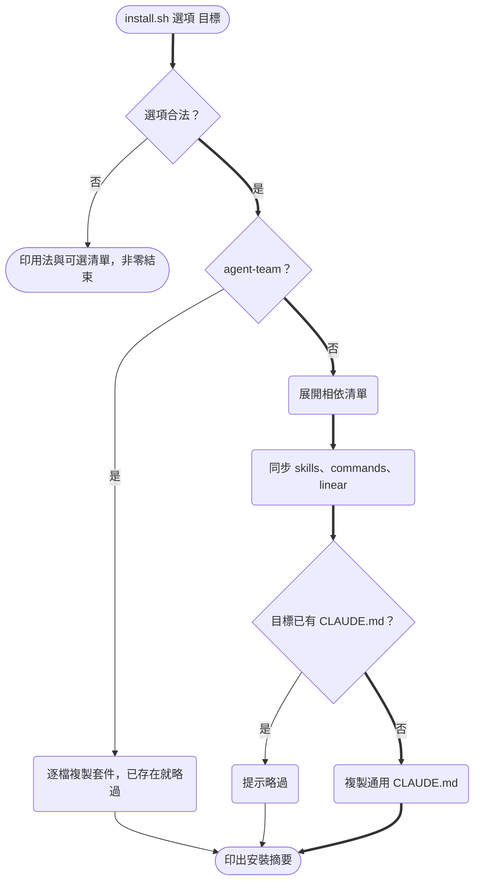

# Design

## Context

- 現行 `install.sh` 以 `copy_contents` 把 `.claude/skills/`、`.claude/commands/`、`linear/` 三個目錄整包 rsync／cp 到目標，唯一參數是目標路徑（預設 `$PWD`）。
- skill 之間有實際相依：`issue-reader` / `issue-processor` / `issue-solver` 會呼叫 `/opsx:propose`、`/opsx:apply`、`/opsx:archive`，並讀取 `linear/*_template.md`；`openspec-*` 與 `.claude/commands/opsx/*.md` 是同一組工作流的兩種入口。`gen-html`、`draw-mermaid` 則完全獨立。
- 來源資產：
  - `~/tao_rui_projects/ignsw_bk_monorepo/.claude/skills/draw-mermaid/`（`SKILL.md` 9.4KB、`scripts/render.sh`）——內含 `IGN-127`/`IGN-129`、`projects/<proj>/openspec/...`、`IngenuityOA_Frontend`、`openspec/specs/module-mermaid-diagrams/spec.md` 等公司綁定內容。
  - Linear SDP-69 附件「多 Agent 開發工作流改造計畫」——含 `~/tao_rui_projects/ignsw_fullstack/...` 路徑、Django/DRF 字樣、`ENG-123` 範例。
  - `mygo_v2_anon/CLAUDE.md`（10 行，全為通用原則）與 `ignsw_bk_monorepo/CLAUDE.md`（166 行，絕大多數綁定 Pants／compose／RBAC）。
- 兩專案的 memory：`ignsw_bk_monorepo` 無 memory 目錄；`mygo_v2_anon` 的 memory 檔名皆為專案專屬（RunPod pod、DB／VM 存取、Gemini 評估等），本次讀取權限被拒，未納入。

## Goals / Non-Goals

**Goals:**
- 安裝單位以「skill 名稱」呈現給使用者，相依由 repo 內部宣告、自動帶入。
- agent-team 與一般 skill 完全隔離：來源目錄不在 `.claude/` 下、`all` 不包含它。
- 使用者既有的 `CLAUDE.md` 與自訂過的 agent 範本永遠不被覆寫。

**Non-Goals:**
- 不提供解除安裝、不清除目標中已不存在於本 repo 的舊檔。
- 不支援 zsh／fish 補齊（只做 bash）。
- 不實作 agent-team 範本中提及的 `/issue-architect`、`/backend-processor` 等 skill——範本只描述角色與交接契約，對應 skill 由使用者在各 repo 自行建立。
- 不更新本 repo 現有 issue-*/openspec-* skill 的內容（工作樹上已有的未提交修改與本 change 無關）。

## Decisions

### D1 安裝流程



### D2 介面：`install.sh <選項> [目標路徑]`

- 選項放第一位、目標路徑維持第二位（預設 `$PWD`），讓既有使用者只需在原指令中插入 `all`。
- 一次只接受一個選項；要裝多個就重跑（安裝本身冪等）。否決「逗號分隔多選」：會讓 tab 補齊與錯誤訊息都變複雜，實際需求只有「挑一個」或「全裝」。
- `-h` / `--help` 印用法；`--list` 印可選清單（補齊腳本也呼叫它，見 D5）。
- 可選清單＝`.claude/skills/` 下的目錄名 ＋ `all` ＋ `agent-team`，由目錄掃描產生，不寫死。

### D3 相依宣告：repo 根目錄 `install.deps`

純文字、一行一個 skill：`<skill>: <資產>...`，資產格式為 `skill:<名稱>`、`commands:<相對路徑>`、`dir:<repo 根目錄下的目錄>`。未列出的 skill 視為無相依。初版內容：

```
openspec-apply-change:   commands:opsx/apply.md
openspec-archive-change: commands:opsx/archive.md
openspec-explore:        commands:opsx/explore.md
openspec-propose:        commands:opsx/propose.md
openspec-sync-specs:     commands:opsx/sync.md
issue-reader:    skill:issue-processor skill:issue-solver skill:openspec-propose skill:openspec-apply-change skill:openspec-archive-change skill:openspec-sync-specs dir:linear
issue-processor: skill:issue-reader ...（同上）
issue-solver:    skill:issue-reader ...（同上）
```

- 展開時遞迴並去重（issue-* 互相依賴，以「已拜訪」集合防止無窮迴圈）。三段式 skill 互相依賴是刻意的：只裝其中一段沒有意義。
- 否決「寫在 SKILL.md frontmatter」：Claude Code 對未知 frontmatter 欄位的處理沒有保證，且安裝器要用 POSIX sh 解析 YAML 不划算。
- `all` 不讀 deps，直接同步三個目錄（行為等同舊版），確保與舊版結果一致。

### D4 agent-team 套件放在 repo 根目錄 `agent-team/`

```
agent-team/
├── CLAUDE.md                       # team-hq 總覽：repo 路徑佔位、worktree 慣例
├── docs/multi-agent-workflow.md    # 建置文件（去公司化）
├── openspec/handoff-template.md    # handoff.md 範本
└── .claude/
    ├── agents/   hyuse.md chika.md yuma.md osamu.md
    └── commands/ ship-issue.md
```

- 放在 `.claude/` 外，才不會在本 repo 啟動 Claude Code 時被載入成真的 agent / 指令。
- 安裝時以「逐檔、不存在才建立」複製到目標根目錄（`cp` 前先 `[ -e ]`），已存在者列入「略過」清單。理由：這些是使用者會改的範本（repo 路徑、人名、權限），覆寫等於毀掉客製化。代價是本 repo 更新範本後不會自動傳到已安裝的專案——在 README 註明「要取新版請先移除或改名舊檔」。
- 去公司化方式：`~/tao_rui_projects/ignsw_fullstack/...` → `<frontend-repo>` / `<backend-repo>` / `<team-hq-repo>`；`Django/DRF` → 「後端框架（例：Django/DRF）」保留為範例；`ENG-123` 範例保留（本就是通用示意）。角色人名 Hyuse／Chika／Yuma／Osamu 屬使用者個人命名，保留。

### D5 tab 補齊：`completions/install.bash`

- 定義 `_littleduck_install`，第一個參數以 `"$(<repo>/install.sh --list)"` 產生候選；第二個參數交給 `compgen -d` 補目錄。
- 以 `complete -F _littleduck_install install.sh` 綁定，並額外綁定腳本的絕對路徑；README 說明在 `~/.bashrc` 加 `source <repo>/completions/install.bash`。
- 補齊腳本由自身位置推得 repo 路徑（`BASH_SOURCE`），不寫死路徑。

### D6 通用 `CLAUDE.md` 的取捨

納入（皆標明出處）：
- 出自 mygo：TDD 測試先行（pytest 為例）、AAA 模式、tests 與 src 鏡像、SOLID、物件導向 + 適當 Design Pattern、完成後同步更新測試／規格／README、檔頭兩行註解（路徑＋功能簡述）。
- 出自 ignsw：註解與 commit 一律繁中、import 排序分群、LF 換行、只對變更範圍跑 fmt/lint（不掃全 repo）、禁止結構／欄位存在型斷言、測試以流程式＋正負向呼叫為主、破壞性 API 變更不就地修改而是開新版號端點、舊版移除另開 change、未發版不跳版號且版號出現處一起同步。
- 出自 issue 本文：design 一律附 mermaid 圖並依 `draw-mermaid` skill 繪製。

排除：Pants、docker compose 佈局、`libs/common`、gunicorn／entrypoint、備份、RBAC 生命週期、MCP 啟動目錄等全部專案綁定條文。

本 repo 自己也會讀到這份 `CLAUDE.md`，內容同樣適用於本 repo，因此不另做區分。

## Risks / Trade-offs

- [舊用法 `install.sh /path` 失效] → 第一參數若是既存目錄，錯誤訊息直接提示「是否要 `install.sh all /path`？」。
- [通用 `CLAUDE.md` 只在不存在時建立，已有專案拿不到] → 安裝摘要印出略過訊息並附來源檔路徑，讓使用者自行合併；不做自動合併以免污染使用者檔案。
- [deps 檔與實際 skill 內容脫節] → tasks 中以 grep 驗證 issue-*/openspec-* 引用的指令與模板都在 deps 展開結果內。
- [`render.sh` 需要 docker 與 python3] → 屬執行期需求，SKILL.md 已說明；安裝器不檢查。
- [agent-team 範本更新不會傳到已安裝專案] → 見 D4，README 註明。
