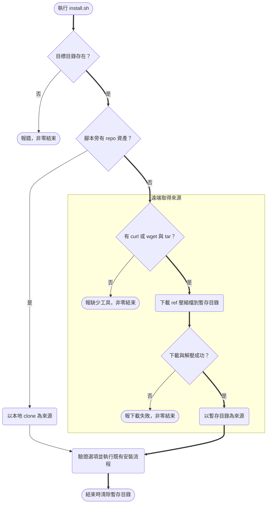

# Design

## Context

- `install.sh` 開頭依 `$0` 解析符號連結，求出 `REPO_DIR`，後續所有複製來源（`.claude/skills/`、`.claude/commands/`、`linear/`、`CLAUDE.md`、`agent-team/`、`install.deps`）都以 `REPO_DIR` 為根。
- 以 `curl … | sh -s -- <選項>` 執行時，`$0` 是 `sh`，`dirname` 得到 `.`，`REPO_DIR` 會變成使用者當下的 `$PWD`——現況下腳本會把目標專案誤當成來源，接著因找不到 skill 而報「未知的安裝選項」。
- repo 為公開 GitHub repo `StevenShih-0402/littleduck-skills`，預設分支 `main`；GitHub 提供不需驗證的壓縮檔下載（`codeload.github.com/<owner>/<repo>/tar.gz/<ref>`，分支與 tag 皆可）。
- 腳本以 POSIX `sh` 撰寫，前一次變更以 dash 驗證過，本次延續。

## Goals / Non-Goals

**Goals:**
- 同一支 `install.sh` 同時支援本地 clone 與遠端 pipe 兩種入口，安裝邏輯只有一份。
- 遠端模式不在使用者機器留下任何東西（除了安裝結果本身）。
- 不需要的網路請求一律不發：目標目錄不存在時在下載前就結束。缺選項、`--help`、`--list` 須列出可選清單（既有 spec「Selection argument is required and validated」），清單取自 repo 內容，遠端模式下只能先下載再列出。

**Non-Goals:**
- 不提供 Windows PowerShell 版一行安裝（`irm … | iex`）；Windows 使用者走 WSL / Git Bash。
- 不支援 fork 或私有 repo 的下載來源設定（不加 `LITTLEDUCK_REPO` 之類變數）。
- 不做下載內容的簽章／checksum 驗證，信任 GitHub HTTPS。
- 遠端模式不提供 tab 補齊（補齊腳本需要本地檔案）。
- 不發版號、不建 GitHub Release；`LITTLEDUCK_REF` 可指向未來的 tag，但本次不建立 tag。

## Decisions

### D1 流程：先做便宜的檢查，再決定來源

- 「目標目錄存在？」只在第一參數是安裝選項時檢查；缺選項、`--help`、`--list` 不帶目標，直接往下取得來源。
- 「腳本旁有 repo 資產」＝`REPO_DIR` 下同時存在 `install.deps` 與 `.claude/skills/` 目錄。只看其一容易誤判（目標專案本身可能就有 `.claude/skills/`）。
- 選項名稱是否合法（`is_skill`）、缺選項與 `--help` 的用法（含可選清單）、`--list` 都需要 repo 內容，所以排在取得來源之後；遠端模式下會先下載再列出。
- 失敗出口（缺工具、下載失敗、選項不合法）都發生在任何寫入目標之前，滿足「失敗不改動目標」。
- 依據：`install.sh`

**替代方案**：另寫一支輕量 `get.sh` 專門下載再呼叫 `install.sh`。捨棄，因為使用者要記兩個 URL，且 `install.sh` 被直接 pipe 時仍會壞掉，問題沒有消失。

### D2 下載方式：壓縮檔而非 `git clone`

- 使用 `https://codeload.github.com/StevenShih-0402/littleduck-skills/tar.gz/${LITTLEDUCK_REF:-main}`；`curl -fsSL` 優先，否則 `wget -qO-`，輸出直接 pipe 給 `tar -xzf - -C "$tmp"`。
- 解壓後的頂層目錄名為 `littleduck-skills-<ref>`（ref 中的 `/` 會被 GitHub 換成 `-`），因此不猜目錄名，改取 `$tmp` 下唯一的子目錄作為 `REPO_DIR`。
- pipe 中 `curl` 失敗不會反映在 `tar` 的退出碼上（POSIX sh 沒有 `pipefail`），所以先下載到 `$tmp/src.tar.gz` 再解壓，兩步各自檢查退出碼。
- **替代方案** `git clone --depth 1 --branch <ref>`：多一個 `git` 相依、會下載 `.git` 物件，且安裝不需要歷史，故捨棄。

### D3 暫存目錄與清理

- 先設 trap 再 `mktemp -d`，避免兩者之間被中斷而留下目錄；清理函式在 `TMP_DIR` 為空時不動作。
- `EXIT` trap 負責正常與 `exit` 結束；被訊號終止時 `EXIT` trap 不會執行，所以另對 `HUP`（關閉終端機）、`INT`、`PIPE`（輸出被 `head` 等提前關閉）、`TERM` 設 trap，清理後以 `128+訊號值` 結束。
- 本地模式不建立暫存目錄、不設清理 trap。既有 `install_kit` 的 `mktemp` 檔案維持原樣。

### D4 輸出與用法訊息

- 開頭摘要的「來源 repo」在遠端模式顯示 `github.com/StevenShih-0402/littleduck-skills@<ref>`，滿足 spec「印出來源與版本」。
- `usage` 目前印 `$0`，遠端模式下會是 `sh`；改為遠端時印出一行安裝指令的格式（`curl -fsSL <url> | sh -s -- <選項> [目標專案路徑]`），本地時維持 `$0`。
- 本地模式下「目標與來源相同」的檢查保留；遠端模式下來源是暫存目錄，不會撞到。

### D5 驗證方式

repo 沒有測試框架，延續前一次變更的作法：以 dash 對 scratchpad 目標實跑，以 `diff -r` 比對「遠端 `all`」與「本地 `all`」的安裝結果。

- 模擬 pipe：在空的 scratchpad 目錄執行 `sh -s -- all < install.sh`，使 `$0` 成為 `sh`。資產取自 GitHub 上的 `main`，與工作樹中被 pipe 的新版腳本無關，因此合併前就能驗證。
- 失敗路徑：`LITTLEDUCK_REF=no-such-branch` 驗證下載失敗；以只含 `sh`、`tar` 等必要指令、不含 `curl`/`wget` 的 `PATH` 驗證缺工具。兩者都以 `find <目標>` 確認目標沒有任何新檔案。
- 清理：執行前後比對 `$TMPDIR` 下 `tmp.*` 目錄的清單，確認沒有殘留。

## Risks / Trade-offs

- [`curl | sh` 會直接執行網路上的腳本] → README 同時提供「先下載、檢視、再執行」的兩步寫法，並寫上用 `LITTLEDUCK_REF` 固定版本。
- [誤判本地／遠端：使用者在某個剛好有 `install.deps` 與 `.claude/skills/` 的目錄執行 pipe] → 只有本 repo 的 clone 會同時有這兩者；此時走本地模式，等同從該 clone 安裝，且會被「目標與來源相同」檢查擋下，不會造成破壞。
- [GitHub 速率限制或公司網路擋 `codeload.github.com`] → 下載失敗時的錯誤訊息附上本地 clone 的替代用法。
- [遠端模式每次都下載整個 repo] → repo 目前很小（純文字），可接受。

## Migration Plan

純新增入口，舊用法不變，無需遷移。合併到 `main` 後 README 中的一行指令即可生效；若要回滾，revert 這次的 commit 即可，已安裝到其他專案的檔案不受影響。
