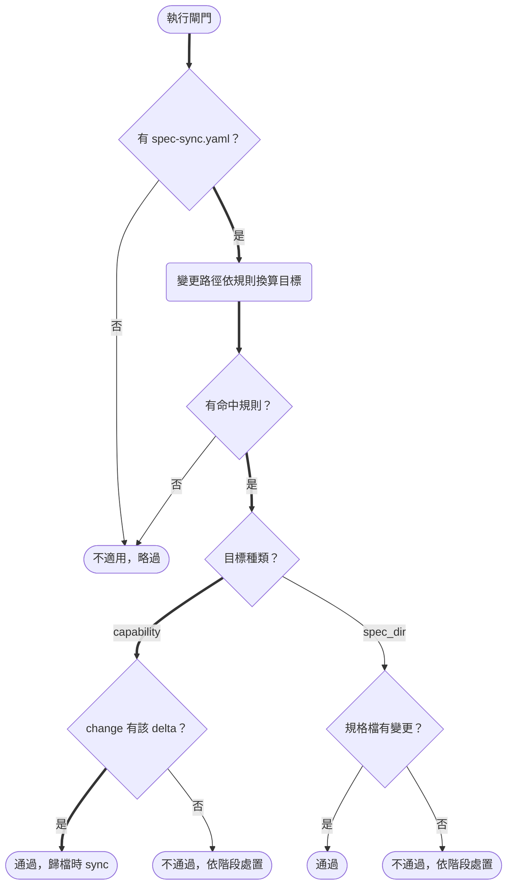
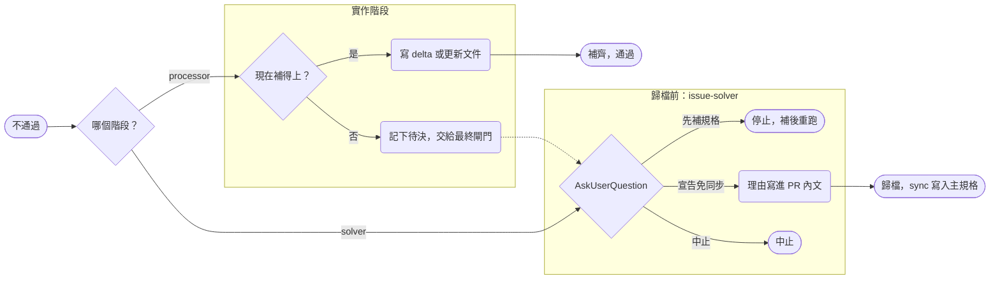
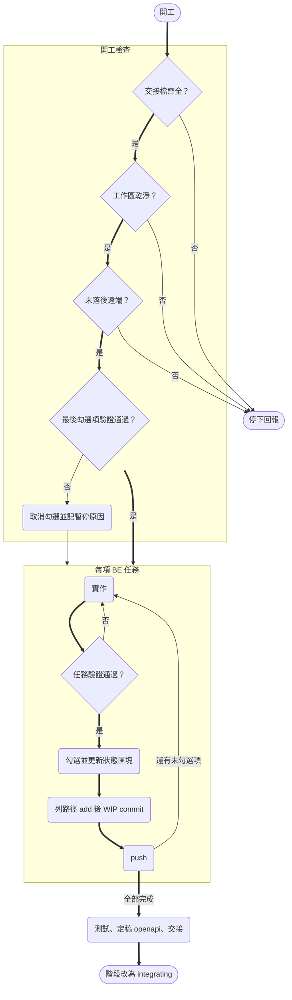

# Design

## Context

- issue-* 三份 skill 與 `linear/` 模板是從使用中的專案搬回來的，專案專屬的部分只做了字面替換（`IGN-` → `SDP-`），`issue-processor` 的「實作期間的規範」整段換成了另一個專案（Ollama CLI）的內容。改動範圍清單見 proposal.md「Impact」。
- `install.sh` 以 `.claude/skills/<名稱>/` 整個目錄為安裝單位，相依由 `install.deps` 的 `skill:` / `commands:` / `dir:` 宣告；`dir:` 會把 repo 根目錄的同名目錄複製到目標根目錄（`linear/` 是現成的例子）。新 skill 不需改 `install.sh`，可選項與補齊會自動出現。
- `agent-team` 以「不存在才建立」的方式 scaffold 到 team-hq；後端 repo 的 skill 則要另外以一般選項安裝到後端 repo（`multi-agent-workflow.md` 已這樣描述，但 littleduck 沒有提供 `backend-processor`）。
- 來源專案的實作有兩處與技術棧綁死：測試／lint／schema 產生指令（docker compose、pants、drf-spectacular），以及四種規格同步檢查寫死的路徑換算規則。這兩處是本次通用化的主要工作。

## Goals / Non-Goals

**Goals:**

- 裝到任何專案都不會出現其他專案的名稱、路徑、issue 前綴或技術棧指令。
- 規格同步閘門由專案自行宣告規則，skill 只保留流程；沒有宣告就完全不介入。
- `backend-processor` 可中斷後接續，且進度只看檔案（`handoff.md` 狀態區塊 + `tasks.md` 勾選 + git 狀態），不依賴對話記憶。

**Non-Goals:**

- 不提供 `frontend-processor`；前端流程待有實際來源再收錄。
- 不收錄推送規格到 Linear Document 的腳本（模組與文件標題的對照必定是專案專屬）。
- 不收錄 `forbid-structural-tests` pre-commit hook：installer 無法安全合併目標專案的 `.pre-commit-config.yaml`，留待另案。
- installer 不修改目標專案的 `.claude/settings.json`；hook 的註冊由使用者在 agent 定義或專案設定中自行加入。
- lint hook 只處理 `.py` 檔。

## Decisions

### D1 issue 代號以通用樣式辨識

issue-* 以 `[A-Z][A-Z0-9]*-\d+` 辨識 Linear identifier，範例統一用 `ENG-123`（與 `agent-team` 現有範例一致）。

- 替代方案：在設定檔宣告 team prefix。否決——Linear 的 identifier 格式本身就足以辨識，多一份設定只增加安裝負擔；同一 workspace 有多個 team 時也不需要列舉。

### D2 issue-processor 的實作規範改為「引用專案文件」

「實作期間的規範」只保留跨專案成立的條目：只對變更檔案跑 lint／format、做不到的任務就地註記 env-blocked、註解語言、版本號單一來源與同步規則、外部服務未就緒時不代為啟動或處理憑證。測試、lint 的實際指令與環境限制一律寫「依專案 `CLAUDE.md` 與 `design.md`」；專案 `CLAUDE.md` 沒寫測試指令時，以 AskUserQuestion 詢問，不自行猜測。

破壞性變更守門直接引用通用 `CLAUDE.md`「API 相容性」的判準，不在 skill 內重抄專案特有的權限登錄檔或 Swagger 細節。

### D3 規格同步閘門：偵測漏寫，寫入交給 sync

閘門只負責「改了程式卻沒寫規格」的偵測；OpenSpec 格式的規格由 `/opsx:archive`（內含 sync）把 delta 寫進主規格，閘門不重做這件事。設定檔位置固定為 `openspec/spec-sync.yaml`，每條規則二選一的目標：

```yaml
rules:
  - name: 帳務模組                 # 顯示在問答與 PR 內文的名稱
    paths: ["src/apps/{app}/**"]    # glob，可用 {名稱} 擷取路徑片段
    exclude: ["**/__init__.py"]
    capability: "apps/{app}"        # OpenSpec capability：change 內有它的 delta 即通過
    exempt_when: 註解、型別標註、不改行為的內部重構

  - name: 部署規格
    paths: ["projects/{proj}/compose/**"]
    spec_dir: "projects/{proj}/docs/specs/compose_{proj}/"   # 自由格式文件：檢查檔案本身
    spec_files: ["spec.md", "diagrams.md"]
    exempt_when: 只改註解、不改行為的腳本內部重構
```

判定：



不通過時依階段處置：



- 變更路徑 = `git diff --name-only $(git merge-base HEAD origin/<預設分支>)` 加未追蹤檔，含刪除與更名。
- `capability` 目標看 `openspec/changes/<change>/specs/<capability>/spec.md` 是否存在；直接改主規格**不算**（會被下次 archive 的 sync 結果蓋掉，也繞過了 delta 審查）。
- `spec_dir` 目標看 `spec_files` 是否出現在變更路徑；`openspec/changes/` 內的 delta 不算；資料夾不存在視為不通過。
- 只檢查「有沒有寫」，內容正確性交給 PR 審查。
- 實作階段的「現在補得上？」：`issue-processor` 以 AskUserQuestion 問 user（選「留給 issue-solver 決定」即走待決）；`backend-processor` 由 Agent 依 `exempt_when` 自行判斷，屬免同步情形就在 `handoff.md` 寫聲明（即待決），否則在同一項任務內補上。
- 檢查前移到實作階段，是因為 delta 必須在歸檔前寫好；`issue-solver` 仍保留為最終閘門，免同步只在這裡宣告（`backend-processor` 的 handoff 聲明會在最終閘門被列為免同步理由）。

替代方案：

- 每種規則各寫一段 skill 文字（來源專案的做法）。否決——四段流程一模一樣，只差換算規則，規則才是專案專屬的部分。
- 直接以 `/opsx:sync` 取代閘門。否決——sync 只合併「已存在的 delta」，漏寫 delta 時它看到的是「沒有東西要同步」並直接通過；也無法寫入 `diagrams.md` 這類非 requirement 格式的文件。兩者分工：閘門偵測漏寫，sync 負責寫入。
- 用 Python 腳本實作檢查。否決——本 repo 的 skill 都是純文字流程、不依賴特定 runtime，glob 換算由 Agent 依文字規則執行即可；路徑量小，不需要腳本。

設定檔格式說明與範例放在 repo 根目錄 `spec-sync/`（`README.md`、`spec-sync.example.yaml`），以 `dir:spec-sync` 讓 `issue-solver` 與 `backend-processor` 共用，不在兩份 SKILL.md 各抄一次格式。

### D4 backend-processor：進度只存在檔案裡



- 只有 ahead（已 commit 未 push）時先 push 再繼續；behind 或 diverged 才停。
- 工作區不乾淨時列出檔案並標出 migration 檔，不 stash、不還原、不自行提交。
- 所有 `[BE]` 已勾選但階段不是 `integrating`：視為中斷在收尾，從 Finalize 接續。
- 測試、lint、schema 產生、migration 正反向的實際指令全部引用專案 `CLAUDE.md`；沒寫就停下詢問。
- 不開 PR、不歸檔、不改 `proposal.md`、不 force push、不 `--no-verify`、不 `git add -A`。

替代方案：以 `.linear.md` 的 `stage` 記錄細粒度進度。否決——`stage` 是三段式 skill 共用的粗粒度欄位，塞入任務層級資訊會讓舊流程誤判；狀態區塊只屬於多 Agent 流程。

### D5 handoff 狀態區塊格式

`handoff-template.md` 在既有的追加式紀錄之上加一個**就地改值**的區塊：

```markdown
## 狀態

- **階段**：proposal | backend | frontend | integrating | archived
- **最後完成**：<任務編號 摘要>
- **下一步**：<任務編號或等待誰>
- **暫停原因**：無
- **更新**：<名稱> — <YYYY-MM-DD HH:MM>
```

狀態區塊不寫 commit SHA，改以 `git log --grep "wip(<ISSUE-ID>): <任務編號>"` 對應，避免每次 commit 後還要再改一次檔案。

### D6 lint hook 隨 skill 發佈、由使用者註冊

腳本放在 `.claude/skills/backend-processor/hooks/post-edit-lint.sh`，安裝 skill 即一併取得。註冊方式在 `chika.md` 範本的 frontmatter `hooks`（PostToolUse、matcher `Write|Edit`）以 `<backend-repo>` 佔位寫出，使用者也可改放專案 `.claude/settings.json`。

lint 指令決定順序：

1. 環境變數 `LITTLEDUCK_LINT_CMD`（例：`./pants lint`、`uv run ruff check`），檔案路徑附在最後；
2. repo 根目錄有可執行的 `./pants` → `./pants lint`；
3. `pyproject.toml` 有 `[tool.ruff]`、有 `uv`，且 `uv run ruff --version` 跑得起來 → `uv run ruff check`（只看設定檔會在專案環境沒裝 ruff 時每次編輯都失敗）；
4. 都沒有 → 直接 exit 0。

hook JSON 有 `jq` 時用 `jq` 解析，沒有就用 `python3`（實作時發現開發機未必裝 `jq`）。只跑 lint、不跑 format 或 fix（會改檔、可能越界）；失敗以 exit 2 把最後 40 行輸出回饋給 Agent。路徑符合 `models.py` 或 `models/` 時印出 migration 提醒，不影響退出碼。

替代方案：installer 自動合併 `settings.json`。否決——POSIX sh 沒有可靠的 JSON 合併工具，覆寫使用者設定風險高。

## Risks / Trade-offs

- [Agent 依文字規則做 glob 換算可能出錯] → 規則保持簡單（只支援 `**`、`*` 與 `{名稱}` 擷取），範例涵蓋單一擷取與多規格資料夾兩種情形；收尾報告列出每條規則的命中路徑，讓 user 能目視核對。
- [`[A-Z][A-Z0-9]*-\d+` 可能誤抓非 issue 字串（例：`UTF-8`）] → 只從呼叫參數擷取，且數字部分必須存在；誤抓時 Linear 查無此 issue 會直接中止。
- [已安裝舊版 team-hq 的使用者拿不到新 `handoff-template.md`，`backend-processor` 會因缺狀態區塊停下] → skill 的停止訊息直接提示「依新版 `handoff-template.md` 補上 `## 狀態`」，README 的 agent-team 段落也註明。
- [lint 自動偵測選錯工具] → 以 `LITTLEDUCK_LINT_CMD` 明確覆寫；偵測不到就不跑，不會阻擋編輯。

## Migration Plan

- 已安裝 issue-* 的專案重跑 `install.sh issue-reader`（或 `all`）即就地更新；若該專案的 Linear 前綴不是 `SDP-`，原本已無法辨識 issue，更新後才恢復正常。
- 需要規格同步閘門的專案，參考 `spec-sync/spec-sync.example.yaml` 建立 `openspec/spec-sync.yaml`；不建立則行為與更新前相同。
- 回復：重跑 installer 時以 `LITTLEDUCK_REF` 指定本變更之前的 commit。
