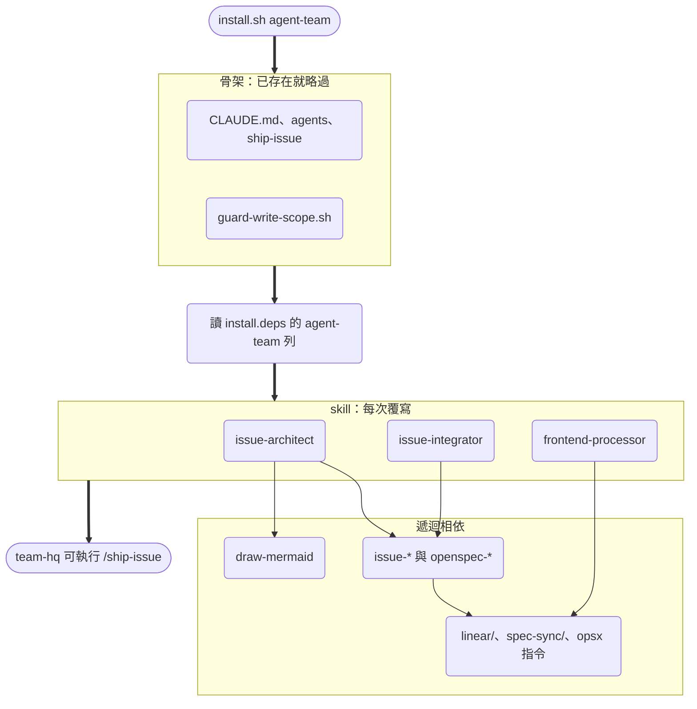
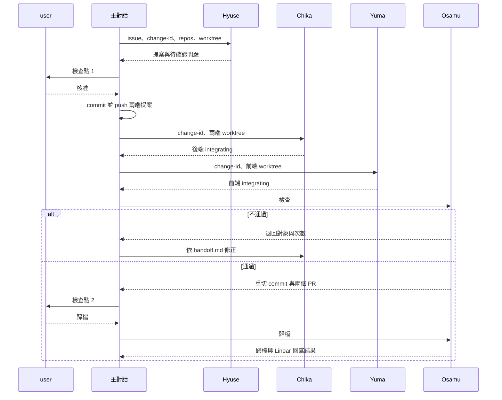

# Design

## Context

- 來源：
  - `ignsw_agents_team/.claude/skills/issue-architect`、`issue-integrator`
  - `ignsw_agents_team/.claude/hooks/guard_write_scope.sh`
  - `IngenuityOA_Frontend/.claude/skills/frontend-processor` 與 `.claude/hooks/post_edit_lint.sh`
- 來源檔綁死在 ignsw 專案上，主要有這幾類：
  - 絕對路徑與 issue 前綴：`/home/steven-shih/...`、`IGN-`、change-id 格式 `ign-<n>-<code>`。
  - 技術棧指令：docker compose 一次性容器跑 pytest、`./pants`、drf-spectacular、`openapi-typescript-codegen`、MSW。
  - 後端三個 OpenSpec 根目錄（`spec_root`）與四種寫死的規格同步檢查。
  - Linear Document 推送。
  - 「做法照舊 skill（後端 repo 的 `issue-reader` 等）的對應步驟」這種跨 repo 引用。
- 來源的 `frontend-processor` 比 `yuma.md` 舊：skill 寫「不 commit、不 push」，`yuma.md` 卻要求每項任務 WIP commit 並 push。littleduck 的 `backend-processor` 已採用 WIP commit 加接續模式，前端版本跟著它走。
- littleduck 的 `handoff-template.md` 階段只有五個值（`proposal | backend | frontend | integrating | archived`）。來源多了 `approved`、`ready-to-archive`，`/ship-issue` 也有對應的接續推導。
- littleduck 的 `ship-issue.md` 沒有在核准時提交提案。`backend-processor` 開工時會檢查 `git status --porcelain`，所以提案若還是未追蹤檔，Chika 第一次開工就會停下。這是現有範本的缺口。

## Goals / Non-Goals

**Goals:**

- `install.sh agent-team` 裝完後，team-hq 內 Hyuse、Yuma、Osamu 叫得到自己的 skill 與 hook，不必再從其他專案複製。
- 三個 skill 不含任何專案名稱、絕對路徑、issue 前綴或技術棧指令。指令一律引用各 repo 的 `CLAUDE.md` 與本 change 的 `design.md`。
- 規格同步沿用既有的 `spec-sync` 閘門，不另寫專案專屬檢查。

**Non-Goals:**

- 不移植來源 `/ship-issue` 的完整接續推導（`approved`、`ready-to-archive` 兩個階段與舊流程衝突偵測），沿用五個階段值。要做接續偵測另開 change。
- 不收錄後端多 OpenSpec 根目錄（`spec_root`）分流與 Linear Document 推送，兩者都是專案專屬。
- 不把 `backend-processor` 改裝到 team-hq：它的 lint hook 與 Chika 定義都以後端 repo 路徑註冊，維持「另外裝到後端 repo」。
- 不開放前後端平行派工（來源也還停在「先依序跑」）。

## Decisions

### D1 三個 skill 放在 `.claude/skills/`，跟其他 skill 一樣可單獨安裝

和 `backend-processor` 一樣，三個 skill 放在本 repo 的 `.claude/skills/`。這樣它們會：

- 自動出現在 `install.sh --list` 與 tab 補齊中；
- 被 `all` 一併安裝；
- 可單獨裝到其他位置，例如 `install.sh frontend-processor <frontend-repo>`。

替代方案是放進 `agent-team/` 骨架，用 scaffold 安裝。不採用，因為 scaffold 遇到既有檔案就略過，skill 改版後已安裝的 team-hq 拿不到更新，而 skill 是「怎麼做」，應該跟著本 repo 更新。

### D2 `agent-team` = 骨架（不覆寫）＋ skill（覆寫更新）

`install.deps` 新增一列 `agent-team: skill:issue-architect skill:issue-integrator skill:frontend-processor`。`install.sh` 的 `agent-team` 分支先跑 `install_kit`，再把這一列的 skill 交給既有的 `install_selected` 展開相依並同步。skill 清單只寫在 `install.deps` 一處。

| skill | 相依 | 理由 |
|------|------|------|
| `issue-architect` | `skill:issue-reader`、`skill:draw-mermaid` | Linear 讀取、格式檢查、回填的細節「照 issue-reader 對應步驟」；design.md 的 UML 依 draw-mermaid 畫 |
| `issue-integrator` | `skill:issue-reader` | 重切 commit、開 PR、Linear 回寫照 `issue-solver`／`issue-processor` 的對應步驟；歸檔用 `openspec-archive-change` |
| `frontend-processor` | `dir:spec-sync` | 與 `backend-processor` 相同，實作中跑規格同步閘門 |

`issue-reader` 會遞迴帶入 `issue-processor`、`issue-solver`、全部 `openspec-*`、`opsx` 指令、`linear/`、`spec-sync/`。來源的 team-hq 本來就裝了這些 skill，所以這樣做和實際使用一致。

`agent-team` 不建立通用 `CLAUDE.md`：骨架自帶 team-hq 版的 `CLAUDE.md`，維持既有行為。

### D3 Yuma 從 team-hq 讀 `frontend-processor`

來源把 `frontend-processor` 放在前端 repo。這次依 user 要求改成隨 agent-team 裝進 team-hq：

- `yuma.md` 指向 team-hq 的 `.claude/skills/frontend-processor/SKILL.md`。
- lint hook 以 `"$CLAUDE_PROJECT_DIR"/.claude/skills/frontend-processor/hooks/post-edit-lint.sh` 註冊。team-hq 是啟動目錄，路徑固定，不需要佔位。
- 想在前端 repo 單獨使用時，仍可 `install.sh frontend-processor <frontend-repo>`。

Chika 維持現狀（skill 與 hook 在後端 repo），兩邊不對稱，在 `multi-agent-workflow.md` 說明原因。

### D4 `frontend-processor` 對齊 `backend-processor`

| 項目 | 做法 |
|------|------|
| 進度依據 | `handoff.md` 狀態區塊；開工檢查與接續同 backend（未提交修改即停、behind／diverged 即停、只 ahead 先 push、重跑最後一項已勾任務的驗證） |
| 每項任務 | 驗證 → 勾選 → 更新狀態區塊 → 列路徑 `git add` → `wip(<ISSUE-ID>): <編號> <摘要>` → push |
| 型別與 mock | 後端未定稿時依 `openapi.yaml` 先產型別與 mock。產生器與 mock 機制依前端 `CLAUDE.md`；**不得**拿只含本次端點的 `openapi.yaml` 覆蓋整個既有產出目錄，要產到暫存目錄後只搬本次的部分（來源踩過的坑，保留為通用規則） |
| 定稿判斷 | `handoff.md` 已有 backend 節，即視為 `openapi.yaml` 已定稿；之後若內容有變，回頭同步型別與 mock |
| 指令 | lint、typecheck、test 依前端 `CLAUDE.md`／`design.md`，兩者都沒寫就停下回報（subagent 不能問 user） |
| 不改 | `proposal.md`、`openapi.yaml` |
| 收尾 | 追加 frontend 節，階段改 `integrating`，下一步「等待 integrator 檢查」 |

### D5 前端 lint hook 的偵測順序

只處理 `.ts .tsx .js .jsx .mjs .cjs .vue` 單一檔案。lint 指令依序決定：

1. 環境變數 `LITTLEDUCK_FE_LINT_CMD`（附上檔案路徑）。和後端的 `LITTLEDUCK_LINT_CMD` 分開命名，因為兩支 hook 可能在同一個 team-hq session 的環境變數下執行。
2. repo 根目錄有 eslint 設定檔（`eslint.config.*` 或 `.eslintrc*`），且 `node_modules/.bin/eslint` 存在，就跑 `npx --no-install eslint`。
3. 以上都沒有就不處理。

失敗時 exit 2，回饋輸出末 40 行。不跑 typecheck（太慢，留給完成定義），也不跑 `--fix`。解析 hook JSON 時有 `jq` 就用 `jq`，沒有就用 `python3`，與後端 hook 一致。

### D6 寫入範圍 hook 放在骨架

`guard-write-scope.sh <hyuse|osamu>` 同時服務兩個角色，不屬於任何一個 skill，所以放在 `agent-team/.claude/hooks/`，由 `hyuse.md`、`osamu.md` 的 PreToolUse（`Write|Edit`）以 `"$CLAUDE_PROJECT_DIR"/.claude/hooks/guard-write-scope.sh` 註冊。

| 角色 | 放行 |
|------|------|
| hyuse | 路徑含 `/openspec/` |
| osamu | `openspec/changes/<id>/` 或 `openspec/changes/archive/<id>/` 下的 `handoff.md`、`.linear.md`；`openspec/specs/**` |

- 路徑先正規化（`realpath -m`，沒有時用 `python3` 的 `os.path.normpath`），避免以 `../` 繞過。
- 未知角色一律拒絕（exit 2）。
- 管不到 Bash 寫檔，由角色定義明文禁止（來源也是同樣的已知缺口）。

缺點：放在骨架代表改版不會自動更新已安裝的 team-hq，和其他骨架檔相同，README 已說明重取方式。

### D7 交接介面與階段值

- change-id 一律**全小寫**，以 Linear issue 代號開頭（例：`eng-123-order-export`）。已實測 OpenSpec 1.14.1 的 `openspec new change ENG-123-order-export` 會回報 `Change name must be lowercase`，所以現有 `agent-team/CLAUDE.md`、`multi-agent-workflow.md`、`backend-processor` 的大寫範例都建不起來，這次一併修正。
- 分支保留大寫 ISSUE-ID（`<label>/<ISSUE-ID>-<code>`），Linear automation 靠分支名辨識 issue。
- ISSUE-ID 的來源：有 `.linear.md` 就取 `primary_issue`；沒有時，從 change-id 開頭擷取 `[a-z][a-z0-9]*-\d+` 並轉成大寫。
- `.linear.md` 沿用 `issue-reader` 的欄位，另加 `repos:`（`backend, frontend` 或其一）。不收錄 `spec_root`。
- 狀態區塊階段沿用五個值，各角色的寫法如下：

| 時機 | 寫入者 | 階段 | 下一步 |
|------|--------|------|--------|
| 提案完成 | Hyuse | `proposal` | 等待檢查點 1 核准 |
| 核准並提交提案 | 主對話 | `proposal` | 開始實作 |
| 實作中 | Chika／Yuma | `backend`／`frontend` | 第一個未勾任務 |
| 實作完成 | Chika／Yuma | `integrating` | 等待 integrator 檢查 |
| 退回 | Osamu | `backend`／`frontend`（退回 Hyuse 時為 `proposal`） | 要修的內容 |
| 檢查通過、PR 已開 | Osamu | `integrating` | 等待 user 回覆歸檔 |
| 歸檔完成 | Osamu | `archived` | 無 |

退回的對象可能是 Chika、Yuma 或 Hyuse，圖中以 Chika 為例。

### D8 `issue-integrator` 的通用化

| 來源做法 | 通用版 |
|----------|--------|
| docker compose、pants、npm 的固定指令 | 依各 repo 的 `CLAUDE.md`／`design.md`；沒寫就停下回報 |
| 四種寫死的規格同步檢查 | 各 repo 有 `openspec/spec-sync.yaml` 時依 `spec-sync/README.md` 判定。未通過的目標有 `handoff.md` 免同步聲明就放行並列入報告，沒有就退回開發 Agent。免同步由 user 在檢查點 2 確認，對應 `issue-solver` 最終閘門的 AskUserQuestion |
| `spec_root` 分流歸檔 | 移除，兩端一律在 worktree 根目錄歸檔 |
| 後端 base `main`、前端 base `dev` | 由主對話依 team-hq `CLAUDE.md` 的「主幹」欄傳入 |
| Linear Document 推送 | 移除 |
| 退回上限 | 沿用 littleduck 範本「同一階段最多退回 2 次，第 3 次停下」 |

重切 commit 的安全網沿用來源：

1. 記下 `OLD` 與 merge-base；
2. `reset --soft` 到 merge-base 後重新依功能分批 commit；
3. `git diff $OLD HEAD` 必須為空，否則還原；
4. 以 `--force-with-lease=<branch>:$OLD` 推送，被拒就停下，不改用 `--force`。

這是整個流程唯一允許改寫已推送歷史的地方。

### D9 `/ship-issue` 補上參數與提交提案

`ship-issue.md` 改成逐步列出每一棒的參數：

| 對象 | 參數 |
|------|------|
| Hyuse | 主 issue、sub-issue、code、label、分支名、change-id、repos、兩端 worktree |
| Chika、Yuma | change-id、worktree 路徑；接續時另加「接續模式」 |
| Osamu | change-id、兩端 worktree、兩端主幹、「檢查」或「歸檔」 |

另外加上兩條規則：

- 檢查點 1 核准時，主對話在每一端只 `git add openspec/changes/<change-id>`，以 `wip(<ISSUE-ID>): 提案核准` commit 並 `git push -u`。這樣開發 Agent 開工時 worktree 是乾淨的。
- 主 issue 的判定、code 與 repos 由主對話先問完 user 再派工，因為 subagent 不能問 user。

## Risks / Trade-offs

- **team-hq 裝了整套 issue-* skill**：team-hq 的 session 也能叫 `/issue-reader` 等舊流程，可能被誤用。不過來源 team-hq 本來就這樣，且 `agent-team/CLAUDE.md` 會說明新舊流程的選用時機。
- **guard hook 管不到 Bash**：Hyuse 和 Osamu 都有 Bash，只能靠定義檔明文禁止。
- **骨架不覆寫**：已安裝的 team-hq 不會自動拿到新版 `hyuse.md` 等檔案。README 已有說明，這次在變更說明中再點名一次。
- **frontend 與 backend 安裝位置不對稱**：使用者可能以為 Chika 的 skill 也在 team-hq。在 `agent-team/CLAUDE.md` 與 `multi-agent-workflow.md` 明確寫出。

## Migration Plan

已用舊骨架建立 team-hq 的使用者：

1. 移除或改名 `.claude/agents/{hyuse,yuma,osamu}.md` 與 `.claude/commands/ship-issue.md`。
2. 重跑 `install.sh agent-team <team-hq>`，就會拿到新版定義、`guard-write-scope.sh` 與三個 skill。
3. 若曾從其他專案手動複製 `frontend-processor` 到前端 repo，可保留或移除，Yuma 改讀 team-hq 的版本。
