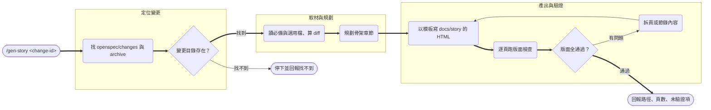

# Design

## Context

既有的 `gen-story`（`~/tao_rui_projects/ignsw_agents_team/.claude/skills/gen-story/`）流程本身已穩定：`/gen-story <change-id>` → 定位變更目錄 → 讀材料與 diff → 規劃章節 → 以模板寫 HTML → 版面檢查 → 回報。問題全在**耦合**：變更目錄探索寫死 `~/tao_rui_projects/ignsw_fullstack` 與多 repo／worktree、base 分支寫死 `main`／`dev`、對話角色寫死五角、輸出到 team-hq、`check_layout.mjs` 的 playwright 載入路徑寫死前端 repo。本設計保留流程骨架，只替換這些耦合點。動機見 proposal.md「Why」，需求契約見 `specs/gen-story-skill/spec.md`。

### 執行流程（通用版）

依據：`~/tao_rui_projects/ignsw_agents_team/.claude/skills/gen-story/SKILL.md`（步驟 1–6）。選用檔指 `handoff.md`／`review.md`／`.linear.md`／`openapi.yaml`；base 分支由 git 偵測。

## Goals / Non-Goals

**Goals:**
- 移植後的 skill 在任何使用 OpenSpec 的單一 repo 都能跑，無專案專屬寫死。
- 純 OpenSpec 專案（無 agent-team 產物）與 agent-team 專案都適用。
- 保留原流程的章節骨架、內容規則與版面檢查品質閘。

**Non-Goals:**
- 不支援原版的多 repo／worktree 同時導覽（通用版聚焦單一 repo 的單一變更）。
- 不改變章節骨架或投影片視覺設計。
- 不自動安裝 playwright，也不自動 commit／發布。

## Decisions

### 決策 1：變更目錄探索改為當前 repo 的 OpenSpec 慣例路徑
依序找 `openspec/changes/<change-id>/`、再找歸檔 `openspec/changes/archive/*-<change-id>/`，相對於當前工作目錄。移除 `ROOT=~/tao_rui_projects/...` 與多 repo／worktree 迴圈。
- **理由**：OpenSpec 專案的變更一律落在 `openspec/changes/`，這是跨專案不變的慣例。
- **替代方案**：讓使用者以參數傳入絕對路徑——否決，`/gen-story <change-id>` 的簡潔用法是原版重點，且 change-id 已足以定位。

### 決策 2：base 分支由 git 自動偵測
以 git 推導預設分支（如 `git symbolic-ref refs/remotes/origin/HEAD`，回退到當前分支的 upstream）來算 `git diff`，不寫死 `main`／`dev`。
- **理由**：通用版不知道專案用哪個分支名；寫死必然在某些專案錯。
- **替代方案**：固定假設 `main`——否決，前端常用 `dev`／`develop`，單一假設不通用。

### 決策 3：材料分「必備」與「選用」
`proposal.md`／`design.md`／`tasks.md` 必備；`handoff.md`／`review.md`／`.linear.md`／`openapi.yaml` 存在才讀，缺少不報錯。
- **理由**：後四者是 agent-team 流程的產物，純 OpenSpec 專案沒有；必備三者是 OpenSpec 標準產物。
- **替代方案**：全部視為必備——否決，會讓非 agent-team 專案直接失敗，違背「通用」目標。

### 決策 4：對話角色改為「專案相依、不強制」
`assets/story-template.html` 保留 agent-team 的角色樣式 class（`you`／`hyuse`／`chika`／`yuma`／`osamu`／`shiori`），但 `SKILL.md` 說明角色依專案而定，非 agent-team 專案可用旁白或單一敘事者。
- **理由**：本 repo 的 agent-team 正好用這五角，保留樣式可零成本相容；同時不逼迫其他專案套用不存在的角色。
- **替代方案**：移除所有角色樣式只留旁白——否決，會讓本 repo 自家的 agent-team 失去既有視覺；保留 class 不造成耦合（純 CSS，用不到就不套）。

### 決策 5：`check_layout.mjs` 的 playwright 載入可攜化
預設從當前專案 `node_modules` 解析 playwright，保留 `PLAYWRIGHT_FROM` 環境變數覆寫；移除寫死的前端 repo 路徑。
- **理由**：腳本需要 playwright 執行期；載入點必須隨專案而變。
- **替代方案**：改用 `npx playwright`——否決，draw-mermaid 已有「npx 首次下載會逾時」的前例，依賴既裝的 `node_modules` 較穩。

## Risks / Trade-offs

- **專案未安裝 playwright 時版面檢查無法執行** → `SKILL.md` 比照 `draw-mermaid` 標注為文件化的執行前置，並提供 `PLAYWRIGHT_FROM` 指向他處既裝版本；檢查步驟失敗時明確回報而非靜默跳過。
- **git 預設分支偵測在無 remote 或 detached HEAD 時可能失準** → 回退策略：偵測不到時改與當前分支 fork point 比較，並在回報中標明所用 base，讓使用者可核對。
- **保留五角色樣式 class 可能讓人誤以為必須用五角** → 由 `SKILL.md` 明文說明角色為選用、依專案而定來降低誤解。

## Migration Plan

全新新增，無既有使用者，無需遷移或回滾。移植後原專案版本不受影響（兩者各自獨立）。
