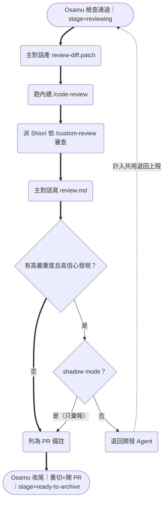
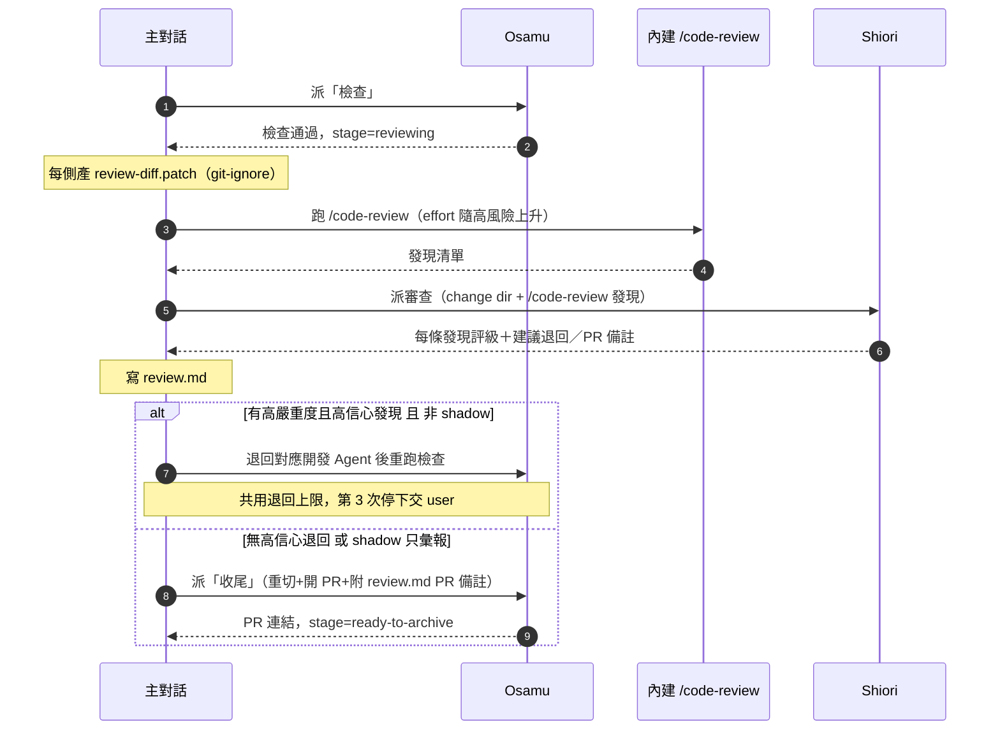

# Design

## Context

見 `proposal.md` — Why。現行 kit 的收尾順序是「Osamu 檢查通過 → 立刻重切 commit／開 PR →（user 核准）歸檔」，審查缺口全落在檢查點 2。參考實作 `ignsw_agents_team` 已把審查階段插在檢查與收尾之間，本設計把它通用化。關鍵約束：

- Shiori 只有 `Read, Grep, Glob`，**看不到 `git diff`**，所以 diff 要由主對話先寫成 `review-diff.patch` 餵進去。
- 內建 `/code-review` 是 Claude Code 指令，**不能被同名 skill 取代**（否則失去 effort／`--fix`／`ultra`）。
- subagent 不能再派 subagent、也不能問 user，所以 code-review 階段的編排（跑 `/code-review`、派 Shiori、寫 `review.md`、決定退回）**都在 `/ship-issue` 主對話**做。

## Goals / Non-Goals

**Goals:**
- 在檢查與收尾之間插入一個「審查」階段，重切／開 PR 延後到審查通過之後，使審查退回不必重切兩次。
- 審查規則依性質三分：機械性→linter、需判斷慣例→repo `CLAUDE.md`＋內建 `/code-review`、對照規格→`custom-review`。
- 退回計數與既有 Osamu 檢查**共用同一上限**，避免無限來回。

**Non-Goals（設計層邊界）：**
- 不實作 Anthropic Callout 的三項優化（題庫評分、誤報率統計、審核輪數啟發式）。
- 不碰 merge queue／feature flag／逐步上線（部署階段）。
- 安全審核、verify 跑起產品、風險分級人工審批留未來工作。

## Decisions

- **審查放在「檢查之後、收尾之前」，而非開 PR 之後。** 重切 commit 與開 PR 移到審查通過後；若放在開 PR 後才審，退回修改會讓已開的 PR 與重切結果作廢，得重來。替代方案（審查併進 Osamu 檢查同一棒）被否決：Osamu 有 `Bash`／寫入權限且帶著「機械檢查」的框架，無法扮演「不帶開發 context 的全新審查者」。
- **diff 以 `review-diff.patch` 落檔並 git-ignore。** 因 Shiori 唯讀且看不到 git diff。替代方案（給 Shiori `Bash`）會破壞「審查者不改動、不執行」的邊界。
- **`/code-review` 與 Shiori 分工。** 內建 `/code-review` 依 repo `CLAUDE.md` 的慣例審；Shiori 依 `/custom-review` 對照 OpenSpec 規格審需求／測試覆蓋，並替 `/code-review` 的每條發現評嚴重度／信心度。只有「高嚴重度且高信心」才退回。
- **退回上限共用。** code-review 的退回與 Osamu 檢查退回共用「同一目標最多 2 次、第 3 次停下交 user」，計數記在 `handoff.md`。
- **Shadow mode 先行。** 前 N 個 issue 只彙報不自動退回，於檢查點 2 讓 user 逐條判定，之後再切自動退回。

## 審查階段資料流

- 退回對象是 Osamu 檢查退回計數的**同一目標**：同一目標（chika／yuma）最多退 2 次，第 3 次停下交 user。
- `review-diff.patch` 每側一份、列入 `.gitignore`、不進 commit。
- 依據：`agent-team/.claude/commands/ship-issue.md`、`.claude/skills/custom-review/SKILL.md`、`.claude/skills/issue-integrator/SKILL.md`。

## /ship-issue 檢查到收尾時序

- shadow mode（前 N 個 issue）：即使有高嚴重度高信心發現也只彙報，於檢查點 2 交 user 判定；N 個後由 user 決定切自動退回。
- 依據：`agent-team/.claude/commands/ship-issue.md`。

## Risks / Trade-offs

- **審查增加 token 成本** → 小改動只跑 `/code-review` 不派 Shiori；effort 預設 medium，僅高風險升 high，禁用 max／ultra。
- **審查誤報造成來回** → 先跑 shadow mode 記誤報率，只有高嚴重度且高信心才退回，其餘列 PR 備註。
- **無限退回** → 與 Osamu 檢查共用退回上限 2 次，超過交 user。
- **同名 skill 覆蓋內建指令** → 明文禁止建立名為 `code-review` 的 skill；installer 與 spec 皆以此為驗收項。
- **對既有 4 角色專案的相容性** → 新增而非破壞；未裝 Shiori 時 code-review 步驟退化為只跑內建 `/code-review`，舊 handoff 階段值仍合法。

## Migration Plan

kit 檔案與 skill 皆為新增或向後相容的擴充；已安裝 4 角色的專案重跑 `install.sh agent-team` 會補上 `shiori.md`、`custom-review`、`review.md` 範本（既有自訂檔 skip-if-present），不需資料遷移。

## Open Questions

- Shadow mode 的 N 預設值（參考實作用 5）與高風險檔案樣式清單的通用預設，留實作時以可設定範例呈現；不影響規格與任務拆分。
