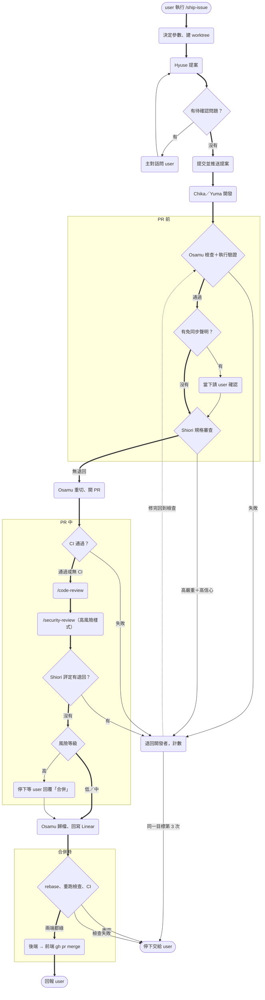
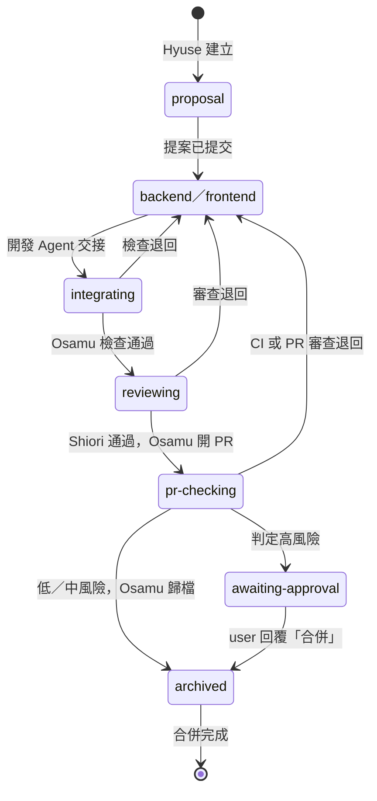

# Design

## Context

動機見 `proposal.md` — Why。現行 `/ship-issue`（add-reviewer-stage 之後）的順序是：

Hyuse 提案 → **檢查點 1** → Chika／Yuma → Osamu 檢查 → 5.5 審查（`/code-review` ＋ Shiori，shadow mode）→ Osamu 收尾開 PR → **檢查點 2** → Osamu 歸檔 → user 手動合併。

會限制做法的條件：

- **subagent 不能派 subagent，也不能問 user。** 所以編排、問 user、執行內建 `/code-review`／`/security-review` 都只能在主對話做。
- **Shiori 唯讀。** 看不到 git，diff 要由主對話寫成 `review-diff.patch`。
- **主對話的 cwd 是 team-hq。** 內建指令預設看的是 cwd 的 git 狀態，不是 worktree。`/code-review` 可以在目標文字寫 worktree 路徑與範圍；`/security-review` 能不能指定目標要實作時確認（見 Decisions 5）。
- **安裝時骨架檔已存在就略過**，角色 skill 則每次覆寫。新舊檔案可能混搭（見 Migration Plan）。

SDP-90 底下各 sub-issue 和本變更的對應：

| sub-issue | 原目標 | 本變更的處置 |
|-----------|--------|-------------|
| SDP-99 安全審核 | 高風險時跑 `/security-review` | 併入「PR 中：安全審核」 |
| SDP-100 PR 前實際跑起產品 | verify 類能力觀察產品 | 併入「PR 前：確保正常運行」的執行驗證；本次只做終端機層級（指令、HTTP），不做瀏覽器截圖 |
| SDP-101 風險分級人工審批 | 低／中／高 對應檢查點 2 的審批深度 | 併入「PR 中：按風險審批」。檢查點 2 已移除，改成只有高風險停下等「合併」；原本「兩位審批者」的語意在單人情境改成 user 核准一次 |

## Goals / Non-Goals

**Goals：**

- 一般 issue 從 `/ship-issue` 開始，中途不用 user 介入就合併完成。
- 每一道關卡都有明確的「失敗去哪」：退回開發者（計數）、停下問 user，或擋住合併。
- 審查輪數會收斂，不會無限來回。

**Non-Goals：**

- 不做瀏覽器自動化或截圖驗證（Osamu 沒有瀏覽器工具），只做終端機能觀察到的行為。
- 不設定 GitHub branch protection、CI workflow 或原生 merge queue。repo 沒有 CI 就記錄略過。
- 不自動刪分支與 worktree。

## 新流程總覽

- `ConfirmExempt` 若 user 不同意聲明，視同檢查失敗，退回開發者。
- `SecReview` 只有 diff 命中高風險檔案樣式時才跑，沒命中就記錄「不適用」直接到 `Rate`。
- 退回後的回合從 Osamu 檢查重來，但審查只看新改動（見 Decisions 8）。

依據：`agent-team/.claude/commands/ship-issue.md`、`.claude/skills/issue-integrator/SKILL.md`。

## handoff 狀態階段

- 移除 `ready-to-archive`。
- 合併完成後無法再 commit 到分支，所以分支上最後的階段是 `archived`；合併結果寫在 PR 與 Linear。
- 合併隊列失敗（rebase 衝突、rebase 後檢查或 CI 失敗）時不改階段，停下交給 user：change 已歸檔，開發 Agent 找不到 `openspec/changes/<change-id>/`，無法依交接檔接續。

## Decisions

1. **拿掉固定檢查點，改用「停下條件」清單。** 主對話只在這些情況停下：釐不清的問題、退回超過上限、rebase 衝突或其他 blocker、免同步聲明要確認、判定為高風險。
   - 替代方案：保留檢查點但預設自動通過。這樣等於沒有檢查點，還讓流程多一種模式，所以不採用。

2. **`/code-review` 從 PR 前移到 PR 中，Shiori 留在 PR 前。** 對應 Anthropic 的「PR 前用全新 agent 檢查代碼品質」與「PR 中 AI 審核」。Shiori 不帶開發上下文、對照規格審需求，符合前者。`/code-review` 依各 repo `CLAUDE.md` 審慣例與 bug，放在 PR 中。兩邊都跑會重複花 token（user 已選定此分工）。
   - 代價：`/code-review` 的退回發生在 PR 開好之後，修完要再重切一次。這可以接受，因為重切本來就從分支起點重做，PR 會隨 force push 更新。

3. **Shiori 分兩種模式。** 「審查模式」在 PR 前，輸入是規格與 patch。「評定模式」在 PR 中，輸入加上 `/code-review`、`/security-review` 的發現，只評嚴重度與信心度，不重新審一遍。評定沿用「只有高嚴重度且高信心才退回」，與 add-reviewer-stage 一致。
   - 替代方案：由主對話自己評定。主對話帶著整條流程的上下文，不是中立的評審，所以不採用。

4. **執行驗證的設定寫在各 repo `CLAUDE.md` 的「## 執行驗證」段。** 內容包括：啟動指令、就緒檢查、觀察點（指令＋預期結果，例：`curl -s localhost:8000/health` 回 200）、停止指令。Osamu 在檢查段的測試之後執行。沒寫這一段就記錄略過、不擋流程，避免沒設定的專案整條流程卡住。
   - 替代方案：寫在 `design.md`。每個 change 都要重寫一次，不合理；`design.md` 只用來補充本次變更特有的觀察點。

5. **`/security-review` 的執行方式（2026-11-08 依官方文件確認）。** 官方 commands 參考頁：`/security-review` 不接受參數，固定審查「目前分支 vs `origin` 預設分支」的 diff，以 cwd 為準；`-p` 模式能否執行，文件未明寫。因此：
   1. 主要：該端主幹等於 `origin` 預設分支（`git symbolic-ref refs/remotes/origin/HEAD`）時，主對話用 Bash 在 worktree 目錄以 `claude -p "/security-review"` 執行，讓 cwd 正確。
   2. 替代：主幹不是預設分支、指令失敗或沒有輸出時，不另外跑，以命中高風險時本來就用 `high` effort 跑的 `/code-review` 代替，`review.md` 註明「security-review 不可用，以 /code-review high 代替」。
   3. 想要能指定分支或 PR 的安全掃描，可另外安裝官方 Claude Security plugin（`/claude-security`），寫在 team-hq `CLAUDE.md` 當選配，本次不依賴它。

   不論哪條路，發現都交給 Shiori 評定。

6. **風險分級表寫在 team-hq `CLAUDE.md`，和既有的「高風險檔案樣式」放在一起。** 預設判定：

   | 等級 | 條件（任一成立） | 處置 |
   |------|-----------------|------|
   | 高 | 命中高風險檔案樣式；破壞性 API 變更；`/security-review` 有成立的發現（列為 PR 備註） | 停下，等 user 回覆「合併」 |
   | 中 | 動到執行期程式碼或 API（非破壞性） | 自動往下，報告中列出 |
   | 低 | 只動文件、測試、註解 | 自動往下 |

   單人開發沒有「兩位審批者」，所以高風險改成 user 核准一次，中風險由 AI 審查代替一位審批者。

7. **合併隊列一律由 Osamu 模擬，順序是先歸檔、再排隊、再合併。** 歸檔 commit 放進同一個 PR，規格同步就和程式碼一起進主幹。合併段的做法：
   - 兩端各自 `fetch` 主幹。主幹有前進就 `rebase` 到最新主幹，再以 `--force-with-lease=<branch>:<rebase 前 SHA>` 推送。
   - 重跑該端檢查（測試／lint／typecheck／migration；執行驗證有設定才跑），並等 CI。rebase 衝突、檢查或 CI 失敗都停下交給 user，不退回開發者（change 已歸檔）。
   - **兩端都綠才開始合併**：先後端、再前端，各自 `gh pr merge --merge`。合併方式可在 team-hq `CLAUDE.md` 設定，預設 `--merge`，保留重切後的功能 commit。
   - 後端合併後，前端合併前若主幹又前進（別條流程合併），前端重跑一次排隊。

   **用 rebase 不用 merge base**：分支保持線性，重切的功能 commit 不會混進 merge commit。

   替代方案是 `gh pr merge --auto`，但它要 branch protection，個人 repo 不一定有，所以不採用（user 已選定一律模擬）。

8. **審查要能收斂。**
   - `review.md` 每輪記錄「已審到」的 HEAD SHA。下一輪的範圍是 `git diff <上輪 SHA> HEAD`。重切後 SHA 會變，但舊 commit 物件還在本機，tree 差異仍然正確。
   - 把前幾輪的 `review.md` 傳給 Shiori，已報過、判不成立、不採納的意見都不再提。
   - 同類問題要一次列出所有位置。
   - 退回上限維持「同一目標 2 次」，Osamu 檢查、PR 前審查、CI、PR 中評定、合併隊列共用。

9. **Osamu 的邊界從「不 merge PR」改為「只在合併段 merge」。** 前置條件：change 已歸檔、prompt 寫明「合併」、兩端檢查與 CI 都綠。禁止 `gh pr merge --admin`，也禁止繞過失敗的檢查。

## Risks / Trade-offs

- [自動合併放過錯誤程式碼] → 有四層把關：PR 前兩檢查、PR 中四檢查、高風險人工審批、合併隊列重跑。不帶 `--admin`，失敗就不合併。
- [主幹前進讓合併隊列反覆重跑] → 每次都重跑屬正常排隊行為。rebase 衝突直接停下交 user，不自動解衝突。
- [合併隊列失敗時已歸檔] → 不退回開發者，停下交給 user（user 於 2026-11-08 實作時選定）。這類失敗多半是和別條流程剛合併的改動整合出問題，需要人判斷。
- [CI 等太久] → 等待設上限（預設 30 分鐘，可在 team-hq `CLAUDE.md` 調整），超過就停下回報，不視為通過。
- [`/security-review` 無法指定 worktree] → 依 Decisions 5 的替代順序處理，並在 `review.md` 記錄實際用了哪條路。
- [拿掉 shadow mode 後沒有誤報率資料] → `review.md` 保留「處理」欄（退回／PR 備註／不成立）可供事後統計。審核題庫評分與誤報率統計另開 issue。
- [token 成本] → PR 前不再跑 `/code-review`，PR 中的 Shiori 只做評定，總量和現行差不多。小 issue 沒有 delta spec 時，PR 前的 Shiori 可以不派（沿用現行捷徑）。

## Migration Plan

1. 本 repo 改完後，新安裝的 team-hq 直接拿到新流程。
2. 既有 team-hq：`install.sh agent-team` 會覆寫角色 skill，但骨架檔已存在就略過。README 與 setup 文件會寫明升級步驟：
   - 先移除或改名舊的 `ship-issue.md`、`osamu.md`、`shiori.md`、`handoff-template.md`、`review-template.md`，再重跑安裝；
   - 手動把 team-hq `CLAUDE.md` 的「交接規則」「審查規則三分法」「風險分級」段落合併進去；
   - 在前後端 repo 的 `CLAUDE.md` 補「## 執行驗證」（可選）。
3. 新舊混搭時，新版 integrator 收到舊版 `ship-issue` 的「歸檔，user 已回覆歸檔」，會因為缺少「PR 檢查已通過」而停下，不會誤合併。
4. 回滾：還原本 change 的 commit 後重跑安裝，並把骨架檔換回舊版。
