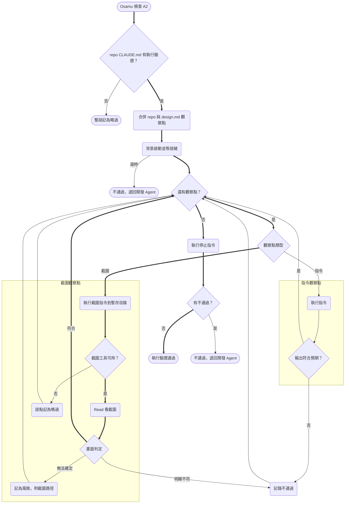
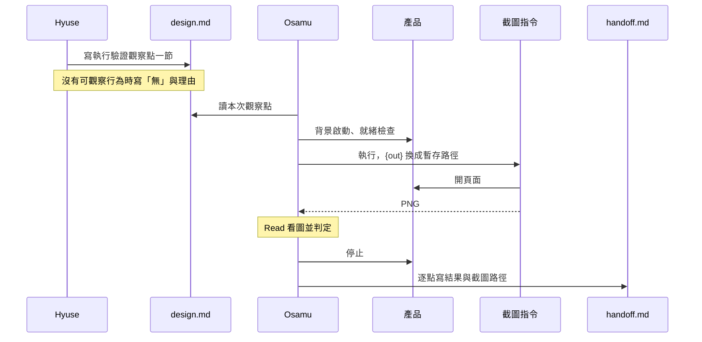

# Design

## Context

動機見 `proposal.md` — Why。現況（SDP-111 之後）：

- `issue-integrator` A2「執行驗證」讀 repo `CLAUDE.md` 的「## 執行驗證」段，依序啟動、就緒檢查、跑觀察點、停止。觀察點只有「指令 → 預期輸出」一種。D 段（合併）rebase 後會重跑同一套。
- `agent-team/CLAUDE.md:126` 寫「只寫終端機觀察得到的行為；本次變更特有的觀察點由 Hyuse 寫在 `design.md`」，`issue-integrator` 也寫了會讀 `design.md` 補充的觀察點。但 `issue-architect` 步驟 3 只規定 design.md 要有 UML，沒有觀察點。

會限制做法的條件：

- **Osamu 的工具只有 Read／Grep／Glob／Write／Edit／Bash／Skill 與幾個 Linear 工具**，沒有瀏覽器類 MCP。subagent 能不能拿到 Claude in Chrome 或 built-in browser 要看執行環境，不能當成前提。
- **Read 可以看圖片**，所以只要能用 Bash 產生 PNG，Osamu 就能「看」畫面。
- **Osamu 不可用 Bash 改檔**，寫入限制 hook 只放行 `handoff.md`、`.linear.md` 與歸檔規格。截圖是產出物，不是改檔，但必須落在 worktree 外，否則 worktree 會變髒，A3「工作樹乾淨」的核對就會失敗。
- **Hyuse 不能問 user**，觀察點寫不出來時只能列成待確認問題。

## Goals / Non-Goals

**Goals：**

- 前端畫面能在 PR 前被實際看過一次，不需要給 Agent 新工具。
- 截圖的啟動方式、瀏覽器、頁面路徑全部由 repo 決定，skill 不綁技術棧。
- 環境沒有瀏覽器時照樣能跑完流程，只是少一層保障。
- 每一次變更都有「針對本次功能」的觀察點，不只是 `/health`。

**Non-Goals：**

- 不做視覺回歸比對（像素 diff、基準圖管理）。判定靠 Agent 看圖對照文字描述。
- 不做互動式操作；需要時由 repo 寫成 E2E 腳本，當作指令觀察點。
- 不改 hook、不改 Agent 的 tools 清單。

## 執行驗證流程（含截圖觀察點）



- 啟動逾時時仍要執行停止指令，避免殘留程序（沿用現行規定，圖上省略）。
- D 段（合併）rebase 後重跑時走同一張圖。
- 依據：`.claude/skills/issue-integrator/SKILL.md` A2。

## 觀察點從提案到檢查



- 本變更只動 skill 與文件，沒有前後端 API 互動。這張時序圖畫的是 Agent 之間的交接，不是前後端呼叫。
- 依據：`.claude/skills/issue-architect/SKILL.md` 步驟 3、`.claude/skills/issue-integrator/SKILL.md` A2。

## Decisions

### 1. 截圖由 repo 提供指令，Osamu 用 Read 看圖

截圖觀察點的格式：

```markdown
- 截圖：`npx -y playwright@1.61.1 screenshot --wait-for-timeout 2000 http://localhost:5173/orders {out}` → 訂單列表頁，表格至少一列，沒有錯誤提示
```

Osamu 把 `{out}` 換成 `<暫存目錄>/<side>-<序號>.png` 後執行，再用 Read 開圖。

- **為什麼**：不用新增工具、不改 hook。瀏覽器與框架的選擇留給 repo，repo 可以換成 Puppeteer、`chromium --headless --screenshot` 或自己的腳本。
- **替代方案**：給 Osamu 加瀏覽器 MCP 工具。工具可用與否依環境而定，subagent 不一定拿得到，加了也會讓 osamu.md 綁定特定環境。不採用。
- **替代方案**：在 skill 內建 Playwright 腳本。會讓 skill 綁定 Node 與 Playwright。不採用。

### 2. 截圖存在 worktree 外的暫存目錄

每次檢查用 `mktemp -d` 建一個目錄，路徑寫進 `handoff.md`。不進版控，也不刪除（PR 前審查可能要看）。

- **為什麼**：截圖放進 worktree 會讓 A3 的「工作樹乾淨」核對失敗，也可能被誤 commit。
- **邊界說明**：osamu.md 的「禁止用 Bash 改檔」要補一句例外：截圖指令寫入 worktree 外的暫存目錄不算改檔。

### 3. 三種判定，只有「明顯不符」會擋

| 判定 | 條件 | 處置 |
|------|------|------|
| 符合 | 畫面呈現預期描述的內容 | 通過 |
| 明顯不符 | 空白頁、錯誤頁、框架錯誤覆蓋層、預期描述點名的元素不存在 | 不通過，退回開發 Agent，重現步驟寫截圖指令 |
| 無法確定 | 畫面有內容，但無法從圖判斷是否符合（例：資料筆數看不清） | 放行，列為風險並附截圖路徑 |
| 工具不可用 | 指令不存在（exit 127）、瀏覽器無法啟動、缺系統相依 | 該點略過，記錄錯誤訊息 |

- **為什麼**：看圖判定有誤判的可能。只讓明顯錯誤擋流程，避免模糊判斷造成無謂退回，並占用「同一目標 2 次」的退回上限。
- 「工具不可用」與「頁面壞掉」的區分：截圖指令有產出 PNG 就進入看圖判定；沒有產出時看錯誤訊息，是工具或瀏覽器問題就略過，是連線被拒或逾時就視為產品問題（不通過）。
- **實測結果**（2026-11-09，`npx -y playwright@1.61.1 screenshot`，tasks 1.1）：**exit code 不足以區分**，工具缺失與連線被拒都是 exit 1，所以要看錯誤訊息。

  | 情況 | exit | PNG | 訊息關鍵字 | 判定 |
  |------|------|-----|-----------|------|
  | 正常頁面、404 頁 | 0 | 有 | — | 看圖判定（404 頁屬明顯不符） |
  | 指令不存在 | 127 | 無 | `command not found` | 工具不可用 |
  | npx 套件未安裝且不允許下載 | 1 | 無 | `npx canceled due to missing packages` | 工具不可用 |
  | 瀏覽器未安裝 | 1 | 無 | `Executable doesn't exist`、`playwright install` | 工具不可用 |
  | 連線被拒 | 1 | 無 | `net::ERR_CONNECTION_REFUSED`（`net::ERR_` 開頭） | 產品問題，不通過 |

  其他無法歸類的失敗：視為「無法確定」，列為風險並附錯誤訊息，不擋流程。
- **範例要固定版本**：`npx playwright`（不帶版本）會抓最新版，最新版對應的瀏覽器常常還沒安裝；`--no-install` 在沒快取時直接失敗。所以格式範例寫 `npx -y playwright@<版本>`，版本要與已安裝的瀏覽器相符。
- 實測時順帶發現：測試頁沒宣告 charset 時，中文會變成亂碼，Read 看得出來。這正是「明顯不符」的典型例子。

### 4. 觀察點來源合併：repo 通用＋design.md 本次專屬

repo `CLAUDE.md` 是每次都跑的通用點，`design.md` 的「## 執行驗證觀察點」是本次專屬的點。兩者都跑，報告分開列。repo 沒設定執行驗證（沒有啟動指令）時整段略過，`design.md` 的點也不跑，因為沒有啟動方式。

### 5. Hyuse 寫觀察點的規則

- 每一端的 `design.md` 都要有這一節，只寫該端能觀察到的點：後端寫指令或 HTTP，前端以截圖為主。
- 只寫本次變更的行為，不重複 repo 的通用點。
- 沒有可觀察行為（純文件、純重構）時寫「無」與理由。
- repo 沒有執行驗證段時，照樣寫觀察點並註明「repo 尚未設定執行驗證，將被略過」，並列進待確認問題。主對話可以據此提醒 user 補設定。

## Risks / Trade-offs

- [看圖誤判：把壞掉的畫面判成符合] → 預期描述要寫具體的元素（標題文字、表格、按鈕），不寫「頁面正常」。架構師規則與格式範例都要示範具體寫法。
- [截圖時頁面還在載入] → 由 repo 在截圖指令內處理等待（例：`--wait-for-timeout`、`--wait-for-selector`），範例要示範。
- [需要登入的頁面截不到] → 由 repo 提供帶登入狀態的截圖腳本，或只截公開頁。寫進格式說明的注意事項。
- [暫存截圖累積] → 放在系統暫存目錄，由作業系統清理。不在 skill 內刪，因為審查可能還要看。
- [既有 team-hq 的 `CLAUDE.md` 不會被安裝覆寫] → 升級指引說明要手動把截圖格式補進「執行驗證」段。沒補也不影響流程，只是沒有截圖觀察點。

## Migration Plan

1. 更新 skill 與 agent 定義，重新安裝即可生效（角色 skill 每次安裝都會覆寫）。
2. 既有 team-hq：照 `docs/multi-agent-workflow.md` 的升級指引，手動更新 `CLAUDE.md` 的「執行驗證」段。
3. 前後端 repo：想要截圖觀察點時，在 repo `CLAUDE.md` 的「## 執行驗證」加截圖指令，並確認環境有 headless 瀏覽器。
4. 回滾：還原這幾個檔案即可。沒有資料或狀態需要遷移。
