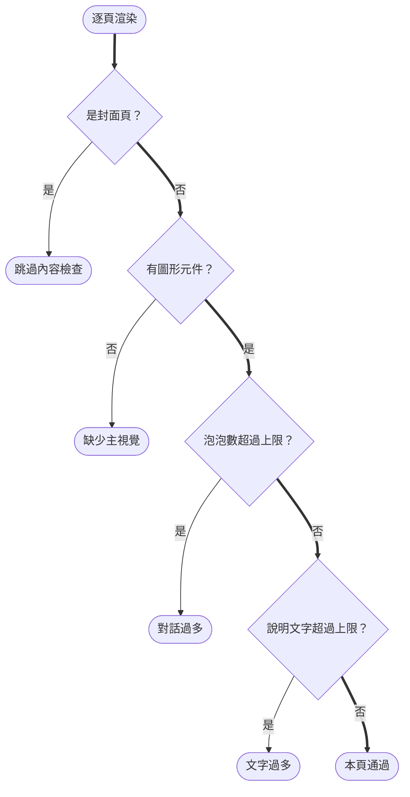

# Design

## Context

動機見 `proposal.md`。現況：

- `.claude/skills/gen-story/SKILL.md` 的「內容規則」只要求對話「一則一兩句、一頁最多五則」，沒有規定每頁要有圖。元件表有 `.flow`／`table.t`／`.matrix`／`.tree`，但沒有說明什麼內容該配什麼圖。
- `assets/story-template.html` 的圖形元件只有單線流程（`.flow`）、表格、勾選矩陣、檔案樹。前後對照、多角色往返、分支判斷、數字結果都沒有現成元件，撰寫者只能退回 `.card` 加 `ul.pts`。
- `scripts/check_layout.mjs` 只檢查幾何問題（超框、捲動、超出畫布、壓到頁尾），不看內容密度，所以文字過多的頁面照樣通過。
- 範例 `docs/story/add-gen-story-skill.html` 實測（去掉程式碼後的字數）：8 頁中有 3 頁（封面、登場人物、問題與決策）沒有任何圖形元件；「問題與決策」頁約 234 字，全是卡片和條列。

限制條件：

- 延續「不用圖片」規則：新元件只能用 HTML/CSS 繪製，不引入 mermaid 等外部函式庫（導覽是單檔 HTML，離線也要能看）。
- 版面檢查腳本已經在 playwright 中逐頁渲染，加內容檢查不會增加新的執行前置。

## Goals / Non-Goals

**Goals：**

- 規則面：撰寫者知道每頁要有主視覺、文字上限是多少、什麼內容該用哪種圖。
- 元件面：常見的「說明型」內容都有對應的圖形元件，不必寫成條列。
- 檢查面：文字過多或沒有圖的頁面會被版面檢查擋下，不靠撰寫者自律。
- 範例導覽照新規則重做並通過檢查，當作示範。

**Non-Goals：**

- 不做自動把條列轉成圖的功能；選圖與繪製仍由撰寫者（Agent）判斷。
- 不引入 mermaid、SVG 圖庫或任何外部 JS。
- 不回頭修改其他專案已產出的導覽。

## Decisions

### D1：版面檢查加三條內容規則，門檻寫成腳本常數

每頁先判斷是不是封面（`section.slide.cover`），封面跳過。其餘頁面逐條檢查：

- 三條規則**都會跑完**再彙整（圖中為了可讀畫成串接；實作上一頁可同時列出多條問題），任一條違反即納入問題清單，最後 exit 1，與既有幾何規則同一套輸出格式：`❌ 第 N 頁｜規則｜位置｜數值｜文字片段`。
- **圖形元件**：`.flow`、`.vs`、`.lanes`、`.branch`、`.stats`、`table.t`、`.matrix`、`.tree`、`.codebox`、`ol.steps`、`.cast`。
- **說明文字**：本頁所有可見文字，扣掉圖形元件內的文字，再扣掉 `h1`、`h2`、`.kicker`、`.tag`、`.cap`、對話泡泡內的角色名（`b.n`），以去除空白後的字元數計。對話泡泡本身算說明文字。
- **預設門檻**：`MAX_PROSE = 150` 字、`MAX_BUBBLES = 3` 則。放在腳本開頭的常數區，並在 `SKILL.md` 寫出同樣的數字。依據：範例的「問題與決策」頁約 234 字，明顯過多；三則泡泡、每則 40 字以內約 120 字，再留一點給標題下的短句。實作時用重做後的範例校正，若需調整，`SKILL.md` 和腳本一起改。
- 替代方案：只把檢查做成警告（exit 0）。不採用，user 已選擇以檢查擋下，且沒擋下的規則實際上就是現在的狀態。

### D2：模板新增四種純 CSS 圖形元件

| 元件 | class | 用來表達 | 結構 |
|------|------|------|------|
| 前後對照 | `.vs` | 改動前 vs 改動後、舊規則 vs 新規則 | 兩欄 `.vs > .side.before`／`.side.after`，中間以 CSS 箭頭分隔 |
| 泳道／時序 | `.lanes` | 多個角色或元件之間的往返順序 | 每列一個 `.lane`（左側角色名＋右側依序排列的 `.step`），步驟間用 CSS 箭頭 |
| 分支決策 | `.branch` | 條件判斷後走不同結果 | 上方 `.q` 問題方塊，下方多個 `.opt`（標籤＋結果），以 CSS 連接線 |
| 數字磁磚 | `.stats` | 測試數、頁數、檔案數等有出處的數字 | `.stats > .stat`（大字數值＋小字說明） |

- 全部沿用既有色票（`--blue-soft` 等），不另開新色；文字可斷行，與 `.flow` 相同的防溢出規則。
- `SKILL.md` 的元件表加入這四列，另加「內容類型 → 元件」對照表，涵蓋新舊元件。
- 替代方案：引入 mermaid CDN 在頁面上渲染。不採用：單檔離線可讀性、與「不用圖片」規則的精神，以及字型／版面檢查都會變複雜。

### D3：`SKILL.md` 內容規則改為「以圖表為主」

- 新增一條規則放在內容規則第一條：封面以外每頁要有一個主視覺；能畫成圖的就不寫成條列；文字上限照 D1 的數字（對話一頁最多 3 則、每則 40 字以內，整頁說明文字 150 字以內）。
- 原本「一頁最多五則」改為三則（與檢查一致）。
- 步驟 3「規劃章節」的表格，每一章加一欄「建議主視覺」（例：問題與決策 → `.vs`／`.branch`；檢查結果 → `.stats`＋`table.t`；登場人物 → `.cast`）。
- 步驟 5「檢查版面」說明新增的三條規則與門檻。

### D4：重做範例導覽

依新規則重寫 `docs/story/add-gen-story-skill.html`，內容事實（程式碼行號、數字出處）沿用原版與歸檔的 `add-gen-story-skill` 變更紀錄，只換呈現方式。須通過新版 `check_layout.mjs`（exit 0）並以截圖目視。

## Risks / Trade-offs

- **門檻太嚴或太鬆** → 數字放在腳本常數並以重做的範例校正；`SKILL.md` 與腳本同步修改。
- **為了過檢查硬塞無意義的圖** → `SKILL.md` 寫明主視覺要承載本頁重點（例：用 `.vs` 呈現前後差異），不得只放裝飾性元件；這點無法自動檢查，靠審查。
- **舊導覽重跑新檢查會失敗** → 預期中的收緊；舊檔的顯示不受影響，只在重跑檢查時需要改寫。
- **字數計算對中英混排不精確**（英文單字一個字母算一字）→ 接受；導覽全繁中，英文主要出現在 `code.i` 與圖形元件內，影響有限。
