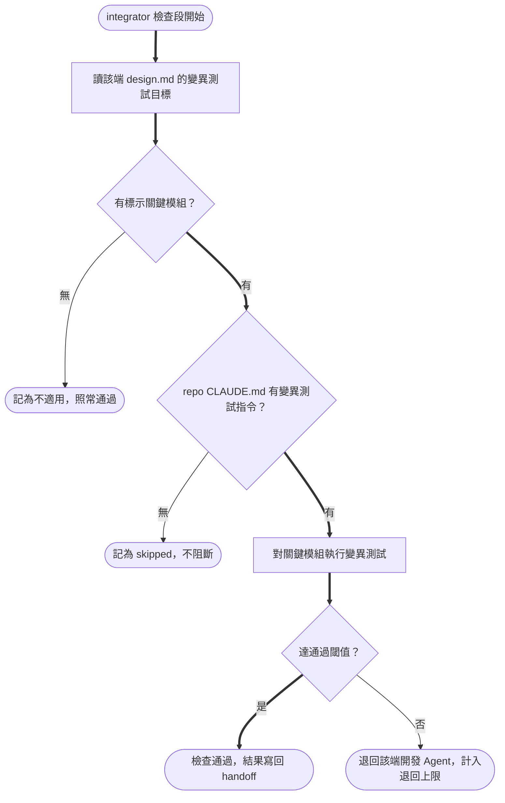

# Design

## Context

多 Agent 流程的測試現況見 `proposal.md` - Why。關鍵既有行為：
- `issue-integrator` 的 check run 已是「實際執行、不信任報告」地跑測試/lint/typecheck/migration/執行驗證（見 `openspec/specs/issue-integrator-skill/spec.md` 的 Checks are executed, not trusted）。
- check 失敗時走既有的 counted-return 機制退回 backend/frontend，同一 target 超過 2 次就停下交 user。
- 所有流程 skill 的指令一律 project-agnostic，取自各 repo 的 `CLAUDE.md`；既有慣例是「指令未設定則記 skipped、不阻斷」（例：執行驗證未設定）。
- `issue-architect` 已在 `design.md` 寫 `## 執行驗證觀察點`，是逐案標示「怎麼看出這次改動有效」的既有樣式。

## Goals / Non-Goals

**Goals**
- 讓「Agent 產出的測試可被驗證」：對關鍵模組以變異測試確認測試能在程式出錯時失敗。
- 完全沿用既有的檢查/退回/記錄機制，不新增 user checkpoint、不新增退回計數。

**Non-Goals**
- 不對全專案跑變異測試（太慢），只跑 architect 逐案標示的關鍵模組。
- 不讓開發 Agent（Chika/Yuma）或 reviewer（Shiori）跑變異測試——驗證集中在 integrator 一處。
- 不在本 repo 綁定任何變異測試工具；工具/指令/閾值由使用流程的專案自己在 `CLAUDE.md` 提供。

## Decisions

### D1：驗證只放 integrator 檢查段（不放開發 Agent、不放 reviewer）

沿用 integrator「實際執行、不信任報告」的定位，把測試有效性驗證和其他檢查放在同一道關卡，單一來源、單一失敗出口。

- **為何不放開發 Agent**：變異測試慢，若 backend/frontend 每項任務都自跑會大幅拖慢實作迴圈；集中到 check run 跑一次即可。代價是弱測試要到 check 才被抓到並退回，接受此延遲。
- **為何不放 reviewer**：Shiori 唯讀、不跑測試，無法執行變異測試。
- 對比方案（開發 Agent 自驗 + integrator 複驗）因雙重執行慢程式而捨棄。

### D2：關鍵模組由 architect 逐案在 `design.md` 標示

criticality 隨變更而異（這次改到的權限/狀態機路徑才算數），由最懂本次改動的 architect 判定，寫進 `design.md` 的 `## 變異測試目標`，與既有 `## 執行驗證觀察點` 同樣是「逐案標示」樣式；並在 `tasks.md` 對應任務點名。無關鍵邏輯時寫「無」。

- 對比方案（專案 `CLAUDE.md` 固定關鍵路徑清單）無法反映單次變更實際碰到的邏輯，捨棄。

### D3：工具/指令/閾值來自各 repo `CLAUDE.md`，未設定則 skipped、不阻斷

與既有 project-agnostic 慣例一致。未提供變異指令、或 `## 變異測試目標` 為「無」時，integrator 記 skipped / 不適用並照常通過；提供但低於閾值時，依既有 counted-return 退回該端開發 Agent，重現指令即該變異指令。對未設定的專案而言行為與現狀相同，屬非破壞性。

## 流程圖：check 段的變異測試關卡

- 粗線為 happy path：有關鍵模組且有指令、達閾值 → 通過。
- 「無」與「skipped」是不阻斷的終點（check 不因此失敗），只記錄於 `handoff.md` 與報告。
- 退回沿用既有 counted-return：同一 target 累計超過 2 次則停下交 user，不新增獨立計數。
- 依據：`openspec/specs/issue-integrator-skill/spec.md`（check run 行為）、`openspec/specs/issue-architect-skill/spec.md`（逐案標示樣式）。

## Risks / Trade-offs

- [變異測試慢，可能拖長 check run] → 只跑 architect 標示的關鍵模組，不跑全專案；多數小改動 `## 變異測試目標` 為「無」而整段跳過。
- [弱測試要到 integrator 才被抓到、才退回開發 Agent] → 接受（D1 的取捨）；退回沿用既有計數與上限，不會無限循環。
- [architect 漏標關鍵模組 → 不會跑變異測試] → 由 reviewer/既有「測試涵蓋」審查與 PR review 作為後續防線；本次不擴充 reviewer 職責。
- [專案未提供變異指令 → 等於沒開啟] → 設計即如此（opt-in）；記 skipped 讓報告看得見「未啟用」而非誤以為已驗。

## Migration Plan

純屬 skill 定義與文件的行為擴充，無資料遷移。對未在 `CLAUDE.md` 設定變異指令的專案零影響（該檢查記 skipped）。回退＝移除三份 delta 對應的 skill/文件段落即可。
