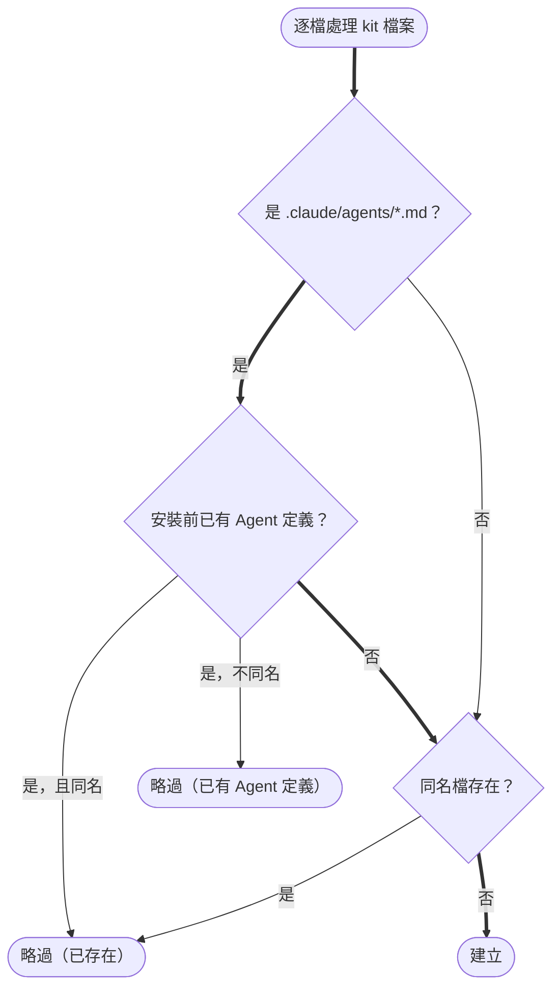

# Design

## Context

`install.sh` 的 `install_kit` 以 `find` 列出 kit 目錄的所有檔案，逐檔判斷 `[ -e "$TARGET/$rel" ]`：存在就印「略過（已存在）」，否則建立。Agent 定義（`.claude/agents/*.md`）與其他骨架檔走同一條判斷，所以「目標已有改名後的 Agent」與「目標還沒裝過」無法區分。動機見 proposal.md - Why；需求見 `specs/agent-team-kit/spec.md`。

## Goals / Non-Goals

**Goals:**

- Agent 定義改用「整組」判斷：安裝前 `.claude/agents/` 有任何 `*.md` 就整組不建立。
- 輸出要讓 user 看得出為什麼某個範本 Agent 沒被建立。

**Non-Goals:**

- 不偵測「改名後的檔案對應哪個範本」，也不比對 frontmatter `name`。
- 不改其他骨架檔、角色 skill 的安裝行為；不新增指令列選項（例：強制建立範本 Agent）。

## Decisions

### 判斷流程

「安裝前」指進入逐檔迴圈之前拍一次快照：若在迴圈中即時判斷，第一次安裝時建立的第一個範本就會讓後面的範本全被略過。

依據：`install.sh` 的 `install_kit`。

### D1：快照只看 `*.md`

Claude Code 只把 `.claude/agents/*.md` 當成 Agent 定義；`.gitkeep` 之類的檔案不算。判斷只看 `.claude/agents/` 第一層，不遞迴。

- 替代方案：目錄存在即視為已安裝 → 空目錄（例如 user 先 `mkdir`）會導致一個 Agent 都裝不到，不採用。

### D2：同名檔仍印「略過（已存在）」，其餘範本印新原因

已存在的同名檔維持原本的訊息（既有測試與 user 熟悉的輸出不變）；只有「因已有 Agent 定義而不建立」的範本改印 `略過（.claude/agents/ 已有 Agent 定義，不建立範本名稱的 Agent）：<rel>`。兩種都計入結尾的「略過 N 個」。

- 替代方案：全部 Agent 範本一律印新原因 → 同名且被編輯過的檔案資訊反而變少，不採用。

### D3：結尾提示補一行說明

`.claude/agents/` 有 Agent 定義而略過範本時，結尾多印一行提示：要取範本請參考 kit 目錄的 `.claude/agents/` 手動合併。

## Risks / Trade-offs

- [目標專案原本就有和 agent-team 無關的自訂 Agent，第一次裝 kit 時範本 Agent 全被略過] → 輸出逐檔說明原因並提示可從 kit 目錄手動複製；這是 issue 明訂的「不論檔名」行為，以保守不重複為優先。
- [kit 新增了一個範本 Agent，已安裝專案重跑也拿不到] → 與其他骨架檔「範本更新不自動傳到已安裝專案」的既有限制一致，靠結尾提示引導手動合併。
