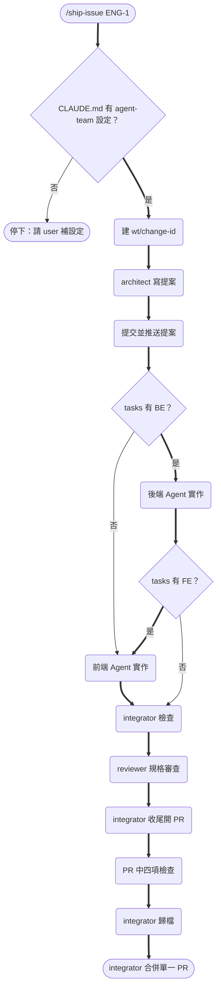
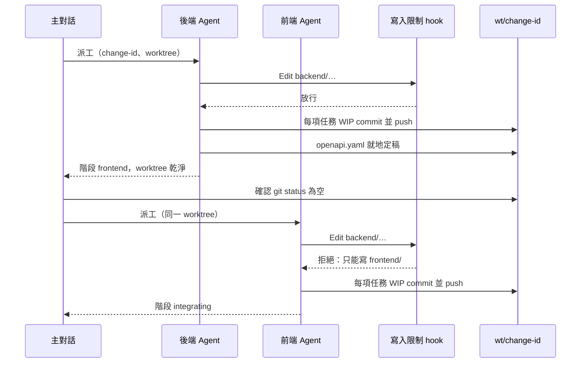

# Design：agent-team 拆成 fullstack 與 single-side（SDP-108）

## Context

動機見 proposal.md。現況：

- `agent-team/` 是「team-hq＋前端 repo＋後端 repo」的骨架；角色 skill 放在本 repo 的 `.claude/skills/`，由 `install.deps` 的 `agent-team:` 列宣告。
- 三個專案都是單一 repo、從 repo 根目錄啟動 Claude Code，worktree 都在 repo 內的 `wt/<change-id>`。kit 的 hook 全掛在 Agent frontmatter，沒有 `.claude/settings.json`。
- littleduck_website 已實作 fullstack 的雛形：`guard-write-scope.sh` 依子目錄限制 yasumi／fujimori、先後端後前端、單一 PR。code_city 已實作 single-side 的雛形：只派 kagura、`repos` 固定 `frontend`。這兩份是這次的主要參考。
- 角色 skill 寫死 Agent 名稱（Hyuse、Chika…），所以改過名的專案重裝後要再改一次 `.claude/skills/`。

## Goals / Non-Goals

**Goals：**

- 一份角色 skill 同時支援兩種結構，差異只由專案 `CLAUDE.md` 的「## agent-team 設定」決定。
- 重裝 kit 後，`.claude/skills/` 不需要任何專案層級的手動修改。
- 三個專案改用新 kit 後，刪得掉所有「單一 repo 覆寫」段落。

**Non-Goals：**

- 不支援前後端分兩個 repo（舊版直接移除，不做相容層）。
- 不做開發 Agent 平行派工；fullstack 一律先後端、後前端。
- Agent 名稱不參數化：名稱仍寫在各專案的 Agent 定義檔名與 `ship-issue.md`，那些是骨架檔，installer 不覆寫。

## Decisions

### D1. 結構宣告放在專案 `CLAUDE.md` 的固定段落

```markdown
## agent-team 設定

- **結構**：fullstack            <!-- fullstack | single-side -->
- **主幹**：main
- **worktree 根目錄**：wt/
- **後端子目錄**：backend/       <!-- 只有 fullstack -->
- **前端子目錄**：frontend/      <!-- 只有 fullstack -->
- **端**：frontend               <!-- 只有 single-side：backend | frontend -->
- **程式碼目錄**：.              <!-- 只有 single-side，預設 repo 根目錄 -->
```

- 角色 skill 與 `/ship-issue` 開工時讀這一段；缺段落或缺欄位就停下回報（subagent 回報給主對話，主對話問 user）。
- **為什麼放 `CLAUDE.md`**：每個 Agent 開工本來就讀 repo 的 `CLAUDE.md`，`/code-review` 也會讀到；另開設定檔（例：`.claude/agent-team.yaml`）多一份要同步的檔案，而且 skill 是 markdown 指示，讀 YAML 沒有比讀段落更可靠。
- 測試、lint 等**指令**仍寫在 `CLAUDE.md` 原本的位置；fullstack 專案依子目錄分列（例：「後端：`cd backend && go test ./...`」）。

### D2. 一份角色 skill，結構差異寫成條件段落

skill 內文改用「本 repo」「後端子目錄」「前端子目錄」「程式碼目錄」，只在真的不同的地方寫「fullstack 時…；single-side 時…」。例如：

| 步驟 | fullstack | single-side |
|------|-----------|-------------|
| architect 建 tasks | `[BE]` 在前、`[FE]` 在後，同一份 `tasks.md` | 全部標宣告端的 tag |
| design.md 時序圖 | 必畫前後端互動 | 沒有前後端互動時可省略並寫理由 |
| 後端交棒 | 有 `[FE]` → 階段 `frontend`；沒有 → `integrating` | 直接 `integrating` |
| integrator 檢查 | 兩個子目錄各跑各的指令 | 程式碼目錄跑一次 |
| `openapi.yaml` | 後端就地定稿，前端讀同一份 | 有 API 就照寫，沒有就 `paths: {}` |

**替代方案**：兩種結構各一套 skill（user 已否決，內容九成重複）。

### D3. kit 目錄與 installer 選項

```
agent-team-fullstack/                  agent-team-single-side/
├── CLAUDE.md                          ├── CLAUDE.md
├── docs/multi-agent-workflow.md       ├── docs/multi-agent-workflow.md
├── openspec/{handoff,review}-template ├── openspec/{handoff,review}-template
└── .claude/                           └── .claude/
    ├── agents/ hyuse chika yuma           ├── agents/ hyuse yuma osamu shiori
    │           osamu shiori               ├── commands/ship-issue.md
    ├── commands/ship-issue.md             └── hooks/guard-write-scope.sh
    └── hooks/guard-write-scope.sh
```

- single-side 的開發 Agent 檔名沿用 `yuma.md`（預設 `端: frontend`）。定義檔寫明：宣告 `端: backend` 時改走 `/backend-processor` 與它的 lint hook，並建議改名。
- `install.deps` 改成兩列：`agent-team-fullstack:`、`agent-team-single-side:`，內容相同（四個角色 skill＋`backend-processor`）。`install.sh` 的 `list_names`、`usage`、選項判斷、`install_kit`（以選項決定 `KIT_DIR`）一起改。
- 選 `agent-team` 時在**寫入任何檔案前**報錯，訊息列出兩個新選項。
- `handoff-template.md`、`review-template.md` 兩份 kit 內容相同。這裡**接受重複**而不抽共用目錄：它們是骨架檔（installer 不覆寫、專案會改），抽出去反而要在 installer 多一條「共用骨架」規則。

### D4. 寫入範圍 hook 改用角色參數，fullstack 加開發 Agent

- 參數從 Agent 名稱改為 `architect`、`integrator`、`backend`、`frontend`，專案改名只改 frontmatter 的 Agent 名，hook 指令不變。
- `backend`／`frontend` 角色（只在 fullstack kit）：從 repo 根目錄的 `CLAUDE.md` 讀子目錄，允許 `*/<子目錄>/*` 與 `*/openspec/changes/<id>/*`，拒絕 `openspec/changes/archive/`。子目錄讀不到時拒絕並說明（fail closed）。
- single-side 的開發 Agent 不掛寫入限制：它擁有整個程式碼目錄，限制只會擋到合法的檔案（例：根目錄的 `Cargo.toml`）。
- **替代方案**：把子目錄寫死在 hook 參數（`guard-write-scope.sh backend backend/`）。這樣同一個值要寫在 Agent 定義與 `CLAUDE.md` 兩處，改子目錄時容易漏改，所以不採用。

### D5. 角色 skill 不寫 Agent 名稱

skill 裡的「Hyuse／Chika／Yuma／Osamu／Shiori」全部換成角色稱呼。Agent 名稱只留在骨架檔（Agent 定義、`ship-issue.md`、kit `CLAUDE.md` 的 Agent 表）。這樣重跑 installer 後 `.claude/skills/` 不必改名，驗收時用不分大小寫的 grep 掃描所有已知 Agent 名稱，應為 0 筆。

### D6. `/ship-issue` 流程（fullstack）



- single-side 只差在中段：不判斷 BE／FE，直接派唯一的開發 Agent。
- 退回規則、審查輪次、停下條件沿用現行 `/ship-issue`，只把「每一端各做一次」改成「做一次」，退回對象依發現所屬的端（`[BE]`／`[FE]`）決定。

依據：`agent-team/.claude/commands/ship-issue.md`、littleduck_website 與 code_city 的 `ship-issue.md` 覆寫段落。

### D7. 共用 worktree 的交棒時序（fullstack）



依據：littleduck_website 的 `.claude/hooks/guard-write-scope.sh`（yasumi｜fujimori 分支）、`yasumi.md`／`fujimori.md` 的完成定義。

### D8. 三個專案的遷移方式

每個專案 repo 各開 `improvement/SDP-108-agent-team-variants` 分支，依序：

1. 用新選項重裝（角色 skill 會被覆寫為新版；骨架檔已存在的會被略過）。
2. 把新 kit 的骨架與專案現有骨架**逐檔手動合併**：以新 kit 為底，套回專案的 Agent 名稱、`color`、模型與專案特有的檢查指令。
3. `CLAUDE.md` 新增「## agent-team 設定」，刪掉「單一 repo 設定」「agent-team（單一 repo、單一開發 Agent）」等覆寫段落；保留執行驗證、變異測試、高風險檔案樣式、風險分級、合併設定、設計同步等專案設定。
4. 刪掉 Agent 定義裡「本專案的差異（單一 repo…）」區塊與 `ship-issue.md` 的覆寫引言。
5. code_city 用不到的 `.claude/skills/backend-processor/` 保留不刪：installer 一律安裝，兩種 kit 的安裝結果一致，比少一個目錄重要；D5 之後它也不含任何 Agent 名稱。
6. 驗收：不分大小寫 grep `.claude/skills/` 中所有專案的 Agent 名稱與「前端 repo／後端 repo／team-hq」，應為 0；hook 用模擬 JSON 跑正反向；能跑 `/ship-issue` 的跑一次。

各專案特有的事項：

| 專案 | kit | 額外處理 |
|------|-----|----------|
| littleduck_website | fullstack（`backend/`、`frontend/`） | Agent 名稱 hikaru／yasumi／fujimori／teshima／akafuku；hook 由專案自訂版改回 kit 版（角色參數） |
| luke | fullstack（`crates/`、`web/`） | 首次真正適配：補「## agent-team 設定」、執行驗證、`.gitignore` 加 `/wt/` 與 `review-diff.patch`；修正 `chika.md` 的 `<backend-repo>` hook 路徑 |
| code_city | single-side（`端: frontend`、程式碼目錄 `.`） | Agent 名稱 gintoki／kagura／sadaharu／shinpachi；恢復目前 skill 被刪掉的執行驗證觀察點與截圖邏輯（改由新版 skill 提供，不再在專案內裁剪） |

## Risks / Trade-offs

- [移除 `agent-team` 選項會讓舊的安裝說明失效] → 報錯訊息直接給出兩個新選項；README 寫遷移步驟。目前已知使用者只有這三個專案，都在本次遷移。
- [hook 從 `CLAUDE.md` 解析子目錄，格式寫錯就全部拒絕] → fail closed 是刻意的；拒絕訊息指出缺哪個欄位，hook 附正反向測試腳本。
- [fullstack 依序派工比平行慢] → 共用 worktree 共用 git index，平行會互相污染 commit；要平行得改成兩個 worktree，不在本次範圍。
- [單一 skill 內的條件段落讓文字變長] → 只在真正不同的步驟寫分支，其餘用中性說法；D2 的對照表也寫進 `docs/multi-agent-workflow.md`。
- [code_city 改用完整版 skill 後，執行驗證的截圖觀察點會回來] → 它的 `CLAUDE.md` 有截圖指令（`--screenshot`）就照跑，沒有就略過，本來就是不擋流程的設計。
- [三個專案的手動合併可能漏掉專案特有設定] → 合併前先 diff 舊骨架與舊 kit，列出專案差異清單，合併後逐條核對。

## Migration Plan

1. 本 repo：完成新 kit、installer、skill、文件，跑 installer 測試與 hook 測試。
2. 本 repo 的 PR 合併後，三個專案用**本地 clone**（`<本 repo>/install.sh agent-team-… <專案>`）重裝，避免遠端 `main` 尚未更新。
3. 每個專案各自開 PR；任一專案出問題可單獨 revert 該專案的 PR，本 repo 不受影響。
4. 回滾本 repo：revert PR 即恢復 `agent-team` 選項；已遷移的專案骨架不受影響（installer 不覆寫骨架）。

## Open Questions

- luke 的執行驗證（`make dev` 的就緒檢查與觀察點）細節，實作時依 luke 的 Makefile 決定；不影響本 change 的規格。

## 執行驗證觀察點

本 repo 沒有可執行的產品，以指令觀察點代替：

- `./install.sh agent-team <空目錄>; echo $?` → 非 0，訊息含 `agent-team-fullstack` 與 `agent-team-single-side`，目錄仍為空
- `./install.sh agent-team-fullstack <空目錄> && ls <空目錄>/.claude/agents` → 五個定義檔
- `./install.sh agent-team-single-side <空目錄> && ls <空目錄>/.claude/agents` → 四個定義檔
- `grep -riE 'hyuse|chika|yuma|osamu|shiori|前端 repo|後端 repo|team-hq' .claude/skills/{issue-architect,issue-integrator,backend-processor,frontend-processor,custom-review,draw-mermaid}` → 無輸出

## 變異測試目標

無：本 repo 沒有設定變異測試工具；寫入限制 hook 以正反向測試腳本驗證（見 tasks）。
