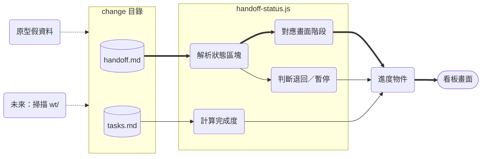
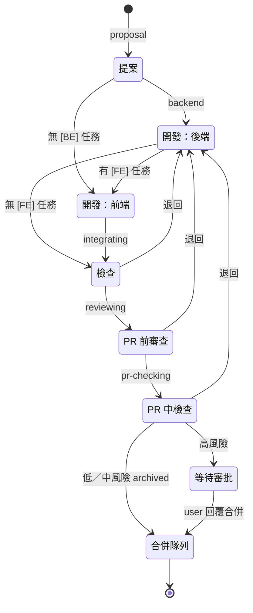
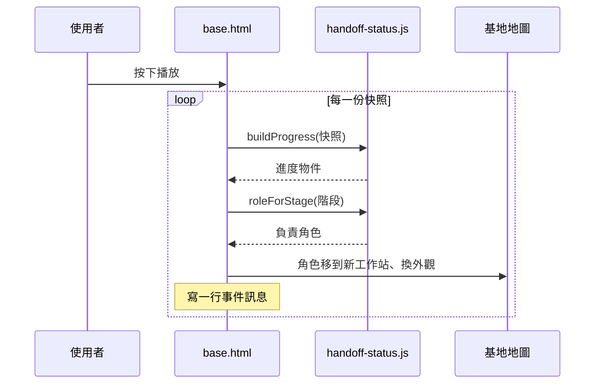

# Design

## Context

- 多 Agent 流程的唯一交接介面是 change 目錄；`handoff.md` 的「## 狀態」區塊由各角色**就地改值**，永遠反映最新進度（範本見 `agent-team-fullstack/openspec/handoff-template.md`、`agent-team-single-side/openspec/handoff-template.md`）。這是目前唯一格式由我們自己定義、又會隨流程即時更新的來源，所以契約只讀它與 `tasks.md`。
- 每個 `/ship-issue` 在 `wt/<change-id>/` 有自己的 worktree，change 目錄在 `wt/<change-id>/openspec/changes/<change-id>/`；integrator 歸檔後搬到 `openspec/changes/archive/<日期>-<change-id>/`，worktree 由 user 在合併後自行移除。
- 本次只做原型（見 proposal.md），不掃描實際檔案系統；但解析規則要寫成之後本機應用程式能直接沿用的形式。
- repo 既有測試是 shell（`tests/*.test.sh`），沒有 JS 工具鏈；本機有 Node.js 20。

## Goals / Non-Goals

**Goals:**

- 解析規則（spec 的對照表、退回判斷、完成度）集中在一支無相依的 JS 模組，原型與未來的應用程式共用。
- 原型的每一個畫面都來自「假 handoff.md 文字 → 解析模組 → 畫面」，讓 user 看到的就是契約真正能推導出的結果。

**Non-Goals:**

- 掃描 `wt/`、監看檔案變動、即時更新。
- 區分 PR 中檢查的子步驟（CI／`/code-review`／`/security-review`）與「合併隊列中／已合併／合併失敗」——handoff.md 沒有這些資訊（見 Risks）。
- 三段式流程（`issue-reader`／`issue-processor`／`issue-solver`）的 `.linear.md` `stage`。

## Decisions

### 1. 資料流：文字進、進度物件出

虛線為資料的提供者：本次只有「原型假資料」，「掃描 wt/」留給之後的應用程式。

依據：`agent-team-fullstack/openspec/handoff-template.md`、`agent-team-fullstack/.claude/commands/ship-issue.md`

- 解析模組只接收**字串**（handoff.md 全文、tasks.md 全文、結構與宣告端），不碰檔案系統。替代方案是讓模組自己讀檔，但那會讓原型（瀏覽器）無法使用、也讓測試需要建暫存目錄。
- 歸檔位置的選擇（spec「已歸檔 change 的讀取位置」）屬於「找檔案」的責任，本次以一個純函式 `pickChangeDir(paths, changeId)` 表達並測試，不實際讀目錄。

### 2. 階段對照與流轉

- 退回同樣可能回到「開發：前端」或「提案」（退回 architect），圖中只畫後端以免交叉；看板不靠流轉推導，只看**目前**的階段值與暫停原因。
- single-side 把兩個開發狀態合成一格「開發（宣告端）」。
- 對照表寫成一個常數物件，未知值回傳 `unknown` 並保留原始值（spec「無法辨識的階段要明示」）。替代方案是以「最接近的階段」顯示，但會誤導觀看者，不採用。

依據：`agent-team-fullstack/openspec/handoff-template.md`（階段註解）、`agent-team-single-side/openspec/handoff-template.md`

### 3. 退回判斷用暫停原因文字

ship-issue 退回時一律把暫停原因寫成「<來源>退回第 N 次」，以正則 `退回第\s*(\d+)\s*次` 取次數。替代方案是解析下方角色紀錄的「退回」欄，但那是只追加的歷史，要自己算最新一筆，複雜且容易和狀態區塊不一致。

### 4. 原型形式

- `prototypes/agent-progress-dashboard/index.html`：單頁、無建置步驟，以 `<script type="module">` 匯入同目錄的 `handoff-status.js`；假資料是內嵌的 handoff.md／tasks.md 字串，頁首標示「示範資料」。
- 每個 change 一張卡片：change-id、結構、階段列（目前格高亮、已過格標為完成）、端別、退回／暫停標籤、完成度條、最後完成／下一步、更新者與時間。
- 依 artifact-design skill 的頁面規範（主題色 token、深色模式、手機寬度）製作，以 Artifact 的 `files` 一併發佈 `handoff-status.js`。

### 5. 測試

`tests/prototypes/agent-progress-dashboard/handoff-status.test.mjs` 以 `node --test` 執行，依 spec 每個 Scenario 寫一個 AAA 測試（流程式呼叫解析函式、斷言回傳值），不做結構斷言。

### 6. RPG 基地畫面（`base.html`）

- **一個任務一個角色**：角色是「拿著任務的人」，外觀依目前負責角色（spec「階段對應負責角色」）切換；同一 Agent 同時處理多個任務時會有多個分身。替代方案「一個 Agent 一個固定角色、手上疊任務」較貼近真實人數，但任務的移動路線看不出來，user 選了前者。
- **負責角色放在解析模組**（`roleForStage`）：它是契約的一部分，之後的應用程式同樣需要；預設顯示名稱（Hyuse、Chika…）屬於頁面，因為 kit 允許改名。
- **示範資料抽成 `demo-data.js`**：卡片看板與基地共用同一批 handoff.md／tasks.md 文字與重播快照，避免兩份假資料各自演變。
- **版面（第二版，依 user 回饋改為雷達平面圖）**：整張基地是一張 SVG 俯視平面圖，房間＝工作站、直角走廊依流程相連，中央是雷達圈與退回用的通道；寬螢幕用橫式座標、窄螢幕（< 640px）換一套直式座標，而不是整張縮小。第一版用 CSS grid 方塊＋說明文字與對話框，user 認為文字太多、角色與動線不夠明確。
- **視覺**：灰階點陣螢幕，只有角色帶顏色。角色是幾何頭像（臉＋依角色不同的頭盔輪廓＋光暈），身後的虛點指向來處；旁邊只有一個以引線相連的標籤：功能圖示方塊（工作站圖示；退回為紅底返回箭頭、暫停為黃底）＋名字＋任務編號。細節收在點選後才出現的資訊卡。全部以 inline SVG 繪製、不載入外部圖片，也不使用既有作品的角色或圖像。
- **移動**：角色沿走廊轉角移動（往前沿流程、往回或進出待查區經過中央），邊走邊留下會淡出的點狀軌跡；`prefers-reduced-motion` 時直接換位、不留軌跡。
- **重播**：快照依序餵給 `buildProgress`，地圖角落只顯示最新一筆事件（時間＋圖示＋角色＋任務編號 → 工作站）。

依據：`prototypes/agent-progress-dashboard/handoff-status.js`

## Risks / Trade-offs

- [handoff.md 分不出合併隊列中／已合併／合併失敗] → `archived` 一律顯示「合併隊列」；合併失敗時 ship-issue 不改階段，看板會一直停在合併隊列。原型頁面註明此限制，後續應用程式再決定是否加讀 `gh pr view` 的 PR 狀態。
- [PR 中檢查無法拆成 CI／code-review] → 顯示「最後完成」「下一步」文字補足細節（例：最後完成「PR 中檢查」、下一步「風險審批」）。
- [欄位格式依賴範本文字] → 解析只認欄位名，不認順序與註解；範本改欄位名時測試會失敗，提醒同步更新。
- [原型的假資料可能與實際 handoff.md 有落差] → 假資料直接照範本格式撰寫，並至少放一份從既有 ship-issue 規則推得的退回範例。

## Open Questions

- 未來應用程式的形式（Electron／Tauri／本機 web server）與是否加讀 PR 狀態——user 已確認以雷達基地畫面為方向，另開 issue 決定，不影響本次規格。
- 角色顏色要與 Agent 定義檔一致（user 於 2026-11-13 提出）：之後的應用程式應讀 `.claude/agents/*.md` frontmatter 的 `color`。目前 kit 只有 `shiori.md` 設了 `color: red`，其餘未設；原型的 Shiori 是藍色，而紅色在原型裡代表「退回」，屆時要一併決定未設色的預設值與退回標示改用什麼顏色。
